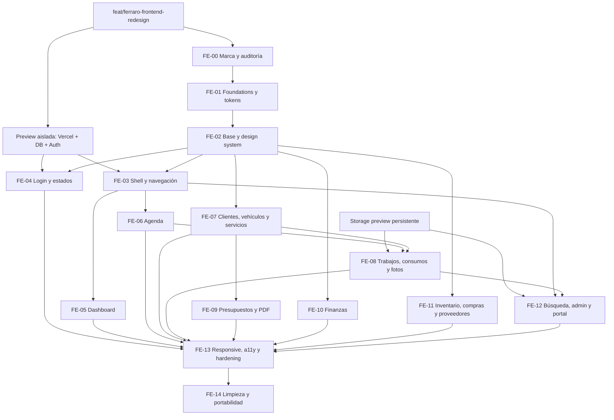

# Ferraro Frontend Master Plan

> Estado: propuesta para revisión humana · Fecha de auditoría: 2026-10-09 · Base auditada: `main` en `0e46325` · Alcance: frontend, identidad, experiencia, accesibilidad y plan de migración. No modifica dominio, datos, autenticación, permisos, API, infraestructura ni producción.

## 1. Resumen ejecutivo

Ferraro Manager ya es un producto funcional, seguro y cubierto por pruebas de flujos críticos. El rediseño no debe reconstruirlo: debe crear una capa visual coherente sobre sus contratos existentes, preservar las proyecciones ADMIN/STAFF y migrar las pantallas por cortes verticales verificables.

La dirección recomendada es una interfaz clara con shell oscuro, superficies operativas claras, tipografía sans reproducible, amarillo Ferraro como señal controlada y activos vectoriales oficiales. “Premium” se expresará con precisión, ritmo, materiales visuales sobrios y ausencia de ruido; no con negro omnipresente, tarjetas decorativas ni fotografía genérica.

El trabajo se divide en 15 BUILDs. Primero se aprueban marca, tokens y componentes; luego shell, acceso y estados; después los módulos por dependencias; finalmente responsive, accesibilidad, limpieza y preparación para PPF House. Cinco gates humanos impiden que una decisión visual no aprobada se propague.

### Resultado objetivo

- Identidad Ferraro inmediata en login, navegación, portal y PDF mediante SVG oficial.
- Un solo design system, semántico y portable, sin convertir la aplicación en multiempresa.
- Jerarquía y densidad adecuadas para operación diaria en desktop, tablet y mobile.
- WCAG 2.2 AA como criterio de aceptación, no como revisión tardía.
- Migración progresiva sin tocar reglas de negocio ni sostener dos sistemas visuales permanentes.

## 2. Estado actual

### 2.1 Evidencia auditada

- Repositorio y remoto correctos: `Broco-Solutions/ferraro-manager`.
- V1 funcional completa según `EXECUTION_LOG.md`; 17 E2E cubren autenticación, roles y módulos críticos.
- 39 rutas de interfaz actuales, más estados globales y 9 segmentos con `loading.tsx`.
- Sólo tres componentes transversales en `src/components`: `AppShell`, `MobileMenu` y `ConfirmButton`; la UI reutilizable vive mayormente como clases globales.
- `src/app/globals.css`: 3.851 líneas, 247 selectores de clase de primer nivel, varios bloques responsive y responsabilidades de todos los módulos.
- `src/config/brand.ts`: texto de marca y una marca provisional `"F"`; no referencia activos oficiales.
- Shell desktop fijo de 17,5 rem, compactado a 11,5 rem; no tiene estado activo ni modo colapsado real.
- Mobile ofrece header, menú `<details>`, buscador sticky y barra inferior de cinco destinos.
- Login inspeccionado a 1440×900, 820×1180 y 390×844: no desborda; a 820 comprime dos paneles y a 390 elimina la expresión de marca del panel lateral.
- PDF actual es legible y multipágina, pero recompone `FERRARO` con Helvetica y usa una paleta dorada no derivada del manual.

### 2.2 Fortalezas a preservar

- Server Components como opción por defecto y fronteras cliente acotadas.
- Proyecciones distintas para ADMIN y STAFF, verificadas en servidor y E2E.
- Mensajes en español, formularios con labels y varios estados vacíos contextuales.
- Transformaciones mobile específicas en inventario, dashboard, galerías y listas.
- `prefers-reduced-motion`, foco global visible, imágenes privadas y portal aislado.
- Pruebas funcionales basadas en roles y nombres accesibles, no en clases CSS.

## 3. Problemas detectados

No se detectó un problema visual **crítico** que impida operar. “Crítico” queda reservado para fuga de datos, tarea imposible o incumplimiento de contraste que bloquee acceso; esos casos deben frenar cualquier BUILD si aparecen.

| Severidad | Problema y evidencia                                                                                                                       | Impacto / pantallas                                     | Solución propuesta                                                                         | Riesgo                                              | Prioridad                 |
| --------- | ------------------------------------------------------------------------------------------------------------------------------------------ | ------------------------------------------------------- | ------------------------------------------------------------------------------------------ | --------------------------------------------------- | ------------------------- |
| Alta      | Marca provisional: círculos con `F` y texto HTML en lugar de activos oficiales.                                                            | Login, shell, portal, PDF; identidad incorrecta.        | Componentes de marca con SVG oficial y matriz de variantes.                                | Deformar o usar mal el logo al extraerlo.           | FE-00/01                  |
| Alta      | PDF recrea el wordmark con Helvetica y usa “gold” (`#9d762f`).                                                                             | Presupuestos; incumple la fuente primaria.              | Template versionado con lockup oficial y tokens de impresión.                              | Saltos de página/fuentes.                           | FE-09                     |
| Alta      | `globals.css` concentra base, módulos, responsive y estados en 3.851 líneas.                                                               | Toda la app; alto acoplamiento y regresiones.           | Cascade layers + tokens/foundations globales + estilos encapsulados por componente/módulo. | Duplicación transitoria.                            | FE-01–14                  |
| Alta      | Navegación no comunica ruta activa; usa puntos genéricos y no existe colapso controlado.                                                   | Shell; orientación y eficiencia.                        | Iconos consistentes, `aria-current`, grupos por rol, colapso persistido y tooltips.        | Estados de hidratación/layout shift.                | FE-03                     |
| Alta      | Errores de campo son inconsistentes: sólo algunos formularios conectan `aria-invalid` y error específico.                                  | Todos los formularios, especialmente largos.            | `Field`, `FieldError`, resumen de errores y foco al primer campo inválido.                 | Cambiar nombres accesibles usados por E2E.          | FE-02 y migración modular |
| Alta      | Confirmaciones sensibles usan `window.confirm`, sin contexto, foco controlado ni severidad visual.                                         | Turnos, trabajos, finanzas, presupuestos.               | `ConfirmDialog` accesible, manteniendo la misma acción servidor.                           | Doble envío/foco.                                   | FE-02/04                  |
| Alta      | Estados de carga sólo existen para dashboard y ocho módulos; detalle, forms, búsqueda, admin y portal no tienen estrategia local uniforme. | Percepción de rendimiento y resiliencia.                | Skeletons estructurales por patrón; loading inline de mutaciones; error/retry.             | Skeleton que no representa layout real.             | FE-04 + cada módulo       |
| Media     | Tipografía depende de Avenir instalada localmente y cae en Segoe/Helvetica; Georgia aparece en login.                                      | Render variable entre SO, jerarquía inconsistente.      | Familia web OFL cargada con `next/font`, subset latino y fallback métrico.                 | FOIT/bundle si se cargan demasiados pesos.          | FE-01                     |
| Media     | Amarillo/dorado actual funciona como acento y warning, sin separar marca de semántica.                                                     | Estados, links, inventario, foco.                       | Familias brand, interaction y semantic independientes.                                     | Sobrecarga de color si no se audita contraste.      | FE-01                     |
| Media     | Breakpoints históricos (68rem, 47.99rem, 900, 620 y 600 px) no forman una escala única.                                                    | Transiciones tablet impredecibles.                      | Tokens de breakpoints documentados y pruebas en seis viewports.                            | Cambios intermedios no visibles en snapshots fijos. | FE-01/13                  |
| Media     | Semana de agenda se comprime/refluye; mobile no es todavía una timeline diaria dedicada.                                                   | Agenda en tablet/mobile; lectura de solapes y duración. | Layout temporal desktop; lista/timeline mobile con fecha horizontal.                       | No confundir rediseño con DnD nuevo.                | FE-06                     |
| Media     | Mes muestra días del mes sin encabezado de semana ni celdas de relleno; duración/continuidad son débiles.                                  | Agenda mensual.                                         | Grilla calendárica completa y overflow resumido accesible.                                 | Requiere preservar query por rango.                 | FE-06                     |
| Media     | Fichas extensas usan secciones apiladas sin navegación contextual; cliente mezcla vehículos, portal, presupuestos y trabajos.              | Cliente, trabajo, inventario.                           | `DetailHeader`, resumen operativo y tabs/anchors según longitud.                           | Ocultar información esencial tras pestañas.         | FE-07/08/11               |
| Media     | Muchos patrones semánticamente iguales tienen clases y markup propios (`status-pill`, `status-badge`, banners, empty variants).            | Consistencia y mantenimiento.                           | Unificar primitives y patrones con variantes explícitas.                                   | Abstracción prematura.                              | FE-02                     |
| Media     | Galería abre previews en otra pestaña; no hay lightbox, navegación ni estado de error de imagen coherente.                                 | Trabajo y portal, sobre todo mobile.                    | Grid + dialog lightbox accesible, retry y placeholder.                                     | Privacidad de URLs/precarga.                        | FE-08/12                  |
| Media     | Dashboard da el mismo peso visual a cinco KPIs ADMIN.                                                                                      | Lectura de “qué pasa hoy”.                              | Operación de hoy primero; un KPI financiero dominante y secundarios compactos.             | Cambiar jerarquía sin alterar cálculos.             | FE-05                     |
| Media     | Tablas/listas son implementaciones específicas; sorting, selección y paginación no comparten contratos.                                    | Clientes, finanzas, inventario, compras, presupuestos.  | `DataToolbar`, `DataTable` y `DataList` con columnas prioritarias.                         | Crear una tabla universal demasiado compleja.       | FE-02 y módulos           |
| Baja      | Copys de estados y nomenclaturas varían (`empty-inline`, `inline-empty`, “sin…”).                                                          | Pulido general.                                         | Taxonomía y tono editorial común.                                                          | Cambio cosmético excesivo.                          | FE-04/14                  |
| Baja      | DevTools aparece sólo en desarrollo; no es defecto productivo.                                                                             | Capturas locales.                                       | Ocultarlo únicamente en protocolo visual mediante configuración de test.                   | Confundir evidencia dev con producción.             | QA                        |

## 4. Fuente de marca

La fuente primaria versionada es `docs/brand/source/FERRARO_manual_marca.pdf`, inspeccionada visualmente página por página (5 páginas). El PDF conserva arte vectorial y puede utilizarse para extraer los assets oficiales, siempre sujetos a comparación visual contra el manual en GATE 1. No contiene especificaciones textuales extensas de área de seguridad o tamaño mínimo; por eso se adoptan los criterios provisionales de §4.2 hasta su validación visual.

### 4.1 Activos observados

| Variante              | Descripción observada                                                                    | Uso recomendado                                                                |
| --------------------- | ---------------------------------------------------------------------------------------- | ------------------------------------------------------------------------------ |
| Lockup FERRARO DETAIL | Isotipo vertical a la izquierda, wordmark FERRARO y descriptor DETAIL debajo.            | Login, portal, PDF, documentos y contextos de presentación.                    |
| Isotipo + FERRARO     | Isotipo vertical a la izquierda y wordmark sin descriptor.                               | Sidebar expandida y header mobile con ancho suficiente.                        |
| Isotipo vertical      | Rectángulo alto dividido en tres módulos; versión outline y versión negro/gris/amarillo. | Sidebar colapsada, favicon y señal gráfica.                                    |
| Monocromo negro       | Isotipo outline + wordmark negro sobre blanco.                                           | Fondos claros e impresión B/N.                                                 |
| Monocromo blanco      | Isotipo outline + wordmark blanco sobre negro o gris.                                    | Shell/fondos oscuros.                                                          |
| Negro sobre amarillo  | Isotipo outline + wordmark negro.                                                        | Fondos amarillos puntuales.                                                    |
| Tricolor              | Módulos negro, Pantone 424 C y Pantone 116 C, wordmark negro.                            | Firma institucional sobre fondo claro.                                         |
| Outline               | Isotipo y wordmark delineados.                                                           | Recurso decorativo, empty states o fondos sutiles; nunca navegación principal. |

### 4.2 Reglas de integridad

- Usar vectores oficiales; no escribir “FERRARO” con una fuente web ni redibujar contornos.
- Mantener proporciones, orden, alineación y relación isotipo/wordmark; no estirar, inclinar, sombrear, recolorear por módulo ni separar letras.
- No colocar la variante negra sobre fondos oscuros ni la blanca sobre fondos claros/gris insuficiente.
- Sobre amarillo usar negro; sobre negro o gris oscuro usar blanco; sobre blanco usar negro o tricolor.
- La versión outline no reemplaza un logo sólido a tamaños reducidos.
- Conservar un área de exclusión provisional equivalente, como mínimo, al ancho del isotipo; GATE 1 debe validar el resultado y reemplazarla si más adelante se entrega una medida oficial.
- Definir mínimos digitales mediante prueba óptica del SVG, no por escala arbitraria. Cuando `DETAIL` deje de ser legible, cambiar al wordmark sin descriptor o al isotipo según el espacio disponible.
- Extraer el SVG fuente desde el PDF vectorial versionado y validar visualmente contra el manual. No autotracear una captura raster.

### 4.3 Matriz final de uso

| Contexto           | Variante                        | Color/contraste                                             | Criterio                                                 |
| ------------------ | ------------------------------- | ----------------------------------------------------------- | -------------------------------------------------------- |
| Fondo claro/blanco | Tricolor o monocromo negro      | Contraste del wordmark ≥ 4.5:1 cuando actúe como contenido. | Preferencia institucional: tricolor; UI compacta: negro. |
| Fondo oscuro/negro | Monocromo blanco                | Blanco pleno; amarillo sólo como detalle separado.          | No usar tricolor si el módulo negro desaparece.          |
| Fondo gris claro   | Monocromo negro                 | Verificar contraste real del gris.                          | Evitar blanco salvo gris suficientemente oscuro.         |
| Fondo gris oscuro  | Monocromo blanco                | ≥ 4.5:1.                                                    | No usar el tricolor sin contenedor claro.                |
| Fondo amarillo     | Monocromo negro                 | Combinación explícita del manual.                           | Reservar la superficie amarilla a momentos de marca.     |
| Tamaño reducido    | Isotipo sólido/outline validado | Una tinta de alto contraste.                                | Sin `DETAIL`; no reducir el lockup completo.             |
| Mobile header      | Isotipo + FERRARO compacto      | Blanco en header oscuro o negro en claro.                   | Colapsar a isotipo bajo umbral probado.                  |
| Favicon/app icon   | Isotipo                         | Versiones 16/32/180/192/512 verificadas.                    | Simplificación sólo si la aprueba marca.                 |
| Impresión color    | Lockup FERRARO DETAIL           | Tricolor o negro según papel.                               | Sin fondos pesados; CMYK/Pantone del manual.             |
| Impresión B/N      | Lockup monocromo negro          | Negro sobre blanco.                                         | Probar láser y escala de grises.                         |
| PDF                | Lockup FERRARO DETAIL           | Negro/tricolor sobre blanco.                                | SVG/vector embebido, sin reconstrucción tipográfica.     |

## 5. Interpretación digital de Ferraro

Ferraro se traducirá a digital mediante contraste técnico, alineaciones firmes, geometría vertical derivada del isotipo y un amarillo de señal. Los tres módulos del isotipo pueden inspirar divisores, numeración de pasos, skeletons y composiciones de empty state, sin repetirse como patrón invasivo.

Son **institucionales**: wordmark, lockups, isotipo, relaciones de color y versiones monocromáticas. Son **recursos adaptables**: proporción vertical, partición en tres, bloques rectangulares, línea outline y ritmo negro/gris/amarillo. Deben adaptarse a digital: mínimos, área segura, píxeles impares, favicon, contraste y variantes responsive.

La interfaz no será enteramente negra. El shell puede ser oscuro para dar anclaje de marca; el área de trabajo será clara para lectura prolongada. El amarillo aparecerá en identidad, foco, selección y acentos de alta intención, no como fondo general ni sinónimo universal de advertencia.

## 6. Principios visuales

| Principio                        | Definición y aplicación                                                           | Ejemplo correcto                                    | Ejemplo incorrecto                                          |
| -------------------------------- | --------------------------------------------------------------------------------- | --------------------------------------------------- | ----------------------------------------------------------- |
| Premium sin ostentación          | Calidad por proporción, tipografía, materiales y detalle; limitar efectos.        | Header preciso, una sombra suave sólo en overlay.   | Gradientes metálicos, brillos y tarjetas flotantes en todo. |
| Precisión visual                 | Alinear números, labels, controles y ritmos con una grilla.                       | Montos tabulares alineados a la derecha.            | Totales centrados y con tamaños arbitrarios.                |
| Jerarquía clara                  | Cada pantalla tiene una tarea, un título y una acción primaria.                   | “Nuevo turno” domina; “Bloquear” queda secundaria.  | Cuatro botones amarillos con el mismo peso.                 |
| Densidad operativa               | Mostrar suficiente información para decidir sin saturar.                          | Fila compacta con vehículo, cliente, hora y estado. | Card gigante por registro o tabla microscópica.             |
| Información antes que decoración | Todo recurso visual debe orientar, agrupar o confirmar.                           | Línea del isotipo separa resumen y detalle.         | Auto genérico de fondo detrás de una tabla.                 |
| Color controlado                 | Negro/blanco estructuran; amarillo marca interacción; semánticos explican estado. | Foco amarillo y error rojo con icono/texto.         | Amarillo para warning, activo, KPI y todos los botones.     |
| Fotografía con propósito         | Mostrar evidencia real del trabajo y vehículo, con privacidad.                    | Galería before/after del job.                       | Stock car en login o dashboard.                             |
| Alineación y ritmo               | Escala de spacing y columnas predecibles.                                         | Secciones a 24/32 px y formularios alineados.       | Márgenes distintos por página sin razón.                    |
| Consistencia entre módulos       | Mismo patrón para lista, detalle, filtros, estados y acciones.                    | `PageHeader` y `DataToolbar` compartidos.           | Cada módulo inventa badges y botones.                       |
| Reducción del ruido              | Priorizar metadatos útiles y ocultar secundarios de forma reversible.             | Acciones raras en menú “Más”.                       | Todas las acciones siempre visibles.                        |
| Mobile propio                    | Reordenar por tarea y tacto, no encoger desktop.                                  | Agenda diaria, filtros en drawer, CTA sticky.       | Semana de siete columnas comprimida.                        |
| Datos financieros legibles       | Lenguaje estable y separación de acordado, cobrado y saldo.                       | Bloques distintos y montos tabulares.               | Un único “total” ambiguo.                                   |
| Estados comprensibles            | Estado = texto + icono/forma + color, con próxima acción.                         | “Sin stock” + icono + botón reponer.                | Punto rojo sin label.                                       |
| Feedback inmediato               | Toda mutación confirma progreso, éxito o error sin perder contexto.               | Botón en loading y toast con enlace al resultado.   | Click sin cambio hasta redirección tardía.                  |

## 7. Paleta

### 7.1 Familias

| Familia             | Tokens conceptuales                                                                                                     | Uso y límites                                                                       |
| ------------------- | ----------------------------------------------------------------------------------------------------------------------- | ----------------------------------------------------------------------------------- |
| Marca oficial       | `brand-yellow`, `brand-black`, `brand-gray`, `brand-white`                                                              | Logos, hitos de marca y referencia; no se alteran para expresar estados.            |
| Neutrales digitales | `background`, `surface`, `surface-raised`, `surface-muted`, `foreground`, `foreground-muted`, `border`, `border-strong` | Estructura diaria, textos, campos, separadores.                                     |
| Shell               | `sidebar-background`, `sidebar-foreground`, `sidebar-hover`, `sidebar-active`, `sidebar-border`                         | Navegación; activo combina superficie, icono y barra/forma, no sólo amarillo.       |
| Semánticos          | `success`, `warning`, `danger`, `info` y sus `-surface/-border/-foreground`                                             | Estados de dominio y feedback. `warning` no hereda automáticamente `brand-yellow`.  |
| Interacción         | `primary`, `primary-hover`, `primary-foreground`, `secondary`, `focus-ring`, `selection`                                | Acciones y foco. Primary puede ser negro; amarillo se reserva a momentos aprobados. |
| Datos               | `data-1…data-8`, `data-positive`, `data-negative`, `data-neutral`                                                       | Gráficos sólo cuando una comparación lo necesita.                                   |

El manual especifica Pantone Pro Black C, Pantone 424 C y Pantone 116 C. El arte vectorial contenido en el PDF embebe estas referencias RGB:

| Color    | Referencia digital inicial |
| -------- | -------------------------- |
| Negro    | `#000000`                  |
| Gris     | `#706F6F`                  |
| Amarillo | `#FFCE13`                  |

**Naturaleza de los valores:** valores RGB extraídos del arte vectorial contenido en el manual. Se utilizarán como referencia digital inicial y deberán aprobarse visualmente en GATE 1. No constituyen una conversión Pantone universal para todos los procesos de impresión.

### 7.2 Reglas de contraste y estado

- Texto normal: ≥ 4.5:1; texto grande: ≥ 3:1; componentes y foco: ≥ 3:1 contra colores adyacentes.
- Amarillo claro no recibe texto blanco. Sobre amarillo usar `brand-black`.
- En fondos oscuros, texto principal casi blanco y secundario con contraste ≥ 4.5:1; no bajar opacidad sin medir.
- Success, warning, danger e info siempre combinan icono/label/forma y no dependen sólo del tono.
- Selección y foco son distintos: selección puede usar superficie amarilla tenue; focus ring debe permanecer visible encima.
- Gráficos: máximo 6–8 series, orden estable, patrones/labels para estados, paleta apta para deficiencias de color. Evitar rojo/verde como única diferencia.

## 8. Tipografía

### 8.1 Alternativas

| Alternativa            | Beneficios                                                                                                                                   | Costos/riesgos                                                                                        |
| ---------------------- | -------------------------------------------------------------------------------------------------------------------------------------------- | ----------------------------------------------------------------------------------------------------- |
| Inter Variable         | OFL, excelente legibilidad pequeña, amplio set latino, muchos pesos, métricas estables, tabular nums y buena disponibilidad con `next/font`. | Muy extendida; la identidad debe venir de composición y marca, no de la fuente sola.                  |
| IBM Plex Sans Variable | OFL, carácter técnico y automotriz, números sólidos, familia amplia.                                                                         | Más personalidad puede competir con el wordmark; curvas y ancho requieren validar densidad en tablas. |
| Source Sans 3 Variable | OFL, muy legible y eficiente, excelente para formularios largos.                                                                             | Tono más editorial/institucional y menos distintivo en títulos.                                       |

Shortlist aprobada para GATE 1: comparar Inter Variable e IBM Plex Sans Variable con las mismas pantallas, densidades, tablas y montos. Inter parte como hipótesis por legibilidad y métricas, pero la elección final sigue pendiente. El wordmark siempre es un asset.

### 8.2 Reglas

- Cargar con `next/font` y archivos/servicio con licencia documentada; subset latino, `display: swap`, fallback métrico y sin llamadas de terceros en runtime.
- Escala mínima: 12 metadata, 14 soporte, 16 cuerpo/control, 20–24 sección, 32–48 título según viewport.
- Números, cantidades, horas y montos usan `font-variant-numeric: tabular-nums`; montos alineados a la derecha.
- Fechas usan formatos de negocio existentes; nunca reducirlas a texto de bajo contraste.
- Inputs heredan tipografía; zoom mobile se evita con 16 px mínimo.
- PDF: familia embebida con licencia y subset; fallback probado para áéíóúñ y símbolos monetarios.
- Portal: misma familia, mayor aire y tamaños, no una tipografía “lujosa” separada.

## 9. Iconografía

En FE-02 se compararán **Phosphor Icons** (MIT) y **Lucide** (ISC) con el mismo set real de navegación, acciones y estados. Phosphor ofrece más variantes de peso y Lucide un catálogo lineal liviano; GATE 1 elegirá una sola librería después de revisar legibilidad, carácter, SSR y bundle. No adoptar ambas.

- Estilo lineal, remates simples, `stroke/weight` regular; activo puede usar variante bold, nunca rellenos mezclados al azar.
- Tamaños: 16 px en metadatos, 20 px en acciones, 22–24 px en navegación/touch; caja óptica fija.
- Alinear icono y label por centro óptico; espacio de 8 px; iconos sin label sólo para acciones universales y con nombre accesible/tooltip.
- Navegación: un icono estable por destino. Acciones: verbo visible en acciones primarias; icon-only para overflow, cerrar, siguiente/anterior.
- Estado: icono + texto + forma; decorativo con `aria-hidden="true"`.
- Prohibidos emojis y marcas de vehículos como iconos de sistema.

## 10. Imágenes

Prioridad: fotos reales autorizadas de Ferraro → assets autorizados → geometría de marca → generación aprobada y documentada. No usar stock de autos, scraping de Instagram ni fotografía genérica en login.

- Guardar procedencia, titular, permiso, fecha y usos permitidos por asset.
- Conservar privacidad: thumbnails/previews por endpoints autorizados; no precargar originales privados.
- `object-fit`, relación de aspecto y focal point se definen por patrón; placeholder neutral en errores.
- Galerías cargan thumbnail lazy, preview bajo demanda y original sólo por acción explícita.
- Remover metadata sensible conforme al pipeline existente.
- El manual basta para login, empty states y fondos mediante geometría; ninguna BUILD depende de conseguir fotos.

## 11. Arquitectura del design system

### 11.1 Estructura propuesta

```text
src/design-system/
  tokens.css            # custom properties semánticas y escala base
  foundations.css       # reset, tipografía, focus, motion y elementos
  utilities.css         # pocas utilidades de layout/a11y aprobadas
  contracts.ts          # tipos de variantes compartidas, sin DOM
src/components/
  brand/                # BrandLogo, BrandMark, BrandLockup
  ui/                   # primitives accesibles sin dominio
  patterns/             # composición transversal de página/datos/forms
src/modules/*/ui/
  *.tsx
  *.module.css          # UI específica del módulo
```

`globals.css` se vuelve un entrypoint pequeño que importa layers. `tokens` y `foundations` son globales; cada primitive posee su CSS encapsulado; patterns sólo conocen primitives; module UI puede conocer patterns y dominio. Nunca al revés.

### 11.2 Clasificación y límites

- **Primitive:** unidad sin conocimiento de Ferraro ni dominio (`Button`, `Input`, `Dialog`). Acepta variantes limitadas y accesibles.
- **Pattern:** composición recurrente de primitives (`PageHeader`, `DataToolbar`, `FormSection`). No hace queries ni mutaciones.
- **Module UI:** conoce entidades/copys/reglas de presentación (`AppointmentCard`, `StockMovementRow`). No reimplementa primitives.
- **Brand:** encapsula assets y matriz de variantes; recibe contexto/tamaño, no texto libre.
- CSS resuelve apariencia, responsive y estados puramente visuales. React resuelve semántica, comportamiento, composición y ARIA dinámica.
- Nombres en inglés para código/tokens; copy en español. Variantes por intención (`danger`, `quiet`), no por color (`yellow`).
- Evitar barrels gigantes y dependencias circulares. Los components cliente se marcan sólo donde comportamiento lo exige.

### 11.3 Estrategia CSS

Usar CSS nativo con `@layer reset, tokens, base, components, patterns, modules, utilities, overrides`. Combinar CSS global modularizado para foundations con CSS Modules en primitives/patterns/module UI. No introducir Tailwind durante la migración: coexistiría con 3.851 líneas globales y ampliaría el vocabulario sin resolver contratos.

Migrar por selector: inventariar propietario → crear componente/pattern → mover estilos → reemplazar usos completos → borrar selector sólo cuando `rg` confirme cero referencias. Prohibir nuevos selectores globales de módulo desde FE-01.

## 12. Tokens

| Grupo       | Tokens mínimos                                                           | Criterio                                                              |
| ----------- | ------------------------------------------------------------------------ | --------------------------------------------------------------------- |
| Color       | familias de §7 + `on-*`                                                  | Semánticos primero; componentes nunca usan Pantone/hex directo.       |
| Tipo        | `font-ui`, `font-weight-*`, `text-xs…display`, `leading-*`, `tracking-*` | Escala corta, responsive con `clamp` sólo en títulos.                 |
| Spacing     | `space-0, 1, 2, 3, 4, 5, 6, 8, 10, 12, 16`                               | Base 4 px; evitar valores únicos salvo geometría del asset.           |
| Radio       | `radius-none/sm/md/lg/full`                                              | Controles 6–8 px; cards moderadas; pills sólo estado/filtro.          |
| Sombras     | `shadow-1/2/overlay`                                                     | Elevación funcional; nada en listas planas.                           |
| Bordes      | `border-width`, `border-subtle/strong/focus`                             | Contraste visible en superficies claras/oscuras.                      |
| Dimensiones | `control-sm/md/lg`, `touch-min`, `icon-*`                                | Touch mínimo 44×44 CSS px; inputs mobile ≥ 48 px.                     |
| Shell       | `sidebar-expanded`, `sidebar-collapsed`, `mobile-header`, `bottom-nav`   | Propuesta: 280/72/64/68 px, validar en GATE 2.                        |
| Contenido   | `content-wide/default/narrow`, `gutter-*`                                | 1504/1200/760 px; gutters 16/24/32+.                                  |
| Breakpoints | `bp-mobile`, `bp-tablet`, `bp-shell`, `bp-wide`                          | CSS custom media si tooling lo soporta; referencia 640/768/1024/1280. |
| Z-index     | `base/sticky/dropdown/drawer/modal/toast`                                | Escala cerrada 0/10/30/50/70/90.                                      |
| Motion      | `duration-fast/base/slow`, `ease-standard/exit`                          | 100–220 ms; transform/opacity preferidos.                             |
| Focus       | `focus-width/offset/color`                                               | Ring 2–3 px, visible en ambos temas.                                  |
| Overlay     | `overlay-scrim`, `overlay-blur`                                          | Scrim suficiente; blur opcional y barato.                             |

Para PPF House se reemplazan assets, tokens de marca, tipografía y `brand.config.ts` en build time. Los componentes consumen semánticos; no contienen `Ferraro`, amarillo ni rutas de assets hardcodeados.

## 13. Componentes

Leyenda: **R** refactorizar existente, **C** crear, **E** conservar y envolver. La prioridad P0 bloquea la migración; P1 es necesaria en el módulo; P2 puede seguir al primer corte si no degrada tareas.

### 13.1 Brand y primitives

| Componente             | Propósito / variantes y estados                                     | Responsive / accesibilidad                                                  | Uso real                           | Estado        | Prioridad |
| ---------------------- | ------------------------------------------------------------------- | --------------------------------------------------------------------------- | ---------------------------------- | ------------- | --------- |
| `BrandLogo`            | Wordmark oficial mono/tricolor; light/dark.                         | Cambia variante, nunca escala ilegible; nombre accesible sólo si es enlace. | Shell, headers.                    | C             | P0        |
| `BrandMark`            | Isotipo oficial; mono/tricolor/outline.                             | 16–64 px probados; decorativo o label según contexto.                       | Sidebar colapsada, favicon, empty. | C             | P0        |
| `BrandLockup`          | FERRARO DETAIL oficial.                                             | Variante compacta por asset, no por CSS recortado.                          | Login, portal, PDF.                | R (hoy texto) | P0        |
| `Button`               | primary, secondary, ghost, danger; sm/md/lg; idle/loading/disabled. | Full-width sólo donde ayude; mantiene nombre, foco y `aria-disabled`.       | Toda la app.                       | R (clases)    | P0        |
| `IconButton`           | Acciones universales; quiet/danger.                                 | 44 px touch; tooltip y `aria-label`.                                        | Galería, agenda, toolbars.         | R             | P0        |
| `Input` / `Textarea`   | default/error/disabled/read-only; prefix/suffix.                    | 16 px mobile; `aria-describedby`.                                           | Todos los forms.                   | R             | P0        |
| `Select`               | Nativo primero; default/error/disabled.                             | Alto táctil, label persistente.                                             | Forms/filtros.                     | R             | P0        |
| `Checkbox` / `Radio`   | Selección binaria/simple; checked/indeterminate/error.              | Label completo clickable; no sólo color.                                    | Servicios, empleados, flags.       | R             | P0        |
| `Switch`               | Preferencia booleana inmediata.                                     | Sólo si efecto es claro; anuncia estado.                                    | Visible al cliente/activo.         | C             | P1        |
| `Label` / `Field`      | Une label, required, optional, help y error.                        | IDs estables, error live y foco.                                            | Todos los forms.                   | C             | P0        |
| `Divider`              | Separa regiones, no decora.                                         | Contraste 3:1 cuando delimita control.                                      | Detalles/shell.                    | C             | P2        |
| `Spinner` / `Skeleton` | Espera de acción / estructura.                                      | Texto SR, `aria-busy`; motion reducida.                                     | Mutaciones/cargas.                 | R             | P0        |

### 13.2 Feedback, overlays y navegación

| Componente                   | Propósito / variantes y estados                                    | Responsive / accesibilidad                                 | Uso real                               | Estado               | Prioridad |
| ---------------------------- | ------------------------------------------------------------------ | ---------------------------------------------------------- | -------------------------------------- | -------------------- | --------- |
| `Badge` / `StatusBadge`      | Metadata / estado de dominio; neutral/success/warning/danger/info. | Texto+icono; no truncar estado.                            | Todos los listados/detalles.           | R                    | P0        |
| `Alert`                      | Mensaje persistente info/success/warning/danger.                   | `role=status` o `alert` según urgencia.                    | Forms, conflictos, notices.            | R                    | P0        |
| `Toast`                      | Confirmación breve con acción opcional.                            | Región live; pausa al hover/foco; no único lugar de error. | Mutaciones.                            | C                    | P1        |
| `EmptyState`                 | first-use, empty, filtered-empty, unavailable.                     | CTA opcional; outline decorativo oculto a AT.              | Listas, galerías, dashboard.           | R                    | P0        |
| `InlineError` / `FieldError` | Error general / por campo.                                         | Asociado, anunciado una vez, conserva input.               | Todos los forms.                       | R                    | P0        |
| `Progress`                   | Upload o tarea determinable.                                       | Valor/nombre accesible; indeterminate explícito.           | Fotos/PDF futuro.                      | R                    | P1        |
| `Dialog`                     | Decisión o contenido corto.                                        | Focus trap/return, Escape, título/descripción.             | Confirmaciones/lightbox.               | C                    | P0        |
| `Drawer`                     | Filtros o detalle contextual.                                      | Bottom sheet mobile; dialog semantics; scroll lock.        | Filtros, navegación, agenda.           | C                    | P0        |
| `DropdownMenu`               | Acciones secundarias.                                              | Flechas, Home/End/Escape, typeahead.                       | Rows y page actions.                   | C                    | P1        |
| `Tooltip`                    | Explica icon-only/sidebar colapsada.                               | No contiene acción; también visible por foco.              | Shell/icon buttons.                    | C                    | P0        |
| `Popover`                    | Contenido ligero anclado.                                          | Cierre/foco robusto; drawer fallback mobile.               | Fecha, filtros.                        | C                    | P1        |
| `ConfirmDialog`              | Confirmar acción sensible con consecuencia.                        | Botón destructivo no recibe foco por defecto.              | Cancelar/anular/revertir.              | R (`window.confirm`) | P0        |
| `Sidebar` / `SidebarItem`    | Navegación agrupada expandida/colapsada.                           | `aria-current`, tooltip, teclado.                          | Backoffice.                            | R                    | P0        |
| `Breadcrumbs`                | Jerarquía en profundidad.                                          | `<nav>`/lista, último no enlace.                           | Detail/edit.                           | C                    | P1        |
| `Tabs`                       | Vistas pares dentro de detalle.                                    | Roving tabindex; mobile scroll con indicador.              | Cliente/trabajo/admin si se justifica. | C                    | P1        |
| `Pagination`                 | Cambiar página y tamaño futuro.                                    | Labels anterior/siguiente y actual.                        | Clientes/listados grandes.             | R                    | P1        |
| `MobileNavigation`           | Hasta 5 destinos + Más.                                            | Safe area, target 44 px, activo visible.                   | Backoffice mobile.                     | R                    | P0        |
| `CommandSearch`              | Búsqueda y acceso rápido, fase opcional.                           | Dialog accesible, teclado y grupos.                        | Global search.                         | C condicionado       | P2        |

### 13.3 Datos, forms y patterns de página

| Componente                     | Propósito / variantes y estados                        | Responsive / accesibilidad                                | Uso real                         | Estado | Prioridad |
| ------------------------------ | ------------------------------------------------------ | --------------------------------------------------------- | -------------------------------- | ------ | --------- |
| `Card`                         | Agrupación justificada; flat/raised/interactive.       | Apila contenido; enlace no envuelve acciones internas.    | Dashboard/portal.                | R      | P0        |
| `KpiCard`                      | Valor, contexto, tendencia/atención.                   | Números tabulares; label completo.                        | Dashboard/finanzas.              | R      | P1        |
| `DataTable`                    | Columnas, sort, selección y acciones cuando aplica.    | Caption/SR, headers, sort anunciado; transforma en lista. | Finanzas, compras, presupuestos. | C      | P1        |
| `DataList`                     | Registros sin estructura tabular fuerte.               | Row/card según ancho; orden DOM estable.                  | Clientes, trabajos, servicios.   | R      | P0        |
| `DefinitionList`               | Pares label/valor.                                     | `<dl>` real; 1–3 columnas.                                | Detalles/resúmenes.              | R      | P1        |
| `Timeline`                     | Historial cronológico.                                 | Fecha legible y orden anunciado.                          | Clientes, jobs, stock, finanzas. | R      | P1        |
| `CalendarEvent`                | Turno/bloqueo con duración y estado.                   | Lista mobile; estado no sólo color.                       | Agenda/dashboard.                | R      | P0        |
| `FilterChip`                   | Filtro aplicado removible.                             | Botón con “Quitar…”.                                      | List pages.                      | C      | P1        |
| `DataToolbar`                  | Búsqueda, filtros, sort, count, bulk.                  | Drawer mobile; orden lógico teclado.                      | Todas las listas.                | R      | P0        |
| `FormSection` / `FormGrid`     | Agrupar campos y layout.                               | 1 columna mobile; headings reales.                        | Todos los forms.                 | R      | P0        |
| `FormActions`                  | Guardar/cancelar/destructiva.                          | Sticky mobile en forms largos; safe area.                 | Forms.                           | R      | P0        |
| `CurrencyField`                | USD, parsing y ayuda; no calcula dominio.              | Inputmode decimal, error asociado.                        | Quotes/finance/purchases.        | C      | P1        |
| `DateField` / `DurationField`  | Fecha/hora local y rango/duración.                     | Picker con fallback teclado; zona explícita.              | Agenda/jobs/finance.             | C      | P1        |
| `Combobox` / `MultiSelect`     | Buscar cliente/vehículo/servicio y selección múltiple. | React Aria/headless; lista virtual sólo si se mide.       | Forms complejos.                 | C      | P1        |
| `PageHeader` / `SectionHeader` | Jerarquía, descripción y acciones.                     | Acciones debajo/sticky cuando corresponde.                | Todas las páginas.               | R      | P0        |
| `DetailHeader`                 | Entidad, estado y acciones.                            | Prioriza identidad/acción en mobile.                      | Cliente, job, quote, stock.      | C      | P0        |
| `ListPage` / `DetailPage`      | Anchos, spacing y slots comunes.                       | Gutter y orden responsive.                                | Módulos.                         | C      | P0        |
| `DashboardSection`             | Heading, count/action, content/empty.                  | 1 columna mobile.                                         | Dashboard.                       | R      | P1        |
| `SplitLayout`                  | Editor+summary o master+detail.                        | Apila; resumen sticky seguro.                             | Quotes/purchases/login.          | R      | P1        |

No se crean `Radio`, `Tabs`, `DataTable` o `CommandSearch` hasta que su primera pantalla los consuma; el inventario define contratos, no obliga a código muerto.

## 14. Patrones

### 14.1 Datos

- Elegir tabla sólo si comparar columnas es la tarea; elegir lista si cada registro tiene narrativa/acciones distintas; card sólo si el objeto necesita agrupación visual autónoma.
- Desktop: columnas esenciales siempre visibles; secundarias ocultables o en disclosure. Tablet: reducir columnas y mover acciones a overflow. Mobile: `DataList`/cards con label-valor; scroll horizontal sólo para una comparación genuinamente tabular y con affordance.
- Sorting se anuncia en header y persiste en URL. Filtros viven en URL, muestran chips aplicados y tienen “Limpiar”. Distinguir vacío inicial de cero resultados filtrados.
- Selección masiva sólo donde exista una acción real aprobada. Barra sticky con cantidad y salida clara; no seleccionar filas fuera de página sin explicación.
- Paginación preserva filtros/sort. No usar infinite scroll para ledgers ni listas administrativas.
- Subtotales se agrupan con encabezado, período y moneda/unidad; total general visualmente separado. Números tabulares y montos a la derecha.
- Loading conserva estructura; error mantiene filtros y ofrece retry; datos incompletos usan “Sin cargar/Por definir”, nunca `—` ambiguo si requiere acción.

### 14.2 Formularios

- Label siempre visible. Marcar “Opcional” en campos opcionales; explicar una sola vez que el resto es requerido o usar `*` con leyenda.
- Helper antes del error; al fallar, helper puede permanecer si es útil. Error específico junto al campo y resumen superior en forms largos.
- `disabled` sólo cuando la acción no está disponible; `readOnly` para dato consultable/copiar. Ambos deben ser visualmente distintos.
- Al enviar: bloquear doble submit, mantener label (“Guardando…”), conservar valores y devolver foco al primer error. Éxito redirige o confirma con destino claro.
- Cancelar vuelve sin mutar; si hay cambios locales no guardados, confirmar abandono. Acciones destructivas quedan separadas de guardar.
- Forms largos: secciones con headings, progreso sólo si hay pasos reales, acciones sticky mobile, ancho de lectura 720–800 px.
- Moneda muestra USD fuera o dentro del control de manera no editable; el servidor sigue calculando. Fechas explicitan zona de negocio cuando haya ambigüedad. Duración ofrece presets + valor; unidades se muestran junto a cantidad.
- Clientes/vehículos: contacto y garage; agenda/bloqueos: rango y disponibilidad; servicios: comercial/variante; jobs: hecho operativo; quotes/compras: editor de líneas + summary; finanzas: tipo/contexto/monto; inventario: unidad base/stock/motivo. No se mezclan secciones de otro dominio.

### 14.3 Estados globales

| Estado            | Patrón                                               | Acción                                       |
| ----------------- | ---------------------------------------------------- | -------------------------------------------- |
| Loading inicial   | Skeleton estructural con `aria-busy`.                | Ninguna falsa; anunciar “Cargando”.          |
| Loading de acción | Botón/progreso localizado.                           | Bloquear sólo la acción relacionada.         |
| Empty             | Explica qué aparecerá y CTA si existe.               | Crear/volver, según rol.                     |
| Filtered-empty    | Repite filtros relevantes.                           | Limpiar filtros.                             |
| Error recuperable | Resumen, correlation ID si existe, retry.            | Reintentar/volver.                           |
| Forbidden         | 403, motivo general, destino seguro.                 | Ir al inicio; no revelar contenido.          |
| Not found         | 404 contextual.                                      | Volver al listado.                           |
| Offline/timeout   | Sólo tras detectar fallo de red/timeout.             | Retry idempotente; no prometer modo offline. |
| Success           | Toast/status persistente según importancia.          | Ver resultado/deshacer sólo si es seguro.    |
| Warning           | Riesgo concreto, no amarillo de marca automático.    | Resolver o continuar informado.              |
| Destructive       | Dialog con entidad, consecuencia y verbo específico. | Cancelar primero; confirmar explícito.       |

## 15. Shell y navegación

### Desktop

- Sidebar expandida propuesta: 280 px; colapsada: 72 px. El usuario controla el estado; persistir en `localStorage` por dispositivo y renderizar fallback expandido/compacto sin layout shift perceptible.
- Brand: isotipo + FERRARO expandida; isotipo colapsada. Grupos: Operación, Comercial/Insumos, Administración, respetando el rol actual.
- Item: icono, label, estado activo por superficie/barra/peso y `aria-current="page"`; badge sólo si existe dato útil. Colapsado conserva tooltip por hover/foco.
- Cuenta al pie con nombre/rol y menú; logout no compite con navegación.
- Search queda en header de contenido, con shortcut documentado; page actions pertenecen al `PageHeader`.

### Tablet y mobile

- 1024 px: sidebar compacta o colapsada según ancho real de contenido; nunca una columna de 11,5 rem que sólo oculta texto parcialmente.
- 768/820 px vertical: preferir sidebar colapsada; drawer disponible para labels y destinos secundarios.
- Mobile: header sticky de 64 px con lockup compacto/isotipo, drawer “Más” accesible y bottom nav de máximo cinco destinos por rol. El contenido deja padding para safe area.
- Bottom nav: Inicio, Agenda, Clientes, Trabajos, Stock para STAFF; ADMIN conserva esos cinco y accede al resto por Más. No insertar Finanzas si desplaza una tarea operativa frecuente sin prueba de uso.
- Breadcrumbs aparecen desde profundidad 2 en desktop/tablet; mobile usa back contextual + título, no una cadena truncada.
- Transiciones 150–200 ms; layout por ancho, opacity de labels; sin animar propiedades costosas. Con reduced motion, cambio inmediato.

### Fallbacks

- Sin JS: sidebar expandida, enlaces funcionan, `<form>` de búsqueda funciona y logout mantiene su flujo actual.
- Si iconos fallan, labels siguen visibles en expandido/drawer; no depender del icono para autorización.
- La visibilidad de navegación nunca reemplaza `requireRole` ni proyecciones de servidor.

## 16. Route matrix

Abreviaturas de layout/patrón: **AS** AppShell, **PF** PortalFrame, **LP** ListPage, **DP** DetailPage, **FP** FormPage, **SP** StatePage. “A/S” significa ADMIN/STAFF según permisos existentes.

### 16.1 Objetivo, acciones, información y dependencias

| Ruta                                                | Audiencia          | Objetivo y acciones (primaria; secundarias)                          | Información crítica                                         | Layout/patrón         | Dependencia funcional preservada           |
| --------------------------------------------------- | ------------------ | -------------------------------------------------------------------- | ----------------------------------------------------------- | --------------------- | ------------------------------------------ |
| `/`                                                 | Pública            | Redirigir a `/app` o `/login`.                                       | Sesión.                                                     | Redirect              | Auth existente.                            |
| `/login`                                            | Anónima            | Ingresar; pedir acceso al admin fuera del sistema.                   | Marca, email, password, error genérico.                     | Split access          | Better Auth sin cambiar flujo.             |
| `/app`                                              | A/S                | Entender hoy; crear entidad, abrir alertas/listas.                   | Turnos, jobs, stock; sólo ADMIN KPIs/saldos.                | AS + dashboard        | Queries por rol.                           |
| `/app/calendar`                                     | A/S                | Navegar día/semana/mes; nuevo turno/bloqueo, abrir/cancelar.         | Fecha, hora, duración, vehículo, cliente, servicio, estado. | AS + calendar         | Query por intersección y TZ.               |
| `/app/calendar/new`                                 | A/S                | Crear turno; volver.                                                 | Cliente, vehículo, rango, servicios, equipo, visibilidad.   | AS + FP               | Transacción caso/turno.                    |
| `/app/calendar/blocks/new`                          | A/S                | Crear bloqueo; volver.                                               | Motivo, rango, día completo, notas.                         | AS + FP               | `CalendarBlock` separado.                  |
| `/app/calendar/[appointmentId]`                     | A/S                | Editar/completar; cancelar, ver trabajo/cobros ADMIN.                | Estado, cliente, vehículo, servicios, rango.                | AS + DP/form          | Estados confirm/completed/cancelled.       |
| `/app/calendar/[appointmentId]/complete`            | A/S                | Confirmar trabajo realizado; volver.                                 | Snapshot turno/servicios/equipo.                            | AS + FP corto         | Creación atómica Job.                      |
| `/app/clients`                                      | A/S                | Buscar/listar; nuevo cliente, filtrar/paginar.                       | Contacto, vehículos, estado.                                | AS + LP               | Proyección cliente.                        |
| `/app/clients/new`                                  | A/S                | Crear cliente; cancelar.                                             | Identidad/contactos/notas.                                  | AS + FP               | Duplicados informativos.                   |
| `/app/clients/[clientId]`                           | A/S                | Operar ficha; editar/archivar/agregar vehículo; ADMIN portal/quotes. | Contacto, garage, historial, jobs.                          | AS + DP               | Allowlist por rol.                         |
| `/app/clients/[clientId]/edit`                      | A/S                | Editar cliente; cancelar.                                            | Datos existentes y duplicados.                              | AS + FP               | Misma validación.                          |
| `/app/clients/[clientId]/vehicles/[vehicleId]/edit` | A/S                | Editar vehículo; volver.                                             | Marca/modelo/año/color/clase/notas.                         | AS + FP               | Ownership cliente/vehículo.                |
| `/app/services`                                     | ADMIN              | Mantener catálogo; nueva categoría/servicio, activar.                | Categorías, servicios, actividad, variantes.                | AS + LP agrupada      | Precios ocultos a STAFF.                   |
| `/app/services/new`                                 | ADMIN              | Crear servicio; cancelar.                                            | Categoría, nombre, descripción, base/duración.              | AS + FP               | Catálogo vigente.                          |
| `/app/services/[serviceId]`                         | ADMIN              | Ver/activar; crear/toggle variante.                                  | Pricing, duración, reglas explícitas.                       | AS + DP               | Snapshots históricos intactos.             |
| `/app/jobs`                                         | A/S                | Buscar historial; nuevo trabajo, filtrar.                            | Fecha, cliente, vehículo, servicios, anulado.               | AS + LP               | Jobs como hechos.                          |
| `/app/jobs/new`                                     | A/S                | Crear job directo; cancelar.                                         | Cliente, vehículo, fecha, servicios, equipo, notas.         | AS + FP               | Caso directo/idempotencia.                 |
| `/app/jobs/[jobId]`                                 | A/S                | Documentar job; consumo/fotos, corregir/anular.                      | Servicios, materiales, galería, trazabilidad.               | AS + DP               | Ledgers y storage privado.                 |
| `/app/quotes`                                       | ADMIN              | Gestionar propuestas; nueva, filtrar/abrir.                          | Número, cliente, estado, vigencia, total.                   | AS + LP               | ADMIN only.                                |
| `/app/quotes/new`                                   | ADMIN              | Crear borrador; cancelar/preview futuro.                             | Cliente, vehículo, líneas, descuento, total, terms.         | AS + editor split     | Cálculo servidor.                          |
| `/app/quotes/[quoteId]`                             | ADMIN              | Ver/emitir/aceptar/rechazar; PDF, editar/agendar.                    | Estado, items, total, vigencia.                             | AS + DP sheet         | Máquina de estados actual.                 |
| `/app/quotes/[quoteId]/edit`                        | ADMIN              | Editar draft; cancelar.                                              | Mismos datos y resumen.                                     | AS + editor split     | Sólo draft editable.                       |
| `/app/quotes/[quoteId]/schedule`                    | ADMIN              | Convertir aceptado en turno.                                         | Quote/caso, rango, equipo, visibilidad.                     | AS + FP               | Reusar ServiceCase.                        |
| `/app/finance`                                      | ADMIN              | Leer caja; registrar, filtrar, abrir saldo/revertir.                 | Cobrado, egresos, neto, ledger.                             | AS + LP/KPI           | Único ledger.                              |
| `/app/finance/new`                                  | ADMIN              | Registrar movimiento/cobro; cancelar.                                | Tipo, monto, fecha, caso/categoría/método.                  | AS + FP               | Permisos y balance.                        |
| `/app/finance/categories`                           | ADMIN              | Crear/activar categorías.                                            | Nombre, dirección/tipo, actividad.                          | AS + settings list    | Categorías actuales.                       |
| `/app/finance/cases/[caseId]`                       | ADMIN              | Gestionar importe/saldo; cobrar/revertir.                            | Acordado, cobrado, saldo, historial.                        | AS + DP financial     | No mezclar estados operativos.             |
| `/app/inventory`                                    | A/S                | Buscar/filtrar stock; ADMIN crear/categorías.                        | Stock, mínimo, unidad, estado; costos sólo ADMIN.           | AS + LP               | Proyección STAFF.                          |
| `/app/inventory/new`                                | ADMIN              | Crear artículo; cancelar.                                            | Categoría, unidad base, mínimo, costo orientativo.          | AS + FP               | Unidad bloqueable.                         |
| `/app/inventory/categories`                         | ADMIN              | Crear/activar categorías.                                            | Nombre/actividad.                                           | AS + settings list    | Catálogo actual.                           |
| `/app/inventory/[itemId]`                           | A/S                | Consultar movimientos; ADMIN ajustar/presentaciones.                 | Stock, mínimo, unidad, ledger.                              | AS + DP               | Costos/ajustes por rol.                    |
| `/app/purchases`                                    | ADMIN              | Buscar/listar; nueva/proveedores, filtrar.                           | Fecha, proveedor, referencia, total, estado.                | AS + LP               | Compra→stock→egreso.                       |
| `/app/purchases/new`                                | ADMIN              | Postear compra; cancelar/configurar faltantes.                       | Proveedor, líneas, unidades base, total.                    | AS + editor           | Transacción/idempotencia.                  |
| `/app/purchases/suppliers`                          | ADMIN              | Crear/activar proveedor.                                             | Contacto, tax/name/notas, actividad.                        | AS + settings list    | Proveedor existente.                       |
| `/app/purchases/[purchaseId]`                       | ADMIN              | Auditar compra; anular si permite.                                   | Snapshots, líneas, stock, egreso, integridad.               | AS + DP               | Compensaciones, no delete.                 |
| `/app/search`                                       | A/S                | Encontrar entidades; abrir resultado.                                | Grupos permitidos por rol y query.                          | AS + grouped results  | Proyección STAFF sin quotes/precios.       |
| `/app/admin`                                        | ADMIN              | Mostrar/operar capacidades administrativas existentes.               | Hoy sólo autorización protegida; futuras UI no se inventan. | AS + settings landing | `requireRole`; sin nuevas capacidades.     |
| `/client/[token]`                                   | Cliente autorizado | Desbloquear/consultar historial; abrir fotos.                        | Vehículos, turnos visibles, jobs/fotos públicas.            | PF + portal           | Token→clientId, no-store, sin finanzas.    |
| `/app/design-system` (nueva)                        | ADMIN              | Validar componentes productivos; cambiar demos/estados locales.      | Assets, tokens, primitives, patterns reales.                | AS + showcase         | Sólo componentes importados de producción. |

### 16.2 Responsive, estados, riesgo y aceptación por ruta

En esta matriz, D/T/M describen desktop/tablet/mobile. Todas las rutas protegidas requieren loading, error, forbidden/not-found cuando aplique, y éxito de mutaciones.

| Ruta(s)                      | D / T / M                                                                | Estados específicos                                           | Riesgo principal                         | Criterio de aceptación visual/funcional                                |
| ---------------------------- | ------------------------------------------------------------------------ | ------------------------------------------------------------- | ---------------------------------------- | ---------------------------------------------------------------------- |
| `/`, `/login`                | Split 45/55 / split 36/64 o apilado / lockup+form único                  | auth loading, credenciales inválidas, autofill                | Perder identidad o enumerar usuario      | Lockup DETAIL visible, foco y autofill legibles, sin overflow/shift.   |
| `/app`                       | 2 columnas + KPI / 1–2 columnas / agenda primero, KPIs apilados          | jornada vacía, sin alerts, carga por bloque                   | Exponer KPIs a STAFF                     | ADMIN/STAFF difieren; acción de hoy aparece sin scroll excesivo.       |
| Calendar: lista              | Canvas temporal / 4–7 días según ancho / timeline día + fecha horizontal | día vacío, bloqueo, 3 estados, solape                         | Depender del color/comprimir semana      | Estado, duración y solape comprensibles con teclado/touch.             |
| Calendar: forms/detail       | 2 cols / 1–2 / 1 + actions sticky                                        | conflicto, cancelado, completado, sin opciones                | Cambiar regla de solape                  | Misma transacción y mensajes; target ≥44 px.                           |
| Clients: list                | filas densas / menos metadata / cards operativas                         | empty vs filtered, archived                                   | Cardificar sin jerarquía                 | Buscar→abrir→actuar en ≤3 acciones; paginación preserva filtros.       |
| Clients: detail/edit/vehicle | resumen+secciones / apilado / identidad+vehículo+acción primero          | sin contacto/vehículo/jobs, duplicado                         | Ocultar ADMIN/mezclar historial          | Portal/quotes sólo ADMIN; no sucesión plana de cards.                  |
| Services                     | grupos/lista / lista / rows/cards compactas                              | sin categoría/variantes, inactivo                             | Mostrar precios a STAFF                  | Sólo ADMIN; precio/duración fáciles de escanear y mantener.            |
| Jobs: list/new               | filas/form 2 cols / reducido / cards/form 1 col                          | empty/filtered, sin servicios                                 | Confundir job con pago                   | Flujo operativo no muestra finanzas a STAFF.                           |
| Job detail                   | secciones/galería 3–4 col / 2 col / 1–2 col + CTA cerca                  | sin consumo/fotos, upload progress/error, voided              | URL de foto privada o acciones saturadas | Consumo y foto accesibles; lightbox autorizado; estados no sólo color. |
| Quotes                       | filas/editor+summary / summary bottom / líneas apiladas+total sticky     | empty/filtered, draft/locked/expired, PDF error               | Totales incorrectos o sticky tapa campos | Totales servidor intactos; summary no obstruye; estados claros.        |
| Finance                      | KPI+ledger / 2→1 / resumen compacto + list cards                         | sin movimientos/filtros, reversión/conflicto                  | Ambigüedad monetaria/fuga                | Acordado/cobrado/saldo separados; ADMIN only.                          |
| Inventory                    | columnas / menos columnas / stock card                                   | empty/filtered, low/out, reversal                             | Color único o costos STAFF               | Cantidad/unidad/estado legibles; proyección por rol intacta.           |
| Purchases/suppliers          | table/editor / list / cards+líneas apiladas                              | falta config, void conflict, empty                            | Ocultar impacto stock/egreso             | Preview base+total; confirmación explicita consecuencias.              |
| Search                       | 2 grupos / 1–2 / 1 grupo                                                 | query vacía, loading, 0 resultados, error                     | Resultados no autorizados                | Grupos y labels por rol; foco/Enter/volver funcionan.                  |
| Admin                        | settings grid / 1–2 / list                                               | forbidden, sin capacidades adicionales                        | Prometer funciones inexistentes          | Sólo UI de capacidades existentes; sensibles confirmadas.              |
| Portal                       | ancho editorial / 1–2 / mobile-first                                     | token inválido, password error/loading, sin turnos/jobs/fotos | Filtración cross-client                  | Sin backoffice/finanzas; headers privados; fotos autorizadas.          |
| Design system                | catálogo por secciones / 2→1 / 1                                         | cada estado controlable                                       | Divergir de producción                   | Importa componentes reales; sólo ADMIN; se usa en gates.               |

### 16.3 Estados del router

| Estado/ruta                         | Audiencia                        | Desktop/tablet/mobile                                | Aceptación                                         |
| ----------------------------------- | -------------------------------- | ---------------------------------------------------- | -------------------------------------------------- |
| `loading.tsx` global y por segmento | Todas                            | Skeleton del layout real; menor detalle en mobile.   | No CLS notable; `aria-busy`; reduced motion.       |
| `error.tsx`                         | Backoffice/portal según boundary | Card/panel contextual, no siempre pantalla completa. | Retry conserva shell seguro y no expone stack.     |
| `global-error.tsx`                  | Todas                            | SP mínima con marca monocroma.                       | HTML/body válidos, retry y navegación segura.      |
| `forbidden.tsx`                     | Autenticada sin permiso          | SP, copy neutral.                                    | 403 sin revelar existencia/datos; volver a `/app`. |
| `not-found.tsx`                     | Todas                            | SP o estado contextual futuro.                       | 404, foco en título, retorno apropiado.            |

## 17. Formularios

### 17.1 Auditoría y plan por módulo

| Formulario actual | Fortalezas                                               | Brecha                                                                               | Patrón futuro                                                        |
| ----------------- | -------------------------------------------------------- | ------------------------------------------------------------------------------------ | -------------------------------------------------------------------- |
| Login             | Autofocus, autocomplete, error genérico, submit loading. | Logo falso; error no asociado a campos; autofill sin estilo especificado.            | Access form con lockup, alert y foco consistente.                    |
| Cliente           | Error por nombre/email y valores preservados.            | Sólo algunos campos tienen error/ARIA; required no tiene leyenda común.              | FormSection Identidad/Contacto/Notas.                                |
| Vehículo          | Campos esenciales y errores en marca/modelo.             | Optional/units no sistemáticos.                                                      | Grid adaptable; identidad vehicular primero.                         |
| Servicio/variante | Secciones según tipo y valores comerciales.              | Error general; conditional fields requieren foco/anuncio.                            | Disclosure condicional + Currency/Duration.                          |
| Turno             | Cliente→vehículo, servicios y empleados; snapshots.      | Selects largos, duración poco visible, error sólo general.                           | Combobox dependiente + rango/duración + MultiSelect.                 |
| Bloqueo           | Corto y comprensible.                                    | All-day no reconfigura visualmente el rango.                                         | Form corto; switch día completo con campos pertinentes.              |
| Trabajo           | Flujo directo consistente con agenda.                    | Muchas selecciones similares a turno, sin resumen del hecho.                         | Reusar fields, summary operativo previo a guardar.                   |
| Presupuesto       | Editor de líneas y total sticky.                         | Alta densidad mobile, botón/summary pueden competir; errores por línea no uniformes. | Line editor responsive + summary sticky no obstructivo.              |
| Finanzas          | Tipo condiciona caso/categoría.                          | Lenguaje financiero y dependencias deben explicarse.                                 | Campos condicionales anunciados; CurrencyField; summary del impacto. |
| Inventario        | Separa item/ajuste; preview.                             | Unidades y signos requieren mayor claridad.                                          | Quantity+unit inseparable, preview before→after.                     |
| Consumos          | Corrección con motivo y unidad.                          | Formularios inline densos.                                                           | Drawer/dialog contextual con stock disponible.                       |
| Compra            | Líneas dinámicas y preview de unidad base/total.         | 269 líneas, mucha carga cognitiva y acciones pequeñas.                               | Editor por líneas, subtotal persistente y confirmación de impacto.   |
| Portal/link       | Acceso y lifecycle claros.                               | Acciones sensibles agrupadas; URL requiere manejo seguro.                            | Settings pattern + ConfirmDialog; copy controlado.                   |
| Fotos             | Progress/retry individual.                               | Picker/metadata/acciones conviven en bloque denso.                                   | Drop/picker, queue y metadata posterior; estados por archivo.        |

### 17.2 Contrato de aceptación

Cada form migrado debe demostrar: navegación sólo teclado; labels y descripciones programáticas; required/optional comprensible; error general y de campo; datos preservados; disabled, read-only y loading distinguibles; doble submit impedido; cancelación; confirmación de sensibles; una columna a 390 px; acciones visibles sin tapar el último campo; autocomplete correcto; sin cambio de validación servidor.

## 18. Data patterns

### 18.1 Mapeo por módulo

| Módulo      | Patrón desktop           | Transformación mobile            | Esencial / secundario                              |
| ----------- | ------------------------ | -------------------------------- | -------------------------------------------------- |
| Clientes    | DataList densa           | Card operativa                   | Nombre/contacto/vehículo/estado / alta y conteos.  |
| Agenda      | Timeline/calendar canvas | Lista por hora y selector de día | Hora/duración/vehículo/estado / servicios/equipo.  |
| Servicios   | Grupos + rows            | Rows apiladas                    | Servicio/precio/duración/activo / variante count.  |
| Trabajos    | DataList cronológica     | Cards                            | Fecha/vehículo/cliente/estado / servicios/fotos.   |
| Quotes      | DataTable                | Cards con total/estado           | Número/cliente/estado/total / vigencia.            |
| Finanzas    | KPI + DataTable ledger   | List cards compactas             | Fecha/concepto/monto/dirección / método/categoría. |
| Inventario  | DataTable/list híbrida   | Stock cards                      | Item/stock/unidad/alerta / mínimo/categoría.       |
| Compras     | DataTable                | Cards                            | Fecha/proveedor/total/estado / referencia/items.   |
| Movimientos | Timeline/table           | Timeline                         | Signo/cantidad/origen/fecha / actor/motivo.        |
| Búsqueda    | Grupos de resultados     | Grupos apilados                  | Tipo/título/contexto / metadata permitida.         |

### 18.2 Reglas de estado y acción

- Row click sólo si toda la fila es un enlace y no contiene controles; de lo contrario, link explícito.
- Menú de fila contiene acciones secundarias; destructivas separadas y confirmadas.
- El sort inicial debe representar la tarea: próximos primero en agenda, reciente primero en ledgers/historiales, alfabético en catálogos.
- Filtros con URL permiten compartir/volver; chips muestran qué afecta el resultado.
- Totales y subtotales se calculan en servidor actual; la UI sólo formatea y presenta.
- No introducir acciones masivas en el rediseño salvo que ya exista caso funcional aprobado.

## 19. Módulos

### 19.1 Dashboard

Pregunta rectora: **¿qué está pasando hoy y qué requiere acción?**

- Nivel 1: fecha, estado de jornada, quick actions por rol y turnos de hoy.
- Nivel 2: próximos turnos, trabajos recientes y stock bajo.
- Nivel 3 ADMIN: **Flujo neto** es el KPI financiero dominante; Cobrado y Egresos quedan como secundarios, junto con trabajos y saldo. La operación del día conserva el mayor peso del dashboard completo; los KPIs financieros no desplazan turnos ni alertas operativas.
- STAFF no recibe espacio vacío donde irían finanzas; la grilla se recompone.
- No añadir charts. Un sparkline sólo entra si existe comparación temporal accionable, datos suficientes y label alternativo.
- Empty por bloque, skeleton independiente y enlaces de destino claros.

### 19.2 Agenda

- Día: columna horaria con bloques proporcionales en desktop; lista temporal en mobile.
- Semana: 7 días sólo cuando cada columna conserva legibilidad; tablet puede mostrar 3–4 días + navegación. Mes: grilla de semanas completas, resumen de eventos y “+N”.
- Turno muestra hora/rango, vehículo, cliente, servicio principal y estado; bloqueo usa trama/icono y label “Bloqueo”. Confirmado, realizado, cancelado y bloqueo difieren por icono, borde/forma, texto y color.
- Duración visible; solapes se presentan en carriles. Múltiples vehículos siguen siendo turnos separados; no inventar capacidad de bahías.
- Interacción: selector de fecha real, anterior/siguiente/hoy, view switcher, abrir detalle y crear. La **página de turno es la fuente de verdad** para consulta y edición. Un drawer rápido queda como mejora complementaria sujeta a pruebas y no bloquea FE-06. Nueva funcionalidad diferida: DnD/resize, undo o capacidad; requiere aprobación y no integra FE-06 por defecto.

### 19.3 Clientes y vehículos

- Lista prioriza nombre, contacto y garage; filtros activos/archivados y búsqueda.
- Ficha: header/acciones → resumen/contacto → vehículos y próxima acción → historial/jobs → sólo ADMIN presupuestos y portal. Usar tabs sólo si la longitud real lo exige; anclas pueden ser mejores.
- Vehículos presentan identidad textual, no siluetas genéricas ni inicial de marca como sustituto permanente.
- Fotos se integran desde trabajos autorizados; no crear galería duplicada ni cambiar storage.
- Empty específico para sin contacto, sin vehículos, sin trabajo y sin fotos.

### 19.4 Catálogo de servicios

- Categorías plegables sólo cuando el catálogo lo justifique; servicio muestra nombre, descripción breve, precio base/a cotizar, duración y estado.
- Variantes separan segmento de excepción marca/modelo y muestran prioridad sin exponer complejidad técnica.
- El mismo selector visual se reutiliza en agenda, jobs y quotes, pero cada proyección conserva permisos (STAFF sin precios).
- Formularios distinguen contenido comercial de reglas de pricing.

### 19.5 Trabajos, consumos y fotografías

- Detalle: identidad vehículo/cliente/fecha → servicios → materiales → galería → notas/historial → zona sensible.
- Consumo muestra item, cantidad/unidad, fecha y vigencia; corrección/anulación como compensación, nunca edición aparente.
- Galería: grid 4/3/2 columnas según ancho, aspecto consistente, badge etapa/visibilidad, preview en `Dialog` lightbox, flechas/teclado/swipe opcional, foco devuelto. Loading por thumbnail, error con retry, empty con upload si autorizado.
- Acciones “Publicar/Ocultar”, portada, ordenar y borrar se agrupan en menú/drawer por foto. No exponer originales ni precargar previews del cliente equivocado.

### 19.6 Presupuestos

- Lista por estado, vigencia y cliente; estado derivado vencido claramente explicado.
- Editor: identidad y fechas, líneas, notas/condiciones, summary sticky. En mobile, total compacto sticky abre resumen; nunca cubre inputs.
- Detalle con apariencia de documento pero acciones separadas del sheet. Flujo draft→emitido→aceptado/rechazado→agenda sin inventar estados.
- Descuentos y total mantienen cálculos actuales; presentar `USD` de forma estable.

### 19.7 Finanzas

- Resumen separa caja del período (cobrado/egresos/neto) de saldos por caso.
- Ledger compacto con fecha, origen, categoría, dirección y monto; ingresos/egresos usan signo, label/icono y color.
- Caso: importe acordado, cobrado neto, saldo o saldo a favor en bloques distintos; pagos parciales en timeline; reversión explica compensación.
- Filtros por período/tipo/categoría en toolbar/drawer. Exclusivo ADMIN; no cambiar cálculos, lenguaje de dominio ni autorización.

### 19.8 Inventario

- Lista destaca stock actual+unidad y alerta respecto del mínimo. Estados: correcto (check/label), bajo (warning), sin stock (danger), nunca sólo color.
- Detalle separa resumen, presentaciones, movimientos y acciones ADMIN.
- Movimiento muestra `PURCHASE`, `CONSUMPTION`, ajustes, devolución y reversión con nombres humanos, signo y origen.
- Ajuste siempre muestra antes/después y motivo; STAFF no ve costo ni control de ajuste.

### 19.9 Compras y proveedores

- Lista por fecha/proveedor/total/estado con filtros.
- Editor de compra muestra presentación, factor, cantidad base e importe sin exigir cálculo mental. Resumen explica que postear impacta stock y caja.
- Detalle preserva snapshots e integridad; anulación advierte compensaciones y conflicto por stock.
- Proveedores usan settings list compacta; no una ficha compleja si no hay capacidad existente.

### 19.10 Búsqueda

- Mantener búsqueda global server-backed y agrupada por Clientes, Vehículos, Trabajos, Servicios y sólo ADMIN Presupuestos.
- Header permite `/` o `Ctrl/Cmd+K` futuro, pero shortcut no debe bloquear typing ni prometer command palette.
- Evolución a command palette recomendada como spike P2: primero búsqueda/navegación; no ejecutar mutaciones desde resultados hasta tener permisos, confirmación y telemetría de uso.
- Estados: query inicial con sugerencias de formato, loading, grupos, sin resultados, error y proyección por rol.

### 19.11 Administración

La ruta actual sólo verifica autorización y no implementa usuarios/configuración. El rediseño debe presentar únicamente capacidades existentes. Cuando el dominio habilite usuarios/roles/reset/config, usar settings sections, tablas con roles explícitos y confirmaciones de acciones sensibles; quedan fuera de este plan funcional.

## 20. Portal del cliente

El portal mantiene su layout propio y comparte foundations/brand, no el `AppShell`. Debe sentirse privado, premium, simple y comercial: lockup FERRARO DETAIL, saludo, garage, próximo turno, historial y fotos.

- Mobile-first; vehículo y próximo turno antes de historial. Desktop usa ancho editorial y máximo dos columnas.
- Sin montos, saldos, notas internas, empleados, stock, búsqueda o navegación de backoffice.
- Acceso: token inválido/expirado/revocado usa estado neutral; password tiene loading/error sin enumeración; headers `no-store`, `no-referrer`, `noindex` permanecen.
- Galería usa sólo endpoints portal autorizados y no comparte URL administrativa.
- No añadir contacto, pagos o aceptación de quote sin nueva aprobación funcional.

## 21. PDF

FE-09 contiene una fase específica de PDF después de aprobar pantalla de presupuestos.

- A4 blanco, economía visual, lockup FERRARO DETAIL vectorial, línea/acentos limitados, datos del cliente/vehículo, conceptos, subtotal/descuento/total, condiciones y footer/paginación.
- Tipografía embebida legal, caracteres españoles y números tabulares. Evitar fondos negros extensos y amarillo como tinta de texto pequeña.
- Draft conserva watermark accesible visualmente; emitido mantiene artifact/template version existente.
- Probar 1 página, 2+ páginas, 35 líneas, descripciones largas, descuento, sin notas, caracteres y escala de grises.
- No modificar endpoint, auth, storage, hash ni lifecycle durante el rediseño.

## 22. Responsive

### 22.1 Viewports obligatorios

| Viewport | Uso de referencia              | Shell/contenido                                                       |
| -------- | ------------------------------ | --------------------------------------------------------------------- |
| 1440×900 | Desktop principal              | Sidebar 280/72, contenido hasta 1200–1504, 2–4 columnas según patrón. |
| 1280×800 | Laptop                         | Sidebar colapsable, acciones compactas, no perder vertical útil.      |
| 1024×768 | Tablet landscape/small desktop | Sidebar 72 o drawer; 1–2 columnas.                                    |
| 820×1180 | Tablet portrait                | Sidebar colapsada/drawer, forms 1–2 columnas, listas reducidas.       |
| 768×1024 | Tablet portrait estrecha       | Drawer o 72 px sólo si no roba contenido; dialogs casi full-width.    |
| 390×844  | Mobile                         | Header+bottom nav, una columna, filtros drawer y acciones sticky.     |

### 22.2 Reglas por patrón

- Prioridad de contenido se define por tarea, no por orden desktop. Elementos secundarios se mueven a disclosure/overflow, nunca desaparecen si son necesarios.
- Tables se transforman según §18. Agenda se transforma según §19.2. Forms pasan a una columna y conservan orden lógico.
- Filter bar mobile se resume en Search + “Filtros (N)” y drawer; chips quedan visibles.
- Dialog desktop centrado; mobile puede ser bottom/full-screen drawer cuando el contenido lo demande.
- Sticky bars respetan safe areas, teclado virtual y no cubren contenido.
- Targets mínimo 44×44; separación evita taps accidentales. Hover nunca es el único acceso.
- Densidad mobile reduce columnas, no el tamaño de texto/control.

## 23. Accesibilidad

Objetivo: WCAG 2.2 AA.

- Landmarks únicos (`header/nav/main/aside/footer`), skip link al contenido y headings sin saltos arbitrarios.
- Teclado completo: orden DOM lógico, foco visible, no focus traps accidentales, Escape en overlays, retorno de foco.
- Contraste según §7; estados, charts y agenda no dependen sólo del color.
- Labels programáticos, required/optional, descripciones y errores asociados. Resumen de error con links/foco para forms largos.
- Icon-only con nombre; decorativos ocultos. Tooltip no reemplaza label de información esencial.
- Dialog/drawer/menu/combobox implementados con primitive headless probado, no ARIA artesanal incompleta.
- Tables con caption contextual, headers y sort state. Cards mobile preservan labels de campos.
- `prefers-reduced-motion`; no autoplay/animación constante. Zoom a 200% y reflow a 320 CSS px sin pérdida.
- Touch 44×44 mínimo para targets frecuentes según WCAG 2.2 criterio 2.5.8, salvo excepciones normativas justificadas.
- Pruebas con axe, teclado manual y lector de pantalla al menos en login, shell, form complejo, calendar, dialog, portal y PDF visual/text extraction.

## 24. Motion

- Motion funcional, rápida y cancelable: fast 100 ms, base 160 ms, slow 220 ms.
- Sidebar: ancho/labels; drawer/dialog: transform+opacity; dropdown/tooltip: opacity+scale sutil; toast: slide corto; filtros: layout sin rebotes.
- Hover no desplaza botones verticalmente en contextos densos; preferir cambio de superficie/borde.
- Skeleton shimmer se detiene con reduced motion y no dura indefinidamente sin texto de estado.
- Prohibidas animaciones decorativas constantes, parallax, contadores que reaniman y transiciones de página que retrasen operación.

## 25. Performance

- Una familia variable, subset latino y pesos limitados; medir WOFF2 y evitar fuentes por módulo.
- SVG oficiales optimizados sin rasterizar; `viewBox`, dimensiones y cache larga para assets públicos.
- Thumbnails con tamaños correctos, lazy load y sin original hasta pedido; preservar endpoints privados.
- CSS: eliminar selectores al migrar, layers predecibles, sin duplicar framework utilitario. Presupuesto de CSS se registra por BUILD.
- Mantener Server Components; headless interactive sólo en islands. Revisar bundle de iconos, calendar, table y overlays antes de adoptar.
- Evitar hidratar la página de design system o todas las filas por conveniencia. Virtualización sólo tras medir.
- Medir LCP/CLS/INP en login, dashboard y portal; la estética no puede empeorar tareas ni Core Web Vitals aplicables.
- Loading representa latencia real; no insertar delays artificiales.

## 26. Estrategia de migración

1. Congelar evidencia visual y mapa de selectores; ningún nuevo estilo global de módulo.
2. Crear tokens/foundations y aliases temporales a variables actuales para evitar big bang.
3. Crear primitives desde usos reales y página `/app/design-system`.
4. Migrar shell/login/estados; esto fija navegación y lenguaje visual.
5. Migrar un corte vertical piloto (dashboard+agenda), ajustar contracts.
6. Migrar módulos por familias: relaciones/comercial; jobs/media; finanzas; inventario/compras; búsqueda/portal/PDF.
7. En cada ruta, reemplazar el patrón completo y borrar selectores sólo al quedar sin referencias.
8. Ejecutar matriz visual/roles/estados por BUILD. No dejar páginas mitad nuevas/mitad viejas salvo una transición explícita de máximo una BUILD.
9. FE-13 resuelve responsive/a11y transversal; no sustituye aceptación por BUILD.
10. FE-14 elimina aliases/legacy, documenta ownership y deja `globals.css` como entrypoint pequeño.

Para evitar dos design systems: source of truth único en tokens; primitives nuevos no importan CSS legacy; prohibir copiar declaraciones; registrar cada selector legacy con BUILD propietario; bloquear FE-14 si queda uso productivo no documentado.

### 26.1 Estrategia de branches

- Branch paraguas de ejecución: `feat/ferraro-frontend-redesign`.
- FE-00 a FE-14 se integran progresivamente en esa branch mediante commits claros y los gates humanos definidos en §33.
- Cada BUILD conserva inventario, validación, commits, evidencia, Definition of Done y gate; compartir branch no reduce sus controles ni mezcla alcances.
- Sólo crear branches cortas adicionales cuando exista trabajo paralelo real. Esas branches salen de `feat/ferraro-frontend-redesign`, vuelven a `feat/ferraro-frontend-redesign` y nunca se mergean directamente a `main`.
- `main` recibe el rediseño únicamente cuando correspondan los gates definidos, la branch paraguas esté validada y exista autorización humana explícita.
- Antes de iniciar la ejecución, crear la branch paraguas desde `main` verde. Los siguientes BUILDs parten del último estado aprobado de esa branch, no nuevamente de `main`.

## 27. Portabilidad a PPF House

| Común/copied package boundary                                            | Configurable en build time                                                    | Específico Ferraro                                                             |
| ------------------------------------------------------------------------ | ----------------------------------------------------------------------------- | ------------------------------------------------------------------------------ |
| Primitives, patterns, contracts, a11y, responsive, tests de interacción. | Tokens, fonts, asset manifest, favicon, PDF brand slots, copy institucional.  | SVG/lockups, Pantone/equivalencias, login composition, copy, fotos, PDF terms. |
| Page shells sin nombres de negocio y data display.                       | `brand.config.ts` tipado con nombre, logos, location, contact y PDF metadata. | Decisiones de énfasis amarillo/negro y geometría del isotipo.                  |
| Tooling visual y checklist WCAG.                                         | Metadata/theme color y assets públicos.                                       | Aprobaciones humanas de marca.                                                 |

No introducir tenant, theme switcher runtime, paquete publicado prematuramente ni imports cruzados entre repositorios. Primero estabilizar Ferraro; luego copiar/extractar una versión con changelog. Cada app mantiene repo, DB, storage, auth, deploy y decisiones propias.

## 28. Testing

| Capa                 | Estrategia futura                                                                                                        |
| -------------------- | ------------------------------------------------------------------------------------------------------------------------ |
| Lint/typecheck/build | En cada BUILD con código; sin warnings nuevos y Server/Client boundaries correctas.                                      |
| Unit                 | Variants/formatters/hooks sólo donde haya lógica; no snapshots masivos de markup.                                        |
| Integration          | Preservar queries, permisos, mutations y proyecciones existentes; el rediseño no reduce cobertura.                       |
| E2E                  | Mantener flujos actuales por roles y nombres accesibles; añadir overlays, teclado, mobile navigation y states.           |
| Visual regression    | Playwright screenshots deterministas por ruta/estado/viewports; tolerancia baja y masks sólo para fecha/datos variables. |
| Accesibilidad        | axe por página clave + teclado/lector manual en gates.                                                                   |
| Responsive           | Seis viewports obligatorios, portrait/landscape donde aplica, sin overflow no intencional.                               |
| PDF                  | Bytes + extracción textual + snapshots raster A4 de casos representativos.                                               |

Los tests funcionales no deben fijar clase, color, coordenada ni estructura decorativa. Los visuales sí capturan apariencia, pero usan fixtures estables y revisión humana de diffs.

## 29. Validación visual

### 29.1 Protocolo

1. Arrancar datos sintéticos aprobados en entorno aislado; nunca producción/PII.
2. Capturar ADMIN, STAFF y portal con fixtures: lleno, vacío, filtrado, loading simulado, error, forbidden y datos largos.
3. Rutas mínimas por BUILD: índice, create, detail y estado sensible de cada módulo.
4. Capturar 1440×900, 1280×800, 1024×768, 820×1180, 768×1024 y 390×844.
5. Comparar baseline/diff, consola, requests fallidos, overflow y foco. Registrar aprobación o issue con ruta+viewport+rol.
6. Hacer recorrido teclado y zoom 200%; probar reduced motion y contraste.
7. Aprobar gate con capturas lado a lado; actualizar baseline sólo después de aprobación humana.

Los baselines visuales se publican como artifacts privados de Playwright, con retención inicial de 14 días. No se versionan en Git. Si una investigación necesita mayor retención, debe copiarse a un artifact privado identificado, nunca al repositorio ni con PII.

### 29.2 Dataset visual mínimo

- Nombres/servicios/descripciones cortos y extremos; email/teléfono ausente.
- 0, 1 y muchos registros; estados activos/archivados/cancelados/anulados.
- Turnos solapados/multidía/bloqueo; stock normal/bajo/cero; ingreso/egreso/reversión.
- Quote de 1 y 35 líneas; compra con varias presentaciones; job con 0/1/muchas fotos y error de imagen.
- Portal válido, password, inválido/revocado y cliente adversarial sin cruces.

## 30. Entorno de ejecución y preview

### 30.1 Flujo de revisión

1. El desarrollo cotidiano y la primera revisión de cada corte se realizan en local, con datos sintéticos y servicios locales/aislados.
2. La branch paraguas `feat/ferraro-frontend-redesign` se despliega como **Vercel Preview** para revisión integrada y gates humanos. Las branches cortas paralelas pueden tener previews efímeras, pero la evidencia final de cada BUILD se toma sobre la preview de la branch paraguas ya integrada.
3. La preview utiliza una base de datos exclusiva de preview, aislada de producción. Está prohibido conectar la preview a la base productiva para probar formularios, Server Actions, uploads o cualquier mutación.
4. Vercel Preview mantiene variables específicas para ese entorno. No reutiliza secretos productivos salvo que un proveedor lo permita expresamente con credenciales de alcance aislado y sin acceso a datos productivos.
5. Better Auth debe aceptar la URL canónica de la preview paraguas: origen/base URL, trusted origins, cookies y callbacks se configuran para ese host sin relajar la política de producción ni usar comodines amplios.
6. Los datos de preview son sintéticos, reconocibles y sin PII. Seeds o fixtures deben ser idempotentes y exclusivos de preview.
7. El storage de preview debe estar separado del productivo por bucket/cuenta/prefijo con credenciales aisladas. Hasta provisionarlo sólo pueden usarse fixtures controlados para revisión visual que no pretendan validar persistencia real.
8. FE-08 y FE-12 no pueden aprobarse con `STORAGE_DRIVER=local` ejecutándose en Vercel si sus criterios incluyen persistencia real de fotografías: el filesystem efímero no demuestra durabilidad, aislamiento ni ciclo upload→procesamiento→portal.

### 30.2 Dependencias y criterio de aceptación

| Capacidad         | Dependencia documental/operativa                        | Criterio de aceptación antes del gate                                                                                                                       |
| ----------------- | ------------------------------------------------------- | ----------------------------------------------------------------------------------------------------------------------------------------------------------- |
| Preview integrada | Branch paraguas desplegable y variables Vercel Preview. | URL estable accesible a revisores, build identificable por commit y ningún secreto productivo expuesto.                                                     |
| Auth              | Better Auth configurado para la URL preview.            | ADMIN/STAFF ingresan y salen en preview; cookies/origins funcionan sin ampliar producción.                                                                  |
| Datos             | DB preview aislada y dataset sintético.                 | Formularios y mutaciones no alcanzan producción; fixtures reproducibles, sin PII.                                                                           |
| Fotografías       | Storage preview separado o fixtures controlados.        | Para FE-08/12, upload, variante, persistencia y acceso portal sobreviven una nueva instancia/deploy; `STORAGE_DRIVER=local` en Vercel no satisface el gate. |
| Evidencia         | Playwright contra local y preview paraguas.             | Artifacts privados por commit/viewport/rol, retención 14 días y sin archivos versionados.                                                                   |

Este plan no provisiona Vercel, base de datos, Better Auth ni storage. La preparación del entorno es una dependencia de ejecución: debe completarse con autorización e instrucciones operativas separadas antes de validar mutaciones en preview.

## 31. Dependency map



Paralelismo seguro después de GATE 2: FE-05 y FE-06 pueden correr en paralelo; FE-07, FE-10 y FE-11 pueden correr en paralelo si no editan primitives compartidos sin coordinación. FE-08 espera agenda/clientes; FE-09 espera clientes/servicios; FE-12 portal espera galería y shell. FE-13/14 no se paralelizan con migraciones activas. Todo cambio a primitive compartido vuelve a FE-02 y exige revalidar consumidores.

## 32. BUILDs

FE-00 inicia sobre `feat/ferraro-frontend-redesign` creada desde `main` verde. FE-00 a FE-14 se integran progresivamente en esa branch paraguas. Cada BUILD comienza desde su último estado aprobado y mantiene inventario de archivos/rutas y baseline visual; termina con commit(s), evidencia, Definition of Done y gate indicado. Branches cortas sólo se usan ante paralelismo real conforme a §26.1. Ninguna BUILD autoriza cambios de Prisma, auth, API, reglas o infraestructura.

### BUILD FE-00 — Auditoría y extracción de marca

1. **Objetivo:** convertir manual, UI actual y contratos en baselines aprobables.
2. **Alcance:** extraer SVG oficiales desde el PDF vectorial versionado y compararlos con el manual; solicitar otro arte maestro sólo si la extracción presenta defectos; inventariar selectores, componentes, rutas y screenshots.
3. **Rutas afectadas:** ninguna productiva; documentación/assets candidatos y baseline de todas las rutas.
4. **Componentes:** contratos propuestos `BrandLogo`, `BrandMark`, `BrandLockup`; sin integrar.
5. **Assets:** PDF fuente, SVG candidatos, matriz de checksum/procedencia/licencia.
6. **Responsive:** capturas en seis viewports de rutas representativas.
7. **Accesibilidad:** contraste preliminar de combinaciones, tamaño mínimo y legibilidad del descriptor.
8. **Dependencias:** ninguna; bloquea FE-01.
9. **Riesgos:** autotracear, tratar los RGB iniciales como aprobación final o aplicar el área provisional sin prueba óptica.
10. **Fuera de alcance:** modificar UI, recolorear logo, crear fotografía.
11. **Tests:** validación SVG, dimensiones/viewBox, scan de rutas/selectores.
12. **Validación visual:** comparar cada variante con páginas 1–5 del manual.
13. **Definition of Done:** assets oficiales/verificados, baseline y decisiones abiertas enumeradas.
14. **Commits sugeridos:** `docs(frontend): record brand and visual audit`; `chore(brand): add approved vector assets` sólo tras aprobación.
15. **Gate humano:** GATE 1, parte marca; sin aprobación no se integra asset.

### BUILD FE-01 — Foundations y tokens

1. **Objetivo:** crear lenguaje semántico, tipográfico y espacial único.
2. **Alcance:** tokens, foundations, layers, font loading y aliases legacy temporales.
3. **Rutas afectadas:** `/app/design-system` inicial y, por herencia, todas sin rediseñarlas.
4. **Componentes:** typography specimens, color/spacing primitives de documentación.
5. **Assets:** familia tipográfica aprobada y manifiesto de marca.
6. **Responsive:** breakpoints/gutters/content widths para seis viewports.
7. **Accesibilidad:** contraste automatizado/manual, focus, reduced motion, zoom.
8. **Dependencias:** FE-00; bloquea FE-02.
9. **Riesgos:** cambio global accidental y FOIT/CLS.
10. **Fuera de alcance:** migrar páginas o adoptar librería visual.
11. **Tests:** lint/typecheck/build, token lint/scan hex, contraste y font fallback.
12. **Validación visual:** página interna con claros/oscuros y textos reales.
13. **Definition of Done:** cero valor de marca nuevo hardcodeado; aliases documentados; tipografía estable.
14. **Commits sugeridos:** `feat(design-system): add semantic foundations and tokens`.
15. **Gate humano:** GATE 1, tokens/tipo; cambios bloquean FE-02.

### BUILD FE-02 — Componentes base y design system

1. **Objetivo:** implementar primitives/patterns necesarios y catálogo vivo.
2. **Alcance:** componentes P0 de §13, overlays headless, `/app/design-system` ADMIN.
3. **Rutas afectadas:** `/app/design-system`; consumidores piloto sin migración total.
4. **Componentes:** Button, Field, inputs, Badge, Alert, Empty, Skeleton, Dialog, Drawer, Tooltip, ConfirmDialog, Card, headers, toolbar.
5. **Assets:** SVG aprobados e iconos subset.
6. **Responsive:** variantes desktop/tablet/mobile y drawer/dialog fallbacks.
7. **Accesibilidad:** APG keyboard/focus, labels, live regions y touch.
8. **Dependencias:** FE-01; bloquea FE-03/04 y módulos.
9. **Riesgos:** wrapper excesivo, bundle headless, client boundaries amplias.
10. **Fuera de alcance:** componentes sin consumidor, data grid enterprise, Storybook.
11. **Tests:** unit/interactions, axe, keyboard, visual states, build.
12. **Validación visual:** todos los estados reales en design-system a 1440/768/390.
13. **Definition of Done:** contracts documentados, cero lógica de dominio, ejemplos importan producción.
14. **Commits sugeridos:** `feat(design-system): add accessible primitives`; `feat(design-system): add production showcase`.
15. **Gate humano:** GATE 1 completo; variantes no aprobadas bloquean migración.

### BUILD FE-03 — Shell, navegación e iconografía

1. **Objetivo:** orientación rápida y marca consistente por rol/dispositivo.
2. **Alcance:** sidebar expandida/colapsada, active state, grupos, cuenta, search slot, mobile header/drawer/bottom nav y breadcrumbs.
3. **Rutas afectadas:** todas bajo `/app`.
4. **Componentes:** Sidebar, SidebarItem, MobileNavigation, Drawer, Tooltip, Breadcrumbs, IconButton.
5. **Assets:** isotipo/wordmark y set de iconos aprobado.
6. **Responsive:** 280/72 px y drawer/bottom nav; probar seis viewports.
7. **Accesibilidad:** landmarks, skip link, `aria-current`, foco, tooltip y orden teclado.
8. **Dependencias:** FE-02 y preview paraguas de §30 para evidencia integrada; bloquea la lectura final de módulos.
9. **Riesgos:** layout shift por persistencia, rutas ADMIN visibles a STAFF, content width reducido.
10. **Fuera de alcance:** cambiar auth, permisos, destinos o búsqueda backend.
11. **Tests:** roles/navigation E2E, persistencia, JS-off links, keyboard/axe.
12. **Validación visual:** ADMIN/STAFF expandido/colapsado/drawer y labels largos.
13. **Definition of Done:** ruta activa inequívoca, colapsada usable, ningún permiso degradado.
14. **Commits sugeridos:** `feat(shell): redesign responsive navigation`; `test(shell): cover roles and collapsed state`.
15. **Gate humano:** GATE 2, shell/navegación.

### BUILD FE-04 — Login y estados globales

1. **Objetivo:** acceso Ferraro inmediato y feedback global coherente.
2. **Alcance:** login, error/global-error, forbidden, not-found, loading/empty/alerts/toasts base.
3. **Rutas afectadas:** `/login`; estados globales y segment loading.
4. **Componentes:** BrandLockup, access layout, Field, Alert, StatePage, Skeleton, Toast.
5. **Assets:** FERRARO DETAIL; geometría derivada del isotipo, sin foto necesaria.
6. **Responsive:** composición 1440/1280; transición tablet; form único branded mobile.
7. **Accesibilidad:** autofocus razonable, autofill, error live, contraste, heading/foco.
8. **Dependencias:** FE-02 y Better Auth válido para la URL preview según §30; puede avanzar junto a FE-03 con coordinación mínima.
9. **Riesgos:** alterar flujo Better Auth, esconder error o perder marca mobile.
10. **Fuera de alcance:** signup/reset/social auth y fotografía no autorizada.
11. **Tests:** auth E2E existente, error/loading, autofill styles, axe, screenshots.
12. **Validación visual:** login idle/error/loading/autofill en seis viewports.
13. **Definition of Done:** lockup oficial, mismo auth, estados globales reutilizables.
14. **Commits sugeridos:** `feat(auth-ui): apply Ferraro access experience`; `feat(ui): unify global states`.
15. **Gate humano:** GATE 2; login/shell se aprueban juntos.

### BUILD FE-05 — Dashboard

1. **Objetivo:** responder “qué pasa hoy” con jerarquía por rol.
2. **Alcance:** header, quick actions, agenda, jobs, stock, KPIs y alerts.
3. **Rutas afectadas:** `/app`.
4. **Componentes:** KpiCard, DashboardSection, DataList, StatusBadge, EmptyState.
5. **Assets:** sólo mark decorativo aprobado si aporta; sin charts/fotos.
6. **Responsive:** 2 columnas desktop, 1–2 tablet, orden operativo mobile.
7. **Accesibilidad:** secciones/headings, montos tabulares, no color-only.
8. **Dependencias:** FE-03 y dashboard queries existentes; paralelo con FE-06.
9. **Riesgos:** KPIs homogéneos, fuga financiera STAFF, contenido bajo el fold.
10. **Fuera de alcance:** métricas/gráficos/cálculos nuevos.
11. **Tests:** dashboard role E2E/integration existentes + visual/axe.
12. **Validación visual:** ADMIN/STAFF, lleno/vacío, datos largos en seis viewports.
13. **Definition of Done:** tareas de hoy primero, jerarquía KPI, proyecciones intactas.
14. **Commits sugeridos:** `feat(dashboard-ui): prioritize today's operations`.
15. **Gate humano:** GATE 3 junto a agenda.

### BUILD FE-06 — Agenda

1. **Objetivo:** hacer tiempo, duración, solapes y estados escaneables.
2. **Alcance:** día/semana/mes, toolbar, eventos/bloqueos, detalle/forms/completar y mobile timeline.
3. **Rutas afectadas:** las cinco rutas `/app/calendar…`.
4. **Componentes:** CalendarEvent, DateField, view switcher, Drawer opcional, StatusBadge, form patterns.
5. **Assets:** iconos de estado/navegación; sin imágenes.
6. **Responsive:** canvas desktop, 3–4 días tablet cuando aplique, día/lista mobile.
7. **Accesibilidad:** lectura teclado, labels de rango/estado, orden cronológico, no color-only.
8. **Dependencias:** FE-03; bloquea FE-08; paralelo con FE-05.
9. **Riesgos:** introducir DnD/funcionalidad, romper timezone o comprimir semana.
10. **Fuera de alcance:** DnD/resize, capacidad, recordatorios y cambios de colisión.
11. **Tests:** scheduling unit/integration/E2E existentes, view/date keyboard, visual states.
12. **Validación visual:** vacío, solape, multidía, bloqueo y 3 estados en seis viewports.
13. **Definition of Done:** las tres vistas y forms conservan contratos; mobile no es semana comprimida.
14. **Commits sugeridos:** `feat(calendar-ui): redesign responsive schedule`; `test(calendar-ui): cover visual states`.
15. **Gate humano:** GATE 3; interacción extra requiere decisión separada.

### BUILD FE-07 — Clientes, vehículos y servicios

1. **Objetivo:** consolidar relación/garage y catálogo comercial mantenible.
2. **Alcance:** listas, fichas, histories permitidos, forms, categorías/variantes y selects reutilizables.
3. **Rutas afectadas:** cinco de clientes y tres de servicios.
4. **Componentes:** DataList, DetailHeader, DefinitionList, Timeline, forms, Combobox, service selector.
5. **Assets:** mark decorativo opcional; no logos de fabricantes.
6. **Responsive:** rows→cards, ficha reordenada, forms 1 col mobile.
7. **Accesibilidad:** fields/errors, archived/status, tabs/anchors si se usan.
8. **Dependencias:** FE-02/03; bloquea FE-08/09; puede paralelizar con FE-10/11.
9. **Riesgos:** sucesión de cards, exponer precios, inventar vehicle visuals.
10. **Fuera de alcance:** nuevas capacidades CRM, transferir vehículo, reglas de precio nuevas.
11. **Tests:** clients/services E2E/integration, role projection, a11y/forms/visual.
12. **Validación visual:** empty/filtered/archived/duplicates, ADMIN/STAFF, long data.
13. **Definition of Done:** ficha operativa, catálogo escaneable, permisos intactos.
14. **Commits sugeridos:** `feat(clients-ui): redesign client and vehicle workflows`; `feat(services-ui): unify catalog presentation`.
15. **Gate humano:** GATE 4, primer corte de módulos.

### BUILD FE-08 — Trabajos, consumos y fotografías

1. **Objetivo:** documentar trabajo real con trazabilidad y media usable.
2. **Alcance:** lista/create/detail, servicios, consumos/correcciones, upload/galería/lightbox/visibilidad.
3. **Rutas afectadas:** `/app/jobs`, `/new`, `/[jobId]`; endpoints sin cambios visuales.
4. **Componentes:** Timeline, StatusBadge, consumption row, uploader, Gallery, Dialog lightbox, menus.
5. **Assets:** fotos privadas existentes; placeholders de marca.
6. **Responsive:** galería 4/2/1–2, actions drawer, form/queue mobile.
7. **Accesibilidad:** progress live, alt contextual, lightbox keyboard/focus, actions named.
8. **Dependencias:** FE-06/07; storage preview persistente y aislado para aprobar fotografías; bloquea portal final FE-12.
9. **Riesgos:** filtrar URLs, reordenar con controles inaccesibles, confundir reversión.
10. **Fuera de alcance:** storage/procesamiento, before-after automático, edición de imagen.
11. **Tests:** jobs/photos/consumptions existentes, upload retry, privacy, lightbox/a11y/visual.
12. **Validación visual:** 0/1/muchas fotos, error/progreso, privado/público, voided.
13. **Definition of Done:** flujo operativo completo, media privada y trazabilidad legible.
14. **Commits sugeridos:** `feat(jobs-ui): clarify work and consumption history`; `feat(photos-ui): add accessible production gallery`.
15. **Gate humano:** GATE 4.

### BUILD FE-09 — Presupuestos y PDF

1. **Objetivo:** alinear propuesta digital e impresa con Ferraro sin alterar lifecycle.
2. **Alcance:** lista/editor/detail/schedule, estados y template PDF A4.
3. **Rutas afectadas:** cinco de quotes y `/api/quotes/[quoteId]/pdf` sólo en presentación del documento.
4. **Componentes:** DataTable/List, line editor, CurrencyField, summary, document sheet, status flow.
5. **Assets:** lockup DETAIL vectorial, fuente PDF embebida aprobada.
6. **Responsive:** editor+summary desktop; apilado/total sticky mobile.
7. **Accesibilidad:** fields por línea, estado textual, PDF legible/extractable.
8. **Dependencias:** FE-07 y GATE 1; puede avanzar después del contrato de servicio.
9. **Riesgos:** cálculo/lifecycle alterado, logo tipográfico, paginación rota.
10. **Fuera de alcance:** email, aceptación portal, moneda/reglas nuevas.
11. **Tests:** quote unit/integration/E2E, PDF 1/multipágina, raster visual, permisos.
12. **Validación visual:** 1/35 líneas, draft/emitido/aceptado/vencido, print color/B&N.
13. **Definition of Done:** UI y PDF comparten identidad; artefacto/autorización intactos.
14. **Commits sugeridos:** `feat(quotes-ui): redesign quote workflow`; `feat(pdf): apply approved Ferraro document identity`.
15. **Gate humano:** GATE 4 para UI; GATE 5 para PDF impreso.

### BUILD FE-10 — Finanzas

1. **Objetivo:** hacer caja y saldos compactos, inequívocos y ADMIN-only.
2. **Alcance:** resumen, ledger, categorías, caso, forms, reversión y filtros.
3. **Rutas afectadas:** cuatro rutas `/app/finance…`.
4. **Componentes:** KpiCard, DataTable/List, Money, Timeline, filters, ConfirmDialog.
5. **Assets:** iconos semánticos, sin marca adicional.
6. **Responsive:** KPIs 3→2→1, ledger→cards, filtros drawer.
7. **Accesibilidad:** signos/labels además de color, montos tabulares, confirmación robusta.
8. **Dependencias:** FE-02/03; paralelo con FE-07/11.
9. **Riesgos:** ambigüedad acordado/cobrado/saldo y exposición STAFF.
10. **Fuera de alcance:** cálculos, moneda, contabilidad o permisos nuevos.
11. **Tests:** finance unit/integration/E2E y denial STAFF; visual/axe.
12. **Validación visual:** empty/filters, ingreso/egreso/reversal, partial/favor/undefined.
13. **Definition of Done:** lectura inequívoca, alineación numérica, ADMIN-only verificable.
14. **Commits sugeridos:** `feat(finance-ui): clarify cash and balances`.
15. **Gate humano:** GATE 4.

### BUILD FE-11 — Inventario, compras y proveedores

1. **Objetivo:** unir lectura de stock con abastecimiento sin perder separación de permisos.
2. **Alcance:** listas/details/forms/categorías, movimientos/ajustes, purchase editor/detail/suppliers.
3. **Rutas afectadas:** cuatro inventory y cuatro purchases.
4. **Componentes:** stock status, DataTable/List, Timeline, quantity/unit, line editor, summary, ConfirmDialog.
5. **Assets:** iconos semánticos; sin imágenes de producto genéricas.
6. **Responsive:** columnas prioritarias→cards; editor de compra apilado; actions sticky.
7. **Accesibilidad:** estados no sólo color, unidades leídas juntas, controles ≥44 px.
8. **Dependencias:** FE-02/03; paralelo con FE-07/10.
9. **Riesgos:** costos STAFF, signo de movimientos, ocultar factor de conversión.
10. **Fuera de alcance:** ledger, unidades, cálculos y permisos nuevos.
11. **Tests:** inventory/purchases/consumptions E2E/integration existentes, projections, visual/a11y.
12. **Validación visual:** stock ok/low/out, todos movimientos, falta config, void conflict.
13. **Definition of Done:** stock accionable, compra explica impacto, trazabilidad preservada.
14. **Commits sugeridos:** `feat(inventory-ui): make stock states actionable`; `feat(purchases-ui): clarify purchase impact`.
15. **Gate humano:** GATE 4.

### BUILD FE-12 — Búsqueda, administración y portal

1. **Objetivo:** cerrar superficies transversales y experiencia cliente diferenciada.
2. **Alcance:** global search/results, admin existente, portal access/content/gallery.
3. **Rutas afectadas:** `/app/search`, `/app/admin`, `/client/[token]` y search slot.
4. **Componentes:** Search, grouped results, settings landing, PortalFrame, Gallery.
5. **Assets:** lockup DETAIL portal y mark; fotos privadas autorizadas.
6. **Responsive:** search groups→1 col; portal mobile-first; admin settings list.
7. **Accesibilidad:** search keyboard, portal password errors, gallery/lightbox, headings.
8. **Dependencias:** FE-03 y FE-08 para galería; DB/auth/storage preview de §30; command palette es spike opcional.
9. **Riesgos:** fuga de resultados/datos, copiar backoffice al portal, inventar admin.
10. **Fuera de alcance:** capacidades admin nuevas, command actions, portal financiero.
11. **Tests:** dashboard/search/admin/portal E2E existentes, adversarial privacy, a11y/visual.
12. **Validación visual:** ADMIN/STAFF search; portal valid/password/invalid/empty/full en seis viewports.
13. **Definition of Done:** proyecciones intactas, portal branded y aislado, admin honesto.
14. **Commits sugeridos:** `feat(search-ui): refine global discovery`; `feat(portal-ui): apply private Ferraro experience`.
15. **Gate humano:** GATE 5, portal.

### BUILD FE-13 — Responsive, accesibilidad y hardening visual

1. **Objetivo:** verificar el sistema completo, resolver cruces y alcanzar WCAG 2.2 AA.
2. **Alcance:** seis viewports, zoom/reflow, keyboard/reader, reduced motion, contraste, visual regression y performance.
3. **Rutas afectadas:** todas las de §16 y estados.
4. **Componentes:** todos; no crear sustitutos tardíos salvo bug transversal.
5. **Assets:** auditoría final SVG/font/image/PDF.
6. **Responsive:** matriz completa D/T/M, orientación/safe area/teclado virtual.
7. **Accesibilidad:** axe + manual WCAG checklist y issues con severidad.
8. **Dependencias:** FE-04–12 completos; bloquea FE-14.
9. **Riesgos:** convertir hardening en rediseño tardío o aceptar excepciones sin dueño.
10. **Fuera de alcance:** nuevas features y re-arquitectura de dominio.
11. **Tests:** suite total, visual full, axe, keyboard, build/bundle/CWV.
12. **Validación visual:** protocolo §29 con ADMIN/STAFF/portal y estados.
13. **Definition of Done:** cero issue crítico/alto; medios con owner/fecha; gates aprobados.
14. **Commits sugeridos:** `fix(ui): harden responsive and accessible interactions`; `test(visual): lock approved frontend baselines`.
15. **Gate humano:** GATE 5 QA final.

### BUILD FE-14 — Limpieza, documentación y propagación futura a PPF House

1. **Objetivo:** retirar legacy y dejar una arquitectura transferible y documentada.
2. **Alcance:** borrar selectores/aliases muertos, reducir globals, docs de ownership/brand swap y reporte final.
3. **Rutas afectadas:** todas por verificación; ninguna cambia funcionalmente.
4. **Componentes:** auditoría de API/consumidores, deprecations cero.
5. **Assets:** manifiesto final, licencias, checksums y guía de sustitución.
6. **Responsive:** confirmar baselines después de cleanup.
7. **Accesibilidad:** confirmar que cleanup no elimina focus/semantics.
8. **Dependencias:** FE-13/GATE 5; último BUILD.
9. **Riesgos:** borrar CSS aún usado o extraer paquete antes de madurar.
10. **Fuera de alcance:** crear PPF House, multiempresa o runtime theming.
11. **Tests:** suite total, unused CSS scan, diff visual, bundle/CSS comparison.
12. **Validación visual:** no-diff esperado salvo cleanup aprobado.
13. **Definition of Done:** un sistema visual, globals pequeño, guía PPF y deuda explícita.
14. **Commits sugeridos:** `refactor(ui): remove legacy frontend styles`; `docs(frontend): document brand portability`.
15. **Gate humano:** cierre posterior a GATE 5; aprobación de release separada.

## 33. Gates humanos

| Gate                          | Qué revisar                                                                                | Evidencia obligatoria                                                                                                   | Bloquea continuar cuando…                                                                          |
| ----------------------------- | ------------------------------------------------------------------------------------------ | ----------------------------------------------------------------------------------------------------------------------- | -------------------------------------------------------------------------------------------------- |
| **GATE 1 — Marca y sistema**  | SVG/variantes, paleta, tipografía, tokens, primitives, iconos, página DS.                  | Comparación manual, contrastes, 1440/768/390, estados de components.                                                    | Logo/proporción/color/fuente no aprobados; primitive P0 inaccesible.                               |
| **GATE 2 — Acceso y shell**   | Login idle/error/mobile, sidebar expandida/colapsada, roles, drawer, bottom nav, búsqueda. | ADMIN/STAFF en local y preview paraguas, teclado, rutas activas, seis viewports.                                        | Identidad débil, auth preview inválido, navegación ambigua, permiso incorrecto o mobile bloqueado. |
| **GATE 3 — Núcleo operativo** | Dashboard y agenda día/semana/mes, solapes, estados, forms.                                | Lleno/vacío, ADMIN/STAFF, screenshots y recorrido teclado.                                                              | No responde “hoy”, agenda depende del color o interacción exige funcionalidad no aprobada.         |
| **GATE 4 — Módulos internos** | Clientes, servicios, jobs, quotes UI, finanzas, inventario, compras.                       | Route matrix, forms/filters/details, datos largos, roles.                                                               | Patrón inconsistente, cálculo/permisos cambiados o módulo queda híbrido sin salida.                |
| **GATE 5 — Portal, PDF y QA** | Portal privado, PDF impreso, full visual/a11y/performance y cleanup plan.                  | Portal adversarial, fotos persistentes en storage preview, PDFs color/B&N, seis viewports, axe/manual y suite completa. | Storage local efímero, fuga/privacidad, PDF ilegible, issue crítico/alto o regresión no aceptada.  |

Cada gate registra fecha, participantes, decisión `approved / approved with actions / rejected`, links a capturas/diffs e issues. “Approved with actions” sólo permite continuar si las acciones no afectan foundations; si afectan tokens/primitive P0, el gate sigue bloqueado.

## 34. Seguridad y privacidad

El rediseño trata la interfaz como una proyección de permisos existentes, nunca como control de acceso único.

- STAFF no recibe montos, precios, costos, saldos, compras, quotes ni controles ADMIN en HTML, RSC payload, resultados de búsqueda, skeletons o mensajes de error.
- Componentes compartidos reciben datos ya autorizados; no ocultan columnas sensibles sólo con CSS.
- Portal mantiene query allowlist por `clientId` resuelto desde token, `visibleToClient`, URLs dedicadas, no-store/no-referrer/noindex y aislamiento adversarial.
- Lightbox, preload, download y error de imagen usan el endpoint correcto para backoffice/portal; nunca exponen signed URLs en logs/toasts.
- ConfirmDialog no debilita autorización/idempotencia ni sustituye validación servidor.
- Copy de forbidden/not-found no confirma existencia de cliente, quote, foto o link privado.
- `/app/design-system` usa datos sintéticos locales, no PII ni ejemplos copiados de producción.
- Capturas de QA se guardan como artifacts privados de Playwright con datos sintéticos, sin PII, retención inicial de 14 días y sin versionarlas.
- Dependencias headless/icon/font se revisan por licencia, mantenimiento, bundle y vulnerabilidades antes de incorporar.

## 35. Decisiones técnicas evaluadas

| Decisión             | Alternativas y beneficios                                                                                                       | Costos/riesgos                                                                                  | Recomendación                                                                                                                         |
| -------------------- | ------------------------------------------------------------------------------------------------------------------------------- | ----------------------------------------------------------------------------------------------- | ------------------------------------------------------------------------------------------------------------------------------------- |
| CSS                  | (A) CSS global modularizado: simple, tokens directos. (B) CSS Modules: ownership/encapsulado. (C) utility framework: velocidad. | A solo puede volver a crecer; B fragmenta tokens; C suma segundo vocabulario durante migración. | Híbrido: layers globales para tokens/foundations + CSS Modules para components/modules. No Tailwind ahora.                            |
| Primitives           | Propios desde cero; headless; kit visual.                                                                                       | Propios elevan riesgo a11y; headless suma JS/API; kit visual homogeneiza marca.                 | Nativo para inputs simples; elegir el primitive headless final para overlays/combobox después del spike FE-02 y aprobación en GATE 1. |
| Iconos               | Phosphor, Lucide, SVG propios.                                                                                                  | Dos librerías inflan bundle/inconsistencia; SVG propios cuestan mantenimiento.                  | Comparar Phosphor y Lucide con el mismo set real; GATE 1 elige una sola librería, peso y catálogo después del spike.                  |
| Dialogs              | `<dialog>` propio; headless; portal artesanal.                                                                                  | `<dialog>` aún exige disciplina; artesanal arriesga foco/inert.                                 | Headless probado, wrapper Ferraro; ConfirmDialog y lightbox comparten primitive.                                                      |
| Drawers              | Dialog adaptativo; primitive separado; CSS-only `<details>`.                                                                    | Dos APIs divergen; details no ofrece modal/focus robusto.                                       | Dialog adaptativo con presentation drawer en mobile y API semántica única.                                                            |
| Data table           | HTML propio; TanStack Table; grid enterprise.                                                                                   | TanStack requiere adaptar a11y/UI; enterprise sobredimensiona; propio puede duplicar sort.      | HTML server-first + headless helpers pequeños. Evaluar TanStack sólo cuando sort/selection complejos reales lo justifiquen.           |
| Calendar UI          | Mantener render propio; librería calendar; construir temporal completo.                                                         | Librería puede traer DnD/bundle y alterar semántica; propio requiere layout.                    | Mantener queries/adapter y rediseñar vistas. Spike de librería sólo para layout/keyboard; DnD fuera de FE-06.                         |
| Visual testing       | Playwright screenshots; Chromatic/servicio; manual.                                                                             | Servicio agrega costo/vendor; manual no escala.                                                 | Playwright determinista + gate humano; artifacts privados, no versionados y con retención inicial de 14 días.                         |
| Typography           | `next/font/google`; archivos locales licenciados; CSS CDN.                                                                      | CDN runtime afecta privacidad/disponibilidad; local exige licencia/updates.                     | `next/font` con fuente OFL fijada/localizada o descarga de build reproducible; sin CDN runtime.                                       |
| SVG                  | `/next/image`; SVGR; inline manual.                                                                                        | SVGR añade tooling y puede alterar IDs; inline duplica markup; img limita `currentColor`.       | Assets oficiales en `public/brand` con dimensiones/manifest; inline sólo variantes expresamente preparadas y auditadas.               |
| Storybook vs DS page | Storybook aísla/dev tooling; página interna usa runtime real.                                                                   | Storybook agrega config y puede divergir; interna requiere auth y estados demo.                 | `/app/design-system` ADMIN primero. Adoptar Storybook sólo si equipos paralelos/public package lo justifican.                         |
| Brand config         | Runtime theme; build-time typed config; hardcodes.                                                                              | Runtime implica multi-tenant/flash; hardcodes impiden PPF.                                      | Config tipada en build time + asset manifest + tokens por app.                                                                        |

## 36. Riesgos

| Riesgo                                            | Prob. | Impacto | Mitigación / señal de control                                                       |
| ------------------------------------------------- | ----: | ------: | ----------------------------------------------------------------------------------- |
| Validación digital del arte del manual            | Media |    Alta | Extraer vectores/RGB del PDF y comparar assets, mínimos, área y colores en GATE 1.  |
| Scope creep funcional en agenda/admin/search      |  Alta |    Alta | Separar visual/interacción/feature; fuera de alcance explícito por BUILD.           |
| Dos sistemas visuales permanentes                 | Media |    Alta | Owner por selector, límite de convivencia y FE-14 bloqueante.                       |
| Regresión de permisos por UI compartida           |  Baja | Crítica | Proyecciones servidor y E2E ADMIN/STAFF/portal en cada BUILD.                       |
| Responsive resuelto al final                      | Media |    Alta | Criterio D/T/M obligatorio por BUILD; FE-13 sólo hardening.                         |
| Dependencia headless/icon/calendar aumenta bundle | Media |   Media | Spikes, imports por componente y presupuesto de bundle.                             |
| Visual regression frágil                          | Media |   Media | Fixtures/dates estables, fonts locales, masks mínimas y tests semánticos separados. |
| PDF diverge de web                                | Media |    Alta | Brand slots/tokens conceptuales comunes, gate impreso y templateVersion.            |
| Fuente produce CLS o glyph faltante               |  Baja |   Media | next/font, fallback métrico, subset latino y prueba PDF/web.                        |
| Amarillo pierde significado o contraste           | Media |    Alta | Límite de uso, tokens semánticos separados y contraste automatizado.                |
| Galería expone o precarga contenido privado       |  Baja | Crítica | Endpoints separados, no original preload y test adversarial.                        |
| Abstracción prematura ralentiza módulos           | Media |   Media | Crear sólo componentes con primer consumidor real; API mínima.                      |
| Cleanup borra estilo usado                        | Media |   Media | `rg`, visual full y commits pequeños/revertibles.                                   |

## 37. Decisiones humanas

### 37.1 Recomendaciones aprobadas para ejecución

1. **Fuente vectorial:** el PDF versionado puede utilizarse para extraer assets vectoriales, sujetos a comparación visual en GATE 1.
2. **Área de seguridad:** usar provisionalmente al menos el ancho del isotipo alrededor del lockup.
3. **Tamaños mínimos:** resolverlos mediante prueba óptica; cambiar de lockup FERRARO DETAIL a wordmark o isotipo cuando el descriptor deje de ser legible.
4. **Dashboard ADMIN:** Flujo neto es el KPI financiero dominante; Cobrado y Egresos son secundarios. La operación del día domina el dashboard completo.
5. **Agenda:** la página de turno es la fuente de verdad. El drawer rápido es una mejora complementaria y no bloquea FE-06.
6. **Fotografías:** las fotografías reales no bloquean el rediseño; se mantiene la prioridad y el control de derechos definidos en §10.
7. **Baselines visuales:** usar artifacts privados de Playwright, no versionados, con retención inicial de 14 días.
8. **Administración:** no diseñar usuarios, roles, configuración ni otras capacidades que la aplicación todavía no implemente.

### 37.2 Pendientes para GATE 1

1. Comparación final de Inter Variable vs IBM Plex Sans Variable.
2. Elección Phosphor vs Lucide con el set real y medición de bundle/SSR.
3. Elección final del primitive headless después del spike de accesibilidad, API y bundle.
4. Aprobación visual final de las referencias RGB extraídas: negro `#000000`, gris `#706F6F` y amarillo `#FFCE13`.

Estas decisiones de planificación quedan registradas aquí. `DECISIONS.md` sólo requiere cambio si durante la ejecución aparece una desviación estructural respecto del Master Plan o de este plan aprobado.

## 38. Definition of Done global

### Marca y coherencia

- Todas las superficies usan activos oficiales aprobados; ninguna recrea el wordmark con texto.
- Paleta/tipo/iconos/tokens están aprobados, documentados y visibles en `/app/design-system` con componentes reales.
- No hay valores Ferraro hardcodeados dentro de primitives reutilizables.

### Cobertura funcional y de rutas

- Las 39 rutas actuales, `/app/design-system` y estados globales tienen patrón, responsive y aceptación verificados.
- Login, dashboard, agenda, clientes, vehículos, servicios, jobs/fotos, quotes/PDF, finanzas, inventario, compras/proveedores, búsqueda, admin y portal están migrados sin cambiar contratos.
- ADMIN, STAFF y cliente reciben exclusivamente su proyección actual.

### Calidad de experiencia

- Desktop/tablet/mobile cumplen la matriz de seis viewports sin overflow no intencional ni desktop comprimido.
- Loading, empty, filtered-empty, error, forbidden, not-found, success, warning y destructive usan el sistema.
- Formularios preservan datos, explican errores y funcionan con teclado/touch.
- Agenda y estados de dominio no dependen sólo del color; montos/cantidades usan números tabulares.

### Accesibilidad, rendimiento y seguridad

- WCAG 2.2 AA sin issues críticos/altos; axe y recorridos manuales documentados.
- Reduced motion, zoom 200%, reflow y targets táctiles verificados.
- No regresión relevante de CSS/JS/fonts/CWV respecto del baseline; assets optimizados.
- Tests de permisos, portal adversarial y fotos/PDF privados continúan verdes.
- La preview paraguas usa DB, variables y credenciales aisladas de producción; FE-08/12 validan fotografías sobre storage persistente, no `STORAGE_DRIVER=local` en Vercel.

### Migración y mantenimiento

- Un solo design system; `globals.css` queda como entrypoint/foundations, sin estilos huérfanos de módulos migrados.
- Suite actual no reduce cobertura; lint, typecheck, unit, integration, E2E, build, visual y a11y pasan en la ejecución futura.
- Gates 1–5 tienen aprobación registrada; deuda media/baja tiene owner y fecha.
- FE-00 a FE-14 están integrados y trazables en `feat/ferraro-frontend-redesign`; ninguna branch corta se integra directamente a `main`.
- Guía de portabilidad PPF House permite reemplazar assets/tokens/config en otro repo sin tenancy ni datos compartidos.

## Apéndice A — Fuentes auditadas

- `docs/brand/source/FERRARO_manual_marca.pdf` (5 páginas, inspección visual).
- `docs/FERRARO_MASTER_PLAN.md`, `docs/DECISIONS.md`, `docs/EXECUTION_LOG.md`, `docs/OPERATIONS.md`.
- Las 39 `page.tsx`, layouts y estados globales de `src/app`.
- `src/app/globals.css`, `src/config/brand.ts`, `src/components/**` y `src/modules/*/ui/**`.
- `src/infrastructure/pdf/quote-document.tsx` y route handler de PDF.
- Tests unitarios, de integración y los 11 archivos E2E de módulo/autenticación.
- Render local de `/login` en 1440×900, 820×1180 y 390×844, sin errores de consola ni overflow observado.

## Apéndice B — Regla de ejecución

Antes de cada BUILD: releer este documento y el Master Plan, verificar `feat/ferraro-frontend-redesign`/dirty state, delimitar rutas/roles y capturar baseline. Después: revisar diff, permisos, selectors legacy, responsive y gate. Branches cortas salen y vuelven a la branch paraguas; `main` exige gates y autorización humana explícita. Ningún BUILD de rediseño autoriza por sí mismo modificar Prisma, datos, autenticación, API, reglas de negocio, Vercel, Railway o producción.
