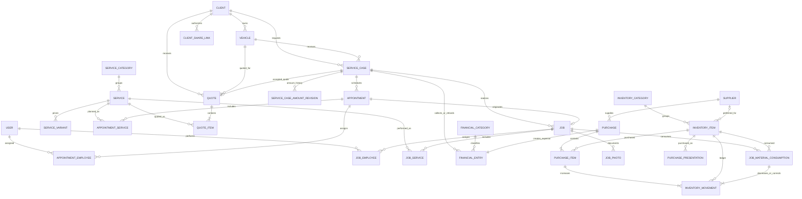
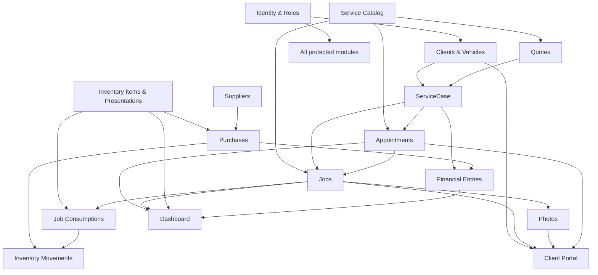

# Ferraro Management System — Master Plan

> Actualización 2026-10-19: por pedido explícito del cliente se habilita borrado definitivo por ADMIN para los módulos operativos, bloqueado por dependencias. La política vigente se detalla en [DEC-2026-10-19](DECISIONS.md#dec-2026-10-19--borrado-definitivo-de-registros-por-admin) y reemplaza las restricciones históricas de sólo archivar/anular que figuran en este plan. Las cuentas de usuario mantienen su política de desactivación.


> **Contrato maestro del proyecto.** Este documento es la fuente de verdad funcional y técnica de FERRARO. Cada BUILD se planifica, implementa y acepta contra este contenido. Cualquier desviación estructural, cambio de alcance, invariante o decisión arquitectónica posterior debe explicarse y registrarse; nunca se modifica silenciosamente. Las decisiones posteriores se registran en [`docs/DECISIONS.md`](./DECISIONS.md).

- **Estado:** contrato funcional actualizado a la implementación; las decisiones posteriores se registran en `docs/DECISIONS.md`.
- **Ubicación del negocio:** Rosario, Santa Fe, Argentina.
- **Zona horaria IANA:** `America/Argentina/Buenos_Aires`.
- **Moneda canónica:** USD. Las cargas de finanzas, presupuestos y compras pueden originarse en USD o ARS; ARS requiere cotización manual expresada como ARS por 1 USD y se conserva la trazabilidad del importe original.
- **Alcance del documento:** producto, dominio, UX, arquitectura, seguridad, datos, testing y ejecución incremental. No constituye implementación.

---

## 1. Executive Summary

FERRARO será una aplicación web interna, responsive y premium para administrar clientes, vehículos, agenda, trabajos, servicios, presupuestos, inventario, compras, cobros, egresos, empleados, fotografías, historial, indicadores y un portal privado para clientes.

El producto será un **monolito modular** con una sola base PostgreSQL y almacenamiento privado de objetos. Esta forma reduce costo operativo y complejidad sin sacrificar integridad. Las reglas críticas vivirán del lado servidor y las operaciones que afecten varias entidades serán transaccionales.

La decisión central para el ciclo comercial-operativo es `ServiceCase`: una identidad mínima que une el presupuesto aceptado, los turnos, los trabajos, el importe acordado y los cobros de un mismo encargo. No es un workflow, no tiene una máquina de estados y no agrega pasos para el usuario. Se crea automáticamente al aceptar un presupuesto o al crear directamente un turno o trabajo. Resuelve señas anteriores al trabajo, cobros parciales y saldo posterior sin convertir `Job` en raíz financiera ni duplicar importes.

El estado financiero nunca gobierna la operación: se puede agendar y completar un trabajo sin cobros o con saldo pendiente. El saldo se deriva de importe acordado menos cobros netos; no se guarda como un valor independiente.

FERRARO será el producto base. PPF HOUSE será, en el futuro, otro repositorio, base y deployment. La reutilización se facilitará mediante configuración de marca, tokens, plantillas y límites modulares, sin multitenancy ni `tenantId`.

## 2. Product Principles

1. **Simplicidad operativa:** una tarea frecuente debe requerir pocos pasos y sólo datos útiles.
2. **Velocidad:** búsquedas, creación rápida, defaults y acciones contextuales reducen carga manual.
3. **Claridad:** agenda, trabajo, cobro y stock representan hechos diferentes y no se mezclan.
4. **Premium funcional:** estética sobria, buena tipografía, fotografía cuidada y feedback preciso, con densidad propia de una herramienta.
5. **Mobile real:** agenda, trabajo, fotos, clientes y stock tienen patrones específicos para pantallas pequeñas.
6. **Integridad por diseño:** invariantes, transacciones, históricos y permisos viven en servidor y base de datos.
7. **Arquitectura aburrida:** monolito modular, tecnologías conocidas y pocas dependencias.
8. **Evolución razonable:** límites claros sin construir infraestructura futura que todavía no aporta valor.
9. **Sin burocracia:** pocos estados, formularios progresivos y automatizaciones discretas.
10. **Una fuente de verdad:** no se duplican saldo, stock, precio histórico ni gasto de compra.

## 3. Assumptions

- El negocio es una única empresa y una única sede operativa en V1.
- USD es la moneda canónica de cálculos, saldos, comparaciones, KPIs, reportes y márgenes. Sólo se acepta USD/ARS como moneda de entrada; ARS se convierte server-side con cotización manual y conserva importe/cotización originales.
- Usuarios internos: `ADMIN` y `STAFF`; los clientes no tienen cuentas tradicionales.
- La agenda admite capacidad simultánea y no intenta optimizar recursos automáticamente.
- La fecha y hora de negocio se interpreta siempre en `America/Argentina/Buenos_Aires`.
- El sistema no emite comprobantes fiscales ni realiza contabilidad de doble entrada.
- Una compra registrada se considera egreso realizado; cuentas a pagar quedan fuera de V1.
- Un cobro representa dinero efectivamente recibido, no una promesa de pago.
- Los datos iniciales se cargarán manualmente o mediante seed de desarrollo; importación masiva queda diferida.
- La interfaz estará en español rioplatense; nombres técnicos internos se mantienen en inglés consistente.

## 4. Recommended Scope

### V1 incluido

- Autenticación interna y permisos `ADMIN`/`STAFF`.
- Clientes archivables y vehículos con historial.
- Catálogo configurable de servicios, categorías y variantes simples.
- Agenda día/semana/mes, bloqueos, superposición, eventos de varias horas o días.
- Casos de servicio, trabajos realizados y consumos.
- Inventario con unidad base, presentaciones de compra y ledger de movimientos.
- Proveedores y compras con impacto atómico en stock y finanzas.
- Presupuestos históricos, conversión al mismo caso y PDF premium.
- Finanzas internas: cobros, señas, devoluciones, ingresos y egresos manuales.
- Fotos privadas con visibilidad explícita al cliente.
- Link privado por cliente con contraseña opcional, revocación y expiración.
- Dashboard operativo, KPIs esenciales y búsqueda global.
- Responsive, accesibilidad razonable, observabilidad y backups administrados.

### Fuera de V1

- Leads/CRM, campañas, WhatsApp automático y Google Calendar.
- Facturación fiscal, ARCA, contabilidad formal, cuentas corrientes y payroll.
- Cobro online, bancos, conciliación, cuotas, monedas distintas de USD/ARS o integración automática de cotizaciones.
- Portal con cuenta/contraseña tradicional o aceptación automática del presupuesto.
- App nativa, multi-sede, multiempresa, SaaS/multitenant e IA.
- Motor de reglas de precios o unidades físicas universal.
- Optimización automática de capacidad, partes horarios o comisiones.

## 5. Suggested Value-Add Features

### Include V1

- **Creación contextual:** desde cliente crear vehículo/turno/presupuesto; desde turno crear trabajo; desde presupuesto aceptado crear turno.
- **Guardado de borrador en presupuestos:** evita perder una cotización extensa sin imponer autosave general.
- **Portada del vehículo:** una foto principal opcional mejora identificación visual.
- **Timeline unificado por vehículo:** turnos, trabajos y fotos relevantes en orden cronológico.
- **Duplicar presupuesto:** acelera trabajos similares sin alterar el original.
- **Alertas internas accionables:** stock bajo y presupuestos vencidos; no requieren motor de notificaciones.
- **Comandos rápidos:** menú global “Crear” y `Cmd/Ctrl + K` para búsqueda.
- **Detección suave de posibles duplicados:** advertir por teléfono/email, sin bloquear la carga.

### Consider Later

- Exportación CSV de clientes, inventario y finanzas.
- Recordatorios manualmente disparados por WhatsApp/email.
- Plantillas de paquetes de servicios y consumos sugeridos.
- Capacidad por box/recurso si la operación real lo necesita.
- Registro de tiempo por empleado, sólo si habilita decisiones concretas.
- Importación inicial asistida desde CSV.

## 6. Information Architecture

La información se organiza por tareas, no por tablas de base de datos:

- **Operación:** Dashboard, Agenda, Clientes, Trabajos.
- **Venta:** Presupuestos y catálogo de Servicios, sólo ADMIN para precios y presupuestos.
- **Insumos:** Inventario, consumos, Compras y Proveedores.
- **Dinero:** Finanzas y métricas monetarias, sólo ADMIN.
- **Administración:** Equipo, configuración y links privados, sólo ADMIN.
- **Experiencia cliente:** portal aislado del backoffice.

El `ServiceCase` es deliberadamente invisible como módulo principal. Aparece como “servicio/encargo” dentro del contexto de un cliente, turno, trabajo o finanzas cuando aporta información de importe y saldo.

## 7. Navigation

### Navegación principal ADMIN

1. Inicio
2. Agenda
3. Clientes
4. Trabajos
5. Presupuestos
6. Inventario
7. Finanzas
8. Más: Servicios, Compras, Proveedores, Equipo, Configuración

### Navegación principal STAFF

1. Inicio operativo
2. Agenda
3. Clientes
4. Trabajos
5. Inventario —consulta y consumos permitidos—

Desktop usa sidebar colapsable; tablet usa navegación compacta; mobile usa una barra inferior de hasta cinco destinos y un menú “Más”. Un botón global “Crear” ofrece sólo acciones autorizadas y prioriza las más frecuentes según pantalla.

## 8. Domain Model

### Contextos

- **Identity & Access:** usuarios, sesiones y roles.
- **Customers:** clientes y vehículos.
- **Catalog:** servicios, categorías y variantes de precio/duración.
- **Commercial Continuity:** `ServiceCase`, importe acordado y continuidad quote → appointment → job → cobros.
- **Scheduling:** turnos, servicios planificados, asignaciones y bloqueos.
- **Work:** trabajos, servicios realizados, empleados, consumos y fotos.
- **Inventory & Purchasing:** ítems, presentaciones, proveedores, compras y movimientos.
- **Finance:** entradas financieras, categorías, cobros y reversiones.
- **Quotes:** presupuestos e ítems snapshot.
- **Client Sharing:** links y proyección segura del portal.

### Decisión `ServiceCase`

Se evaluaron tres opciones:

1. Vincular cobros sólo a `Job`: falla porque una seña puede existir antes del trabajo.
2. Vincular cobros opcionalmente a quote/appointment/job: crea relaciones polimórficas, ambigüedad y riesgo de contar dos veces.
3. Crear un contrato/orden comercial con workflow: resuelve identidad, pero agrega estados y burocracia innecesarios.

Se elige una cuarta forma mínima: `ServiceCase` como ancla de identidad. Contiene cliente, vehículo e importe acordado opcional; no contiene estado operativo. Quote, appointment, job y cobros se asocian al mismo caso. El sistema lo crea en segundo plano y el usuario no debe completar un formulario adicional.

## 9. Entity Model

| Entidad | Propósito y campos esenciales | Política histórica |
|---|---|---|
| `User` | email, nombre, passwordHash, role, active, lastLoginAt | Desactivar; nunca borrar actividad asociada |
| `Client` | nombre identificatorio, nombre/apellido opcionales, phone, whatsapp, email, instagram, notas internas, active | Archivar, no borrar con historial |
| `Vehicle` | clientId, marca, modelo, versión, año, color, notas, coverPhotoId opcional, active | Archivar; propietario no cambia silenciosamente |
| `ServiceCategory` | nombre, orden, active | Desactivar |
| `Service` | categoryId, nombre, descripciones interna/comercial, basePriceUsd, duración, imagen, orden, active | Desactivar; históricos por snapshot |
| `ServiceVariant` | serviceId, tipo `VEHICLE_CLASS` o `MODEL_EXCEPTION`, label/criterio explícito, priceUsd, duración opcional, prioridad | Sin motor de reglas; coincidencia explícita |
| `ServiceCase` | clientId, vehicleId, acceptedQuoteId opcional y único, agreedAmountUsd nullable con origen, directCostUsd nullable con origen, origen, timestamps/actor | Sin estados; importe acordado nullable significa “por definir”; costo null significa “sin imputar” |
| `ServiceCaseAmountRevision` | serviceCaseId, before/after USD y trazabilidad de origen, razón, actor, fecha | Append-only; sólo se crea al cambiar un importe ya fijado |
| `Appointment` | serviceCaseId, startAt/endAt, status, notas internas, color opcional, visibleToClient | Cancelar, no borrar si tuvo actividad; portal nunca muestra notas internas |
| `AppointmentService` | appointmentId, serviceId opcional, nombre y duración snapshot | Editable mientras está agendado; snapshot visible |
| `AppointmentEmployee` | appointmentId, userId | Asignación opcional |
| `CalendarBlock` | startAt/endAt, allDay, motivo, color, notas, actor | Separado de turnos; cancelable/archivable |
| `Job` | serviceCaseId, originAppointmentId opcional único, performedAt/fecha local, notas | Hecho operativo; no depende del pago |
| `JobService` | jobId, serviceId opcional, nombre/descripcion snapshot | Conserva lo realizado aunque cambie catálogo |
| `JobEmployee` | jobId, userId | Sin horas en V1 |
| `JobMaterialConsumption` | jobId, inventoryItemId, quantityBase, unit snapshot, estado | Corrección mediante movimientos compensatorios |
| `JobPhoto` | jobId, object keys, MIME, tamaño, dimensiones, type opcional, order, visibleToClient, cover | Metadata DB; binarios fuera de PostgreSQL |
| `InventoryCategory` | nombre, active | Desactivar |
| `InventoryItem` | categoría, supplier preferido opcional, nombre, SKU, `costHintUsd` canónico opcional, baseUnit, currentStock, minimumStock, active, notas | Base unit inmutable tras primer movimiento; hint interno en USD, no es costo imputado al caso |
| `PurchasePresentation` | itemId, nombre (“rollo 15 m”), factorToBase, active | Factor explícito; preservar snapshot en compra |
| `Supplier` | nombre, contacto, phone, email, notas, active | Desactivar |
| `Purchase` | supplierId, businessDate, reference, notas, totalUsd canónico y moneda/importe/cotización de origen, status, actor | `POSTED` o `VOIDED`; numeración humana |
| `PurchaseItem` | purchaseId, itemId, presentationId opcional, snapshots de nombres/unidad/factor y costos USD/origen, quantityPurchased, quantityBase | Inmutable después de postear; reversar compra |
| `InventoryMovement` | itemId, type, signedQuantityBase, occurredAt, purchaseItemId o consumptionId opcional, reversalOfId, actor, note | Ledger append-only |
| `FinancialCategory` | nombre, direction permitida, orden, active | Configurable por ADMIN |
| `FinancialEntry` | direction, type, amountUsd canónico positivo, moneda/importe/cotización de origen, occurredAt, categoryId, method opcional, serviceCaseId/purchaseId opcional, reversalOfId, descripción, actor | Ledger de caja append-only; reversiones compensatorias preservan la semántica monetaria |
| `Quote` | clientId, vehicleId, number, status, fechas, moneda/cotización de origen, notes/terms, subtotal/discount/total snapshots en origen y USD, templateVersion | Emitido/aceptado no se reescribe; el caso referencia al único quote aceptado |
| `QuoteItem` | quoteId, serviceId opcional, nombre/descripcion/cantidad/precio/descuento/total snapshots en origen y USD, orden | Snapshot completo |
| `ClientShareLink` | clientId, tokenHash, passwordHash opcional, expiresAt, revokedAt, lastAccessAt, actor | Token crudo nunca en DB; sólo ADMIN administra |
| `IdempotencyKey` | key, operation, actor, requestHash, result reference, expiresAt | Protege mutaciones financieras/stock críticas |

Todos los IDs internos serán UUID/UUIDv7 o CUID2 consistentes. Los identificadores humanos son adicionales, nunca claves foráneas.

## 10. ER Diagram



La cardinalidad `ServiceCase`–`Quote` representa como máximo un presupuesto aceptado como origen; un cliente puede tener otros presupuestos rechazados o borradores que nunca generan caso. Un caso puede tener varios turnos o trabajos para contemplar visitas o entregas relacionadas sin forzar esa complejidad en la UI.

## 11. Invariants

1. USD es la moneda canónica. La entrada sólo admite `USD`/`ARS`; para ARS la cotización manual siempre significa ARS por USD y usa decimal exacto.
2. Dinero usa `Decimal(19,2)`; cantidades y factores nunca usan floating point binario.
3. Todo cálculo/redondeo monetario ocurre en servidor con regla única: redondeo comercial a 2 decimales por ítem y total verificable.
4. Todo vehículo pertenece exactamente a un cliente.
5. El cliente y vehículo de un `ServiceCase` deben corresponder entre sí.
6. Un turno cancelado no equivale a un trabajo realizado.
7. Un trabajo puede existir sin turno, y crea/se asocia a un caso.
8. Un turno puede existir sin pago y sin importe acordado.
9. Una seña puede existir antes del turno o trabajo, siempre dentro de un caso.
10. Completar un trabajo no exige saldo cero.
11. Cobros y devoluciones no modifican estados operativos.
12. Todo cobro de cliente pertenece exactamente a un `ServiceCase`.
13. El saldo es derivado: importe acordado menos cobros netos; nunca es fuente persistida independiente.
14. Sin importe acordado el estado es “Importe por definir”, nunca saldo cero.
15. Reversar un cobro modifica cobros netos mediante asiento compensatorio y no borra historia.
16. Un presupuesto aceptado copia su total USD canónico y su trazabilidad de origen al importe acordado del caso una sola vez; cambios posteriores del catálogo o presupuesto no lo alteran.
17. Cambiar un importe acordado ya definido requiere ADMIN, motivo y revisión append-only.
18. Servicios e ítems desactivados conservan históricos.
19. QuoteItem, JobService y PurchaseItem preservan snapshots definidos, incluidos importes originales y cotización cuando corresponda.
20. Todo cambio de stock deja un `InventoryMovement`.
21. El stock actual debe coincidir con la suma del ledger; cualquier reparación es un ajuste trazable.
22. Consumo de trabajo genera movimiento negativo; corrección genera compensación, no edición silenciosa.
23. Compra posteada crea movimientos y un único egreso atómicamente.
24. Anular una compra revierte stock y egreso; no elimina registros.
25. Una presentación convierte a unidad base sólo con factor explícito positivo.
26. La unidad base de un ítem no cambia después de tener movimientos.
27. No se permite stock negativo por consumo normal; un ADMIN puede forzar ajuste excepcional con motivo.
28. Sólo fotos con `visibleToClient = true` pueden entrar en la proyección del portal.
29. Un link privado resuelve exclusivamente el `clientId` al que pertenece.
30. Coincidencias de apellido, teléfono, email o vehículo nunca amplían acceso.
31. Tokens y contraseñas nunca se almacenan en texto plano.
32. `STAFF` no accede a presupuestos, precios, compras, proveedores, costos, finanzas, KPIs monetarios, usuarios, configuración ni links privados.
33. Toda autorización se verifica del lado servidor.
34. Operaciones multi-entidad críticas son atómicas e idempotentes.
35. “Hoy”, meses, jornadas y períodos se calculan en `America/Argentina/Buenos_Aires`.
36. Instantes se almacenan en UTC; fechas civiles se almacenan como `date` cuando no representan un instante.
37. Registros con historia no se eliminan mediante cascadas destructivas.

## 12. Sources of Truth

| Concepto | Fuente de verdad | Derivados / prohibiciones |
|---|---|---|
| Cliente/vehículo | `Client`, `Vehicle` | Historial no se copia a otros clientes |
| Continuidad comercial | `ServiceCase` | Quote, appointment y job no compiten por identidad |
| Importe acordado | `ServiceCase.agreedAmountUsd` | Se origina opcionalmente en quote aceptado; no se lee del precio actual |
| Costo directo | `ServiceCase.directCostUsd` nullable | ADMIN lo imputa explícitamente; null significa no informado y nunca se deriva de stock |
| Origen monetario | Campos `sourceCurrency`, `sourceAmount`, `exchangeRateArsPerUsd` del registro aplicable | USD es canónico; ARS conserva importe original y cotización manual |
| Cobrado neto | Suma de `FinancialEntry` de cobro menos devoluciones/reversiones del caso | No guardar `paidAmount` mutable |
| Saldo | `agreedAmountUsd - netReceipts` | Nullable/indefinido si no hay importe acordado |
| Agenda | `Appointment` y `CalendarBlock` | Pago no valida ni cambia agenda |
| Trabajo realizado | `Job` + `JobService` | `Appointment.status=COMPLETED` sin Job está prohibido por command transaccional |
| Precio actual de catálogo | `Service`/`ServiceVariant` | No reescribe documentos |
| Presupuesto histórico | `Quote` + `QuoteItem` snapshots | Catálogo sólo ayuda a crear |
| Stock actual | `InventoryItem.currentStock`, validado contra `InventoryMovement` | Campo agregado para lectura; ledger explica cada cambio |
| Compra | `Purchase` + `PurchaseItem` | Egreso vinculado único y movimientos derivados atómicos; origen y cotización quedan snapshotteados |
| Caja interna | `FinancialEntry` | No hay tabla paralela de Payment/Income; saldos/KPIs suman `amountUsd` canónico |
| Visibilidad portal | `ClientShareLink.clientId` + flags publicables | Nunca consultas globales filtradas después en cliente |

## 13. Architecture

### Decisión

Monolito modular Next.js con capas explícitas por dominio, PostgreSQL, almacenamiento privado de objetos y despliegue único.

### Beneficio

Una transacción puede cubrir compra, stock y finanzas; el equipo mantiene un solo sistema y los módulos siguen siendo separables por límites de código.

### Alternativas descartadas

- Microservicios: coordinación y observabilidad desproporcionadas.
- Backend separado desde V1: duplicaría contratos y despliegues sin necesidad.
- BaaS como dominio: útil para infraestructura, pero reglas no deben vivir dispersas en triggers/clientes.
- Arquitectura genérica multiempresa: contradice productos y datos separados.

### Capas

1. **Presentation:** rutas, Server Components y Client Components puntuales.
2. **Application:** commands, queries, autorización, transacciones y casos de uso.
3. **Domain:** invariantes, cálculos y tipos sin dependencia de React.
4. **Infrastructure:** Prisma, auth, object storage, PDF, logging y servicios externos.

No se exige DDD ceremonial. La separación existe para impedir que UI y handlers sean la única ubicación de reglas.

## 14. Technology Stack

| Decisión | Elección | Beneficio | Alternativa / tradeoff |
|---|---|---|---|
| Web | Next.js estable, App Router, React, TypeScript strict | Full-stack cohesivo, SSR y deployment simple | Backend separado da independencia, pero más operación |
| Packages | pnpm, lockfile obligatorio | Instalaciones reproducibles y eficientes | npm sería válido, sin beneficio para cambiar después |
| DB | PostgreSQL administrado | Transacciones, decimal, índices y búsqueda suficiente | MySQL también sirve; PostgreSQL ofrece mejor encaje |
| ORM | Prisma + migraciones versionadas | Tipado, productividad y transacciones | SQL/Drizzle da más control, con mayor superficie manual |
| Validation | Zod en fronteras | Contratos compartibles y mensajes consistentes | Validación ad hoc se dispersa |
| Forms | React Hook Form sólo en formularios complejos | Estado y errores sin rerenders excesivos | Form actions nativas para formularios simples |
| Auth | Better Auth con sesiones de base, usuarios provisionados y Argon2id (DEC-001) | Credenciales sin signup público y sesiones opacas persistidas, sin proveedor externo | Auth.js Credentials exige JWT; un servicio administrado agrega costo/dependencia |
| UI | Componentes accesibles headless + CSS/Tailwind y tokens propios | Comportamiento robusto sin estética de plantilla | Librería visual cerrada acelera pero homogeneiza marca |
| Calendar | Biblioteca madura de calendario evaluada en BUILD 3, envuelta por adaptador | DnD/layout complejo ya resuelto | Construirlo completo es costoso y riesgoso |
| PDF | `@react-pdf/renderer`, fuentes embebidas, artifact al emitir | Determinista, server-friendly, template versionable | Chromium ofrece CSS web completo, pesa y complica runtime |
| Files | Bucket privado S3-compatible detrás de adapter | Signed URLs, portabilidad y variantes | Vercel Blob simplifica setup, aumenta acoplamiento |
| Tests | Vitest, Testing Library y Playwright | Pirámide práctica y E2E crítico | Cobertura total no es objetivo |

Las versiones exactas se fijan en BUILD 0 tras verificar compatibilidad estable; no se usa “latest” flotante.

### Next.js usage rules

- **Server Components:** lectura inicial, layouts, páginas de detalle y tablas; opción por defecto.
- **Client Components:** calendario interactivo, DnD, uploads, inputs enriquecidos y estados locales; frontera mínima.
- **Server Actions:** mutaciones internas iniciadas por formularios, con auth, validación e idempotencia.
- **Route Handlers:** uploads firmados, descarga/PDF, portal público, webhooks futuros y APIs que necesiten HTTP explícito.
- Ningún acceso a Prisma desde componentes cliente.
- Revalidación por tags/rutas después de commands; sin caching de datos sensibles entre usuarios.

## 15. Repository Structure

```text
src/
  app/
    (auth)/
    (backoffice)/
    client/[token]/
    api/
  modules/
    identity/
    clients/
    services/
    service-cases/
    scheduling/
    jobs/
    inventory/
    purchasing/
    finance/
    quotes/
    media/
    portal/
    dashboard/
  components/
    ui/
    patterns/
  infrastructure/
    db/
    auth/
    storage/
    pdf/
    logging/
  config/
  shared/
    validation/
    money/
    date-time/
    errors/
prisma/
tests/
docs/
```

Cada módulo puede contener `domain`, `application`, `data`, `ui` y `tests` sólo cuando lo necesite. No se crean carpetas vacías ni repositorios genéricos. `shared` acepta sólo conceptos realmente transversales; no se convierte en un `lib/` indiscriminado.

## 16. Database Strategy

- PostgreSQL con claves técnicas no secuenciales y constraints para montos/factores positivos, rangos de fechas y unicidad.
- Prisma migrations revisadas y versionadas; producción nunca usa `db push`.
- Decimal: dinero `Decimal(19,2)`, stock `Decimal(18,3)`, factores `Decimal(18,6)`. Si un insumo exige más precisión, se decide antes de cargar movimientos.
- `timestamptz`/instantes UTC para `startAt`, `endAt`, cobros, auditoría y accesos. `date` para fechas civiles como fecha de compra o vigencia cuando la hora carece de significado.
- Toda conversión a día/mes de negocio usa `America/Argentina/Buenos_Aires` en una utilidad única y testeada.
- Índices iniciales: claves foráneas consultadas; `Appointment(startAt,endAt,status)`; `Job(performedAt)`; `ServiceCase(clientId,vehicleId)`; `InventoryMovement(itemId,occurredAt)`; `FinancialEntry(occurredAt,direction)` y `(serviceCaseId,occurredAt)`; `Quote(status,issuedAt)`; unicidad de números humanos y vínculos purchase-expense.
- Búsqueda: índices normalizados para teléfono/email, `pg_trgm` en nombre de cliente y marca/modelo si el volumen lo justifica; empezar con `ILIKE` indexable y medir.
- Paginación por cursor en timelines grandes y offset en tablas administrativas moderadas.
- Soft delete selectivo mediante `active/archivedAt/revokedAt`; no tabla universal de soft delete.
- Cascades sólo para hijos sin significado independiente antes de publicar (por ejemplo ítems de draft). Históricos usan `RESTRICT` o `SET NULL` con snapshot.

## 17. Authentication

- Login interno por email y contraseña; alta y reset sólo por ADMIN en V1.
- Hash Argon2id con parámetros revisados; nunca logging de credenciales.
- Sesiones opacas persistidas en DB, cookies `HttpOnly`, `Secure`, `SameSite=Lax`, rotación e invalidación al desactivar usuario.
- Rate limit de login, mensajes que no enumeren usuarios y auditoría de éxito/fallo sin contraseña.
- Middleware/proxy sólo aporta redirección temprana; cada query/command vuelve a autenticar y autorizar.
- No self-signup, social login ni recuperación por email en V1.

## 18. Authorization Matrix

| Capacidad | ADMIN | STAFF |
|---|:---:|:---:|
| Clientes y vehículos | CRUD/archivar | Crear, ver, editar; archivar según política |
| Agenda y bloqueos | Sí | Sí |
| Trabajos y fotos | Sí | Sí |
| Consumos | Sí | Registrar/corregir con motivo |
| Stock | Completo, costos y ajustes | Ver cantidades; sin costos; consumo operativo |
| Servicios | CRUD, precios y variantes | Ver nombre/duración necesaria; sin precios |
| Presupuestos | Exclusivo | No acceso |
| Compras/proveedores/costos | Exclusivo | No acceso |
| Finanzas/cobros/saldos | Exclusivo | No acceso |
| KPIs monetarios | Exclusivo | No acceso |
| Links privados | Exclusivo | No acceso |
| Usuarios/configuración | Exclusivo | No acceso |

Las proyecciones de datos también ocultan columnas: no alcanza con negar rutas. Las queries para STAFF no seleccionan costos, precios ni totales. Los commands verifican rol dentro de la misma transacción cuando corresponda.

## 19. Clients & Vehicles

Cliente exige únicamente nombre identificatorio y al menos un medio de contacto útil cuando exista; el teléfono se prioriza pero no se inventan obligatoriedades. WhatsApp puede ser el mismo teléfono mediante checkbox. Email e Instagram son opcionales.

La ficha muestra resumen, vehículos, próximo turno, última visita, cantidad de trabajos, último servicio, presupuestos sólo a ADMIN y galería relevante. Los conteos son derivados. El historial del vehículo se obtiene por sus `ServiceCase`; nunca se mezcla por texto coincidente.

La búsqueda tolera espacios, mayúsculas y formatos de teléfono. La advertencia de duplicado es informativa. Un vehículo puede tener portada opcional. Cambiarlo de cliente requiere ADMIN y operación explícita con auditoría, no edición corriente.

## 20. Service Catalog

Los servicios son configurables y agrupados por categoría. `basePriceUsd` puede ser nullable para “a cotizar”; `estimatedDurationMinutes` también puede ser opcional. La descripción comercial alimenta presupuestos; la interna ayuda a operación.

Las variantes admiten sólo:

- clase/tamaño seleccionado explícitamente (`Sedan`, `SUV`, `Pickup`);
- excepción explícita de marca/modelo (`Ford Raptor`).

La UI sugiere la mejor coincidencia, pero ADMIN confirma el precio. No hay expresiones, rangos ni reglas encadenadas. El precio seleccionado se copia al presupuesto; nunca se referencia en vivo desde un histórico.

## 21. Calendar Architecture

`Appointment` representa trabajo agendado y siempre se vincula a un `ServiceCase`. `CalendarBlock` representa indisponibilidad sin cliente y permanece separado. Estados únicos: `CONFIRMED`, `COMPLETED`, `CANCELLED`.

Crear turno directo crea el caso en la misma transacción si no existe. No pide pago ni importe. Completar usa un command atómico que crea `Job`, copia/permite ajustar servicios y marca el turno `COMPLETED`; no puede existir ese estado sin Job.

La agenda consulta por intersección (`startAt < rangeEnd AND endAt > rangeStart`) y renderiza en zona del negocio. Soporta día, semana y mes; el evento puede cruzar días. DnD/resize se habilita sólo si la biblioteca elegida ofrece keyboard/touch razonable, validación de colisiones visuales y rollback ante error. Superposición se muestra, no se bloquea. El cambio de fecha desde DnD pide confirmación sólo si es riesgoso y siempre ofrece feedback/undo cuando sea seguro.

Mobile usa agenda diaria tipo lista/timeline, selector horizontal de fecha y acceso a vista mensual de navegación; no intenta comprimir la semana desktop.

## 22. Jobs Architecture

`Job` es el hecho operativo de que el trabajo se realizó. Puede nacer desde turno o de forma directa. Desde turno, “Marcar como realizado” abre una hoja/página corta con servicios precargados, empleados, consumos, notas y fotos opcionales; se puede guardar el trabajo primero y completar fotos después.

El job no tiene estado de pago, total ni saldo propios. Esa información pertenece al caso y sólo la ve ADMIN. El costo directo opcional también vive en `ServiceCase`, porque el monto comercial acordado y su revisión ya son del caso que puede abarcar varios turnos o trabajos. No es obligatorio, no se completa con cero ni se infiere de inventario; null significa sin imputar y cero explícito significa costo conocido igual a cero. `JobService` guarda nombre y descripción snapshot; los costos de materiales se consultan históricamente desde compra/movimientos, no se imputan automáticamente al caso.

Un job creado por error se anula mediante marca y reversión de consumos; no se borra si produjo stock o exposición al cliente. El detalle usa timeline, servicios, equipo, materiales y galería.

## 23. Inventory Architecture

Se adopta **stock agregado + ledger**:

- `InventoryItem.currentStock` permite listados y alertas rápidos.
- `InventoryMovement` es la trazabilidad de cada cambio.
- Ambos se actualizan en una misma transacción con bloqueo/actualización atómica.
- Una verificación administrativa compara agregado con suma del ledger.

Stock completamente derivado simplificaría verdad conceptual pero encarece cada listado y control concurrente. Sólo almacenar agregado sería rápido pero perdería auditoría. La combinación es el punto pragmático.

Movimientos: `PURCHASE`, `CONSUMPTION`, `ADJUSTMENT_IN`, `ADJUSTMENT_OUT`, `RETURN`, `REVERSAL`. La cantidad es firmada en unidad base. Ajustes requieren motivo; STAFF no realiza ajustes generales. No se permite editar `currentStock` directamente.

## 24. Unit Conversion Model

Cada ítem define una unidad base de una lista pequeña configurable en código/seed (`unit`, `meter`, `milliliter`, `gram`, etc.). `PurchasePresentation` pertenece a ese ítem y expresa un factor positivo hacia la base.

Ejemplo: PPF X, base `meter`; “rollo 15 m”, factor `15`. Comprar 2 genera `quantityBase = 30.000`. Consumir `2.425` resta exactamente esa cantidad.

No hay conversión global entre dimensiones, prefijos automáticos ni fórmulas. Una presentación nunca se usa en otro ítem. Al postear una compra se snapshottean presentación, factor y unidad. La unidad base queda bloqueada tras el primer movimiento.

## 25. Purchase Architecture

Un command `postPurchase` valida rol ADMIN, ítems, presentaciones y totales; dentro de una transacción crea compra/ítems, incrementa stocks, agrega movimientos y crea exactamente un `FinancialEntry` de egreso con `purchaseId` único. Una idempotency key impide doble posteo.

La compra se edita sólo como draft si se decide habilitar drafts. Una compra posteada se corrige anulando y creando compensaciones; no se reescriben cantidades históricas. Si reversar dejaría stock negativo, el sistema informa el conflicto y exige resolverlo mediante ADMIN, nunca corrompe la suma.

V1 considera la compra pagada al registrarla. Cuentas a pagar quedan fuera del alcance y no se simulan con estados ambiguos.

Una compra usa una sola moneda de origen USD o ARS. Para ARS ADMIN informa la cotización ARS/USD; cada importe original y cotización quedan preservados junto a los costos y total USD canónicos. El egreso asociado y el ledger de stock mantienen sus contratos actuales.

## 26. Finance Architecture

`FinancialEntry` es el único ledger simple de caja. Tiene dirección `INFLOW`/`OUTFLOW`, tipo (`CUSTOMER_PAYMENT`, `CUSTOMER_REFUND`, `PURCHASE`, `MANUAL_INCOME`, `MANUAL_EXPENSE`, `REVERSAL`), monto USD canónico positivo y, para entradas manuales en ARS, moneda/importe/cotización originales; fecha, categoría, método opcional y origen. La cotización es ARS por USD. El cálculo definitivo ocurre server-side. Reversiones son compensatorias y conservan la trazabilidad monetaria de su operación original.

Los cobros/señas son entradas `CUSTOMER_PAYMENT` obligatoriamente ligadas a un `ServiceCase`. Las devoluciones o correcciones son salidas/entradas compensatorias enlazadas al asiento original. El cobrado neto del caso se calcula por entradas menos salidas de cliente válidas. No existe tabla `Payment` paralela ni un ingreso adicional al completar el job.

El importe acordado es nullable y vive en `ServiceCase`. Puede provenir de un quote aceptado o ser fijado por ADMIN en un encargo directo. Si cambia el alcance, ADMIN ajusta el importe con motivo y revisión histórica. El sistema distingue:

- **Importe acordado:** valor comercial vigente del caso.
- **Cobrado:** flujo de caja efectivamente recibido en el período o acumulado.
- **Saldo pendiente:** importe acordado menos cobros netos, sólo si el primero existe.
- **Trabajo realizado sin cobrar:** job realizado, importe definido y cobrado neto menor al importe.

Un saldo negativo se muestra como “saldo a favor” y no se corrige automáticamente. Métodos iniciales: transferencia, efectivo y otro; son opcionales. Finanzas no intenta conciliación bancaria ni devengamiento contable.

El costo directo se carga opcionalmente en `ServiceCase` en USD o ARS y se guarda en USD más su origen. El estado no imputado tiene sus cuatro campos de costo en `NULL`; nunca se representa como cero. La DB exige que USD conserve el mismo importe de origen y no tenga cotización, y que ARS tenga importe de origen, costo USD y cotización positiva; ambos importes admiten cero explícito y rechazan negativos. El margen por caso sólo existe cuando hay importe acordado y costo informado: `agreedAmountUsd - directCostUsd`; el porcentaje usa el importe acordado como denominador cuando es mayor que cero. El margen puede ser negativo; igualdad produce margen cero. Si falta costo, margen y porcentaje no se calculan. En agregado se muestra “Margen conocido” y “Costos imputados” (casos con costo sobre casos del período); sólo con cobertura del 100% se conoce el costo directo de todos los casos incluidos. Esto no constituye ganancia neta ni resultado operativo.

Flujo neto mide entradas y salidas de caja del período; margen compara importes acordados con costos directos imputados de trabajos/casos. Son métricas separadas y sólo ADMIN puede ver costo y margen. STAFF y el portal no reciben sus campos en sus proyecciones.

## 27. Quotes Architecture

Estados: `DRAFT`, `SENT`, `ACCEPTED`, `REJECTED`, `EXPIRED`. `EXPIRED` puede derivarse visualmente de `validUntil` para evitar un job automático; se persiste sólo si hace falta filtrar consistentemente. Un draft es editable. Una versión emitida/aceptada queda bloqueada; para cambiarla se duplica o crea revisión. Cada presupuesto usa una sola moneda de origen USD o ARS; si es ARS, conserva importes/cotización originales y también los totales USD canónicos. Sus PDFs muestran la moneda ofertada y el equivalente USD sin presentar engañosamente el original como USD.

Cada item snapshottea nombre, descripción, cantidad, precio unitario, descuento y total. El quote snapshottea subtotal, descuento global y total. El servidor recalcula todos los valores y rechaza discrepancias.

Aceptar presupuesto crea o vincula un único `ServiceCase` y copia `Quote.totalUsd` y la trazabilidad de origen a `agreedAmountUsd`. “Convertir en turno” reutiliza ese caso, cliente, vehículo y servicios. Si el caso ya tiene importe, no se sobrescribe silenciosamente. El presupuesto no registra cobro por sí mismo.

## 28. PDF Architecture

Los PDFs se generan en servidor con un template React PDF versionado y `BrandConfig`. Incluyen marca, cliente, vehículo, fecha/número, items, descripciones, precios, subtotal, descuento, total, vigencia, condiciones, contacto y footer.

- Draft: preview generado bajo demanda con watermark opcional.
- Al marcar `SENT`: se genera artifact inmutable en storage privado, con hash/templateVersion.
- Descarga interna: autorización ADMIN.
- Compartir externo inicial: descarga manual; no email automático.
- Fuentes se embeben y se prueban saltos de página, caracteres españoles, impresión A4 y vista mobile.

HTML→Chromium se descarta inicialmente por peso de runtime y diferencias de render; puede reconsiderarse si React PDF limita el lenguaje visual aprobado.

## 29. Photos Architecture

Upload directo a bucket privado mediante URL firmada de corta vida. El servidor crea intención, valida rol/job, límites y MIME permitido; tras upload confirma tamaño y metadata antes de publicar el registro.

Se conservan original y variantes preview/thumbnail. El procesamiento puede ser síncrono para imágenes moderadas al inicio; si supera el timeout se introduce job administrado sin cambiar el dominio. Se corrige orientación y se remueve metadata EXIF sensible de derivados.

Mobile ofrece cámara/galería, selección múltiple, previews, progreso individual, retry, orden y portada. `before/process/after` es opcional. Borrar una foto publicada es acción confirmada y auditable; el objeto puede retenerse brevemente para recuperación antes de eliminación definitiva.

## 30. Client Portal Architecture

El link contiene un token aleatorio de al menos 256 bits codificado URL-safe. La DB guarda sólo su hash. Puede tener contraseña Argon2id, expiración, revocación y regeneración. Tras validación se emite una sesión portal corta y segura; los intentos de contraseña se limitan por link/IP mediante capacidad de plataforma o fallback persistente.

La resolución segura es:

1. hash del token → exactamente un `ClientShareLink` activo;
2. obtener su `clientId` inmutable;
3. ejecutar queries del portal que empiezan por ese `clientId`;
4. aplicar flags publicables, especialmente `visibleToClient`.

No se acepta `clientId` enviado por navegador ni se reutilizan queries administrativas con filtrado tardío. V1 muestra datos del cliente, sus vehículos, próximos turnos publicables, trabajos/servicios y fotos visibles. No muestra montos, saldos, notas internas, empleados internos, stock ni datos de otros clientes.

Sólo ADMIN crea, protege, revoca o regenera links. La regeneración invalida inmediatamente el token anterior.

## 31. Dashboard

El dashboard responde “¿Qué pasa hoy en Ferraro?” en zona del negocio.

### ADMIN

- Turnos de hoy y próximos, con acciones rápidas.
- Trabajos recientes y tareas incompletas de documentación.
- Alertas de stock bajo.
- Resumen mensual de cobrado, egresos y flujo neto.
- Casos con trabajo realizado y saldo pendiente, separados de caja del mes.
- Trabajos con “Importe por definir” en un grupo separado; nunca se contabilizan como saldo cero ni como deuda conocida.
- Accesos a nuevo turno, cliente, trabajo, presupuesto, compra, ingreso y egreso.

### STAFF

- Turnos de hoy/próximos, trabajos recientes, alertas operativas de stock y accesos permitidos.
- Sin montos, precios, saldos, compras ni KPIs monetarios.

No se agregan gráficos si una lista o comparación numérica habilita mejor una acción.

## 32. KPIs

### Must-have

| Nombre | Descripción y fórmula | Fuente | Período | Utilidad | Complejidad |
|---|---|---|---|---|---|
| Cobrado | Suma `INFLOW CUSTOMER_PAYMENT` menos devoluciones del período | FinancialEntry | Mes actual + comparación anterior | Caja real recibida | Baja |
| Egresos | Suma de outflows válidos del período | FinancialEntry | Mes actual | Control de salida real | Baja |
| Flujo neto | Cobrado + otros ingresos − egresos | FinancialEntry | Mes actual | Pulso financiero interno, no utilidad contable | Baja |
| Margen conocido | Suma del margen de casos del período con importe acordado y costo directo informado | ServiceCase + Job | Mes | Margen parcial explícito; no es ganancia neta | Media |
| Cobertura de costos | Casos con costo directo informado / casos del período considerados | ServiceCase + Job | Mes | Indica completitud del margen conocido | Baja |
| Trabajos realizados | Conteo de jobs no anulados | Job | Día/mes | Volumen operativo | Baja |
| Ticket acordado promedio | Suma de importes definidos / casos con job del período | ServiceCase + Job | Mes | Valor comercial, distinto de caja | Media |
| Saldo pendiente realizado | Suma `max(agreed-net,0)` en casos con job | ServiceCase + FinancialEntry + Job | Actual | Seguimiento de cobro sin bloquear operación | Media |
| Stock bajo | Ítems activos con stock ≤ mínimo | InventoryItem | Actual | Acción de compra | Baja |

### Nice-to-have

| Nombre | Descripción y fórmula | Fuente | Período | Utilidad | Complejidad |
|---|---|---|---|---|---|
| Servicios más realizados | Conteo de JobService por snapshot/serviceId | JobService | 30/90 días | Orienta oferta | Media |
| Clientes recurrentes | Clientes con ≥2 jobs en ventana / clientes atendidos | Job/ServiceCase | 12 meses | Retención simple | Media |
| Ocupación estimada | Horas agendadas / horas configuradas, sin pretender capacidad por box | Appointment | Semana/mes | Tendencia de carga | Media; requiere horario |
| Materiales más consumidos | Suma cantidad base por ítem | Movement | 30/90 días | Reposición | Baja |
| Presupuestos aceptados | Aceptados / emitidos con cohorte de emisión | Quote | Mes/trimestre | Eficacia comercial | Media |

### Future

| Nombre | Descripción y fórmula | Fuente | Período | Utilidad | Complejidad |
|---|---|---|---|---|---|
| Productividad empleado | Trabajo/horas reales | Jobs/time tracking | Mes | Sólo útil con carga confiable | Alta |
| Forecast | Agenda futura valorizada | Cases/Appointments | 30/60 días | Planificación | Media, puede confundir con caja |

“Cobrado”, “acordado”, “saldo”, “flujo neto” y “margen conocido” nunca se presentan como sinónimos. Los KPIs monetarios son sólo ADMIN. No se etiqueta el margen como ganancia neta, rentabilidad total o resultado definitivo; cobertura parcial debe ser visible.

## 33. UX Principles

- Acciones primarias visibles y una secundaria agrupada; no menús con decisiones irrelevantes.
- Formularios por secciones y progressive disclosure; nunca wizard largo para tareas simples.
- Defaults: hoy en zona del negocio, duración del servicio, último vehículo usado cuando el contexto lo determina.
- Autocomplete y creación inline controlada para cliente/vehículo, evitando abandonar el flujo.
- Agenda y presupuestos comparten un picker cliente→vehículo: búsqueda server-side acotada, clientes sin vehículo visibles, vehículos dependientes y alta transaccional de cliente con uno o varios vehículos. Teléfono/email son duplicados fuertes; nombre similar sólo sugiere.
- Feedback en toda mutación: pending, éxito y error específico; doble submit bloqueado.
- Confirmación sólo para acciones destructivas o de impacto difícil de revertir.
- Estados distintos: loading, empty, filtered-empty, permission denied y error recuperable.
- Mantener datos ingresados ante error y colocar foco en el primer campo inválido.
- Densidad media-alta en desktop; jerarquía y acciones táctiles en mobile.

La identidad de un turno directo sólo puede cambiar antes de generar historia comercial: sin quote aceptado, jobs, movimientos financieros, importes/costos/revisiones ni otras appointments en el mismo caso. Después queda fija y la UI explica por qué; nunca se reescribe historia para simplificar una edición.

## 34. Responsive Strategy

Breakpoints definidos como tokens según contenido, no dispositivos específicos. Cada BUILD incluye revisión a anchos pequeños, tablet y desktop.

- Tablas se transforman en cards/listas priorizadas cuando pierden legibilidad; columnas secundarias pasan al detalle.
- Filtros desktop inline; mobile en drawer accesible con chips activos y “Limpiar”.
- Acciones primarias permanecen al alcance; barras sticky sólo si no ocultan contenido.
- Drawers se usan para tareas rápidas; páginas completas para formularios largos o deep links.
- Touch targets mínimos razonables, sin depender de hover.
- Imágenes usan tamaños responsivos, placeholders y variantes; nunca original en grillas.

## 35. Mobile Strategy

- **Agenda:** vista día/lista por defecto, cinta de fechas, mini mes para navegar, cards por horario y botón flotante controlado para nuevo turno.
- **Trabajo:** encabezado compacto con vehículo, checklist ligero de servicios, consumos con buscador/unidad visible, notas y fotos; guardado por secciones cuando corresponda.
- **Fotos:** captura múltiple, progreso por archivo, retry, reordenar y visibilidad con controles grandes.
- **Inventario:** búsqueda inmediata, stock/unidad y alerta como información principal; sin costos para STAFF.
- **Clientes:** búsqueda prominente por nombre/teléfono/vehículo; resultado agrupado con acción contextual.
- **Finanzas ADMIN:** cards y listas; carga rápida de cobro/egreso sin intentar reproducir tabla desktop.

## 36. Table Strategy

Se construye un patrón compartido después de dos usos reales, no una mega tabla genérica. Debe soportar según pantalla: búsqueda, sort permitido, filtros combinables, contador, paginación, acciones rápidas, skeleton, error, empty, filtered-empty y reset.

Filtros relevantes:

- Clientes: texto, activo/archivado, última visita sólo si se usa.
- Trabajos: fecha, cliente/vehículo, servicio y empleado.
- Inventario: categoría, bajo stock, proveedor y activo.
- Finanzas: período, dirección, categoría, método y caso.
- Presupuestos: fecha, estado, cliente y vencimiento.

Persistencia en URL para listados compartibles; preferencias locales sólo cuando no contengan información sensible. Export CSV queda diferido.

## 37. Form Strategy

- Zod define input del command; cliente y servidor comparten forma cuando conviene, pero servidor siempre revalida.
- React Hook Form para listas dinámicas, presupuestos y compras; formularios nativos/server actions para casos simples.
- Campos monetarios aceptan texto localizado y normalizan de forma explícita en servidor. Los flujos con monto editable admiten USD o ARS; al elegir ARS solicitan cotización manual ARS/USD y muestran un preview USD que no sustituye el cálculo de servidor.
- Fechas/horas se editan en zona del negocio y se convierten una sola vez a instante UTC.
- Selects grandes son buscables; navegación de teclado y labels reales obligatorios.
- Errores de dominio vuelven por campo o mensaje global tipado; no se filtran detalles internos.
- Idempotency key por intento en compras, cobros, ajustes y finalización con consumos.

## 38. Design System

Tokens:

- Color de marca y escalas; semánticos `background`, `surface`, `text`, `muted`, `border`, `success`, `warning`, `danger`, `info`.
- Tipografía display/body/mono opcional, tamaños y line-height.
- Espaciado, grids, radios, bordes, sombras/elevación y motion.
- Breakpoints, ancho de contenido y densidad.
- Estados `hover`, `focus-visible`, `pressed`, `disabled`, `loading`, `invalid`.

Patrones candidatos: `PageHeader`, `EntitySearch`, `FilterBar`, `DataList`, `EmptyState`, `Money`, `BusinessDate`, `StatusBadge`, `FormSection`, `ConfirmDialog`, `Drawer`, `Timeline`, `UploadGallery`, `KpiCard`. Se extraen sólo al segundo/tercer uso consistente.

La UI evita negro puro excesivo, gradientes decorativos, glassmorphism y cards para cada texto. Fotografías reales y marca aportarán carácter; la herramienta conserva legibilidad y densidad.

## 39. Branding Architecture

`BrandConfig` tipado y validado contiene nombre comercial, logos/mark, paleta, tipografías, contacto, dirección, social, assets, términos por defecto y metadatos de PDF. Se consume en layout, login, portal y PDF.

La lógica de dominio no contiene “Ferraro” hardcodeado. Los tokens CSS se generan desde configuración de build, no desde datos multi-tenant. PPF HOUSE podrá copiar/extraer módulos en otro repositorio y reemplazar configuración, assets y pequeñas políticas sin compartir base o deployment.

## 40. Security

- Autenticación segura y autorización en cada entrada servidor.
- Principio de mínimo privilegio y proyecciones específicas por rol.
- CSRF cubierto mediante cookies SameSite/origin checks del framework; XSS mitigado sin HTML no confiable.
- Inputs limitados y validados; queries parametrizadas por Prisma.
- Headers de seguridad, HTTPS, cookies seguras y secretos fuera del repositorio.
- Rate limits en login, portal y generación/upload sensibles.
- Dependencias actualizadas deliberadamente; análisis automático en CI.
- Auditoría del 2026-10-10: `braces@3.0.3` conserva un advisory alto dev-only (`GHSA-vfj7-8cjw-p6xm`) por la cadena de lint de Next; `pnpm audit --prod` no reporta vulnerabilidades. La versión corregida declarada (`3.0.4`) aún no está publicada, por lo que no se fuerza un override ni un upgrade mayor; se reevalúa al existir release corregido.
- Logs sin passwords, tokens, URLs firmadas, notas privadas ni PII completa.
- Backoffice no indexable; portal usa token fuerte y políticas de cache privadas/no-store.

## 41. File Security

- Bucket privado; acceso mediante signed URLs cortas emitidas tras autorización.
- Allowlist MIME/extensión y verificación de firma mágica; renombrado con IDs aleatorios.
- Límites configurables por archivo, lote y job; cuotas para prevenir abuso.
- Nunca confiar en metadata del navegador.
- Derivados sin EXIF sensible; original sólo accesible internamente salvo decisión explícita.
- Objetos en prefijos no adivinables y metadata DB autorizada antes de servir.
- Limpieza de uploads incompletos y objetos huérfanos con tarea operativa futura, no en cada request.

## 42. Performance

- Seleccionar campos necesarios y paginar; evitar includes profundos y N+1.
- Agenda siempre consulta rango acotado y precarga relaciones resumidas.
- Totales críticos se calculan en SQL/servidor, no trayendo el ledger entero al cliente.
- `currentStock` y totales snapshot evitan agregaciones costosas frecuentes.
- Thumbnails/previews, formatos modernos y lazy loading para galerías.
- Server Components reducen JavaScript; calendario/uploads son islas cliente.
- Cachear catálogo/configuración no sensible con invalidación; datos de usuario/portal permanecen privados.
- Medir consultas antes de sumar índices; revisar planes para dashboard y búsqueda.

## 43. Transactions

Transacciones atómicas obligatorias:

- Crear turno directo + crear/vincular `ServiceCase` + servicios/asignaciones.
- Aceptar quote + crear/vincular caso + fijar importe acordado.
- Completar turno + crear Job + servicios + consumos/movimientos + estado appointment.
- Registrar compra + ítems + movimientos + stock agregado + egreso.
- Registrar/corregir consumo + movimientos + stock agregado.
- Registrar/reversar cobro + asiento compensatorio y auditoría.
- Anular job/compra cuando revierta impactos.

Concurrencia de stock usa update condicional (`currentStock >= quantity`) dentro de transacción o nivel/bloqueo apropiado. Una restricción única protege appointment→job, purchase→financial entry, números humanos e idempotency keys.

## 44. Error Handling

Errores se clasifican en validación, autenticación, autorización, conflicto, no encontrado, regla de dominio, dependencia externa e inesperado. Commands devuelven un resultado tipado esperado; excepciones inesperadas obtienen correlation ID y se reportan.

La UI usa mensajes accionables: “No hay 3,2 m disponibles; stock actual 2,8 m” en vez de “Error 500”. No muestra stack, SQL ni claves. Los errores de red permiten retry seguro gracias a idempotencia. Una boundary por ruta evita que falle toda la aplicación.

## 45. Audit & Traceability

No habrá auditoría universal de cada campo. Se registran actor/fecha y eventos críticos en:

- stock y sus reversiones;
- compras y anulaciones;
- finanzas, cobros y compensaciones;
- cambios del importe acordado;
- creación/revocación/regeneración de links;
- usuarios, rol, activación y reset;
- fotos eliminadas/publicadas cuando corresponda.

Entidades principales incluyen `createdAt`, `updatedAt`, `createdBy` y `updatedBy` donde tenga valor. Ledgers append-only usan `createdBy` y relaciones `reversalOfId`; no se sobreescriben.

## 46. Testing Strategy

### Unit

Dinero/redondeos, descuentos, variantes, conversión a base, saldos con señas/devoluciones, fechas en zona del negocio, KPI formulas y políticas de permiso puras.

### Integration con PostgreSQL real

- Quote aceptado → caso e importe snapshot.
- Turno sin pago y finalización con saldo.
- Seña antes de job + pagos posteriores + devolución.
- Compra atómica → stock + movimientos + único egreso.
- Consumos concurrentes y correcciones.
- Snapshot históricos y soft delete.
- Queries portal aisladas por `clientId` con fixtures adversariales.
- Matriz ADMIN/STAFF sobre commands y proyecciones.
- Idempotencia ante doble submit.

### E2E

Cliente → vehículo → turno; turno → job; job → consumo/fotos; compra → stock/egreso; presupuesto → PDF → caso → turno; seña → saldo → pago final; portal con/without password y cliente aislado; dashboard por rol.

No se persigue 100% de cobertura. Cada bug crítico obtiene prueba de regresión en la capa más barata que lo reproduzca.

## 47. Migration Strategy

- Migraciones Prisma pequeñas, revisadas y aplicadas en orden por CI/deploy.
- Desarrollo puede resetear una DB local dedicada; producción nunca usa `db push` ni migraciones destructivas implícitas.
- Cambios de columnas con datos siguen expand → backfill → switch → contract en releases separados cuando sea necesario.
- Backfill probado con copia representativa y consultas de verificación.
- Antes de cambio riesgoso: backup/PITR confirmado y plan de rollback aplicativo.
- Migraciones no dependen de seed ni de servicios externos.

## 48. Seeds

Seed de desarrollo idempotente, reconocible y no destructivo:

- Clientes: Martina López / Porsche Macan gris; Juan Pérez / BMW M3 negro 2024; Lucía Benítez / Toyota SW4 blanca.
- Servicios: PPF frontal/completo, cerámico, corrección de pintura, interior y cristales con variantes Sedan/SUV/Pickup.
- Agenda: turnos solapados, multi-día, cancelado y bloqueo de taller.
- Casos: sin importe, con seña, pagado y con saldo posterior al job.
- Inventario: PPF por rollo/metro, coating por botella/ml, pads por unidad; stock normal y bajo.
- Compra, movimientos, trabajo con consumos y galería placeholder local segura.

Nunca se ejecuta seed demo en producción. El primer ADMIN productivo se provisiona por flujo explícito y auditable.

## 49. Environments

- **Local:** PostgreSQL local aislado, storage emulado o bucket dev, datos seed.
- **Preview:** DB/storage aislados de producción; datos sintéticos, nunca clon libre de PII.
- **Production:** recursos dedicados, backups, observabilidad y secretos rotables.

`.env.example` documenta nombres sin valores. Un schema de env valida al arrancar/build según disponibilidad. Variables sólo servidor no usan prefijo público. Los ambientes tienen URLs, claves y buckets diferentes.

## 50. Deployment

Recomendación: Next.js en Vercel, PostgreSQL administrado con pooling compatible con runtime serverless y bucket privado S3-compatible. La selección comercial exacta del proveedor se confirma al provisionar, sin cambiar contratos de dominio.

Pipeline: install locked → lint → typecheck → unit/integration → build → migración controlada → deploy → smoke test. Preview no aplica migraciones destructivas sobre producción. Región de compute y DB se mantiene cercana para reducir latencia. No se introducen workers hasta que procesamiento de imágenes lo requiera medidamente.

## 51. Backups

- PostgreSQL administrado con backups automáticos y PITR según plan contratado.
- Ensayo periódico de restauración a ambiente aislado; backup sin restore probado no se considera estrategia.
- Object storage con durabilidad administrada, versionado/retención si el proveedor lo permite y política de lifecycle.
- Documentar RPO/RTO iniciales antes de producción; recomendación: RPO ≤ 24 h y RTO de un día laboral, mejorados según criticidad.
- No construir motor propio ni copiar backups al repositorio.

## 52. Observability

- Error tracking con releases y source maps protegidos.
- Logs estructurados con request/correlation ID, actor técnico, operación y resultado, minimizando PII.
- Eventos críticos: login, fallo auth, upload, generación PDF, compra, consumo, cobro/reversión y error transaccional.
- Health/uptime externo para app y chequeo de dependencia DB.
- Métricas web básicas y performance real; no analytics invasivo en portal.
- Alertas accionables por error rate, indisponibilidad y fallos repetidos de jobs/uploads.

## 53. Dependency Map



Orden de construcción: identidad/configuración → clientes → catálogo → casos/agenda → trabajos → quotes → finanzas → inventario → compras → consumos → fotos/portal → dashboard/search → hardening. Inventario se separa de consumos para estabilizar ledger primero; finanzas precede compras para que el egreso tenga una única fuente desde su primer build.

## 54. User Flows

### Crear cliente y vehículo

Buscar duplicados → “Nuevo cliente” → datos mínimos → guardar → agregar vehículo inline o después → abrir ficha. Si falla, conserva campos. No se exige vehículo al crear cliente.

### Agendar directamente

Buscar/crear cliente → elegir/crear vehículo → seleccionar servicios → aplicar duración sugerida → fecha/hora local → empleados/notas opcionales → guardar. En servidor crea `ServiceCase` si hace falta y el Appointment `CONFIRMED`. No pide pago ni importe.

### Presupuesto a turno

ADMIN elige cliente/vehículo → servicios/items manuales → revisa totales → emite PDF → acepta → sistema crea/vincula caso y fija importe → “Agendar” precarga servicios y usa el mismo caso. No crea cobro automático.

### Registrar seña o cobro

ADMIN abre cliente/caso → “Registrar cobro” → monto, fecha, método y nota → confirmar → asiento de caja ligado al caso → saldo se recalcula si hay importe; si no, sigue “Importe por definir” y se muestra lo cobrado. Puede ocurrir antes del turno/job.

### Completar trabajo

Turno → “Marcar como realizado” → verificar servicios/empleados → cargar consumos y notas → fotos opcionales → confirmar → transacción crea Job/movimientos y completa turno. El saldo no bloquea. Desde “Nuevo trabajo” se crea caso directo si no hubo turno.

### Compra

ADMIN elige proveedor → fecha → agrega ítem/presentación/cantidad/costo → preview de unidades base y total → postear → una transacción crea compra, incrementa stock y registra único egreso.

### Corrección/reversión

Abrir hecho original → acción ADMIN o autorizada → motivo obligatorio → crear compensación enlazada → recalcular agregado/saldo. No editar o borrar ledger.

### Portal cliente

ADMIN genera link → comparte fuera del sistema → cliente abre token → contraseña si existe → servidor fija clientId → muestra sólo proyección publicable de ese cliente. Revocar/regenerar invalida acceso previo.

## 55. Key Screen Structures

### Dashboard

Header con fecha local y crear/buscar; agenda de hoy como bloque principal; próximos turnos y trabajos recientes; alertas accionables; fila compacta de KPIs según rol. En mobile, agenda primero y KPIs apilados.

### Agenda

Toolbar: hoy, anterior/siguiente, fecha, día/semana/mes, filtros mínimos. Canvas calendario en desktop; lista diaria en mobile. Quick add al seleccionar rango; detalle en drawer; edición extensa en página. Bloqueos visualmente distintos de turnos.

### Cliente

Resumen/contacto y acciones; cards de vehículos; próximo turno; tabs/sections de timeline, trabajos, fotos y —sólo ADMIN— presupuestos/casos financieros. Mobile muestra vehículo y próxima acción antes del historial.

### Trabajo

Vehículo/cliente y fecha; servicios; equipo/notas; consumos; galería. Acción de agregar foto/consumo cerca del bloque. ADMIN puede acceder al caso financiero sin mezclarlo en la vista STAFF.

### Inventario

Resumen de stock bajo; búsqueda/filtros; lista con stock y unidad; detalle con presentaciones e historial. Costos y compras sólo ADMIN. Mobile usa cards con cantidad destacada.

### Presupuesto

Header cliente/vehículo; editor de items; resumen sticky de subtotal/descuento/total; notas/condiciones y preview PDF. Flujo de estado corto y conversión a turno desde aceptado.

### Finanzas

Selector de período local; cobrado/egresos/flujo; filtros; ledger; acciones registrar cobro/ingreso/egreso. Vista por caso separa importe acordado, cobrado neto y saldo.

### Portal

Hero sobrio del vehículo, próximo turno si publicable, historial de servicios y galería. Sin navegación interna, montos ni notas. Diseño mobile-first y marca premium.

## 56. BUILD Strategy

Cada BUILD termina en gate de revisión y no habilita automáticamente el siguiente. Los gates comunes exigen diff revisable, migraciones seguras, lint, typecheck, tests, build, `git diff --check`, revisión visual/responsive, accesibilidad básica y estados loading/empty/error aplicables.

### BUILD 0 — Foundation

- **Objetivo:** establecer una base reproducible, segura y visual sin funcionalidad de negocio.
- **Scope:** Next.js/TypeScript/pnpm; lint/format/test; PostgreSQL/Prisma; env validation; layouts base; tokens/BrandConfig; auth interna ADMIN/STAFF; logging/error boundaries; CI; documentación de arranque.
- **Out of Scope:** entidades de negocio, pantallas finales, dashboard y storage productivo.
- **Data Model:** User, Session/Account según adapter e IdempotencyKey base; primera migración y mecanismo de ADMIN bootstrap.
- **Backend:** auth/session, guards `requireUser/requireRole`, Prisma singleton, result/error pattern.
- **Frontend:** login, shell autorizado, navegación por rol, estados 403/404/error; componentes fundacionales mínimos.
- **UX:** marca configurable, focus visible, feedback login, sin sidebar vacía decorativa.
- **Responsive:** shell y login verificados desktop/tablet/mobile.
- **Domain Rules:** roles únicos; usuario inactivo no inicia/conserva sesión.
- **Security:** Argon2id, cookies, headers, rate limit plan y secretos validados.
- **Tests:** unit de config/guards; integración auth/roles; E2E login/logout/ruta protegida.
- **Acceptance Criteria:** entorno nuevo inicia desde README; ADMIN entra; STAFF no accede a ruta ADMIN; CI verde.
- **Quality Gate:** versiones fijadas, migración revisada, sin `any` injustificado ni secretos.
- **Risks:** compatibilidad Better Auth/Next/Prisma y provisioning de DB; resolver antes de negocio.

### BUILD 1 — Clients & Vehicles

- **Objetivo:** construir la base del historial operativo y búsqueda cotidiana.
- **Scope:** alta/edición/archivo de clientes y vehículos, ficha, portada metadata-ready, búsqueda y detección suave de duplicados.
- **Out of Scope:** fotos reales, agenda, casos y portal.
- **Data Model:** Client, Vehicle, índices de búsqueda y auditoría básica.
- **Backend:** queries paginadas/detalle; commands create/update/archive con ownership.
- **Frontend:** listado, filtros, ficha, formularios cortos y creación inline de vehículo.
- **UX:** teléfono prioritario no obligatorio artificialmente; empty vs filtered-empty; búsqueda rápida.
- **Responsive:** cards en mobile; ficha y acciones táctiles; sin tabla horizontal obligatoria.
- **Domain Rules:** vehículo pertenece a un cliente; archivo conserva historial futuro.
- **Security:** ADMIN/STAFF operan; campos internos nunca públicos.
- **Tests:** validación, ownership, archivo y duplicados; E2E cliente→vehículo.
- **Acceptance Criteria:** crear y encontrar por nombre/teléfono/vehículo en pocos pasos; archived distinguible.
- **Quality Gate:** fixtures realistas, accesibilidad y performance de listado.
- **Risks:** sobrecargar ficha antes de tener historial; usar placeholders explícitos.

### BUILD 2 — Service Catalog

- **Objetivo:** eliminar servicios/precios hardcodeados y preparar agenda/quotes.
- **Scope:** categorías, servicios, variantes simples, orden y activación.
- **Out of Scope:** bundles, reglas complejas, presupuestos y pricing automático definitivo.
- **Data Model:** ServiceCategory, Service, ServiceVariant y constraints.
- **Backend:** CRUD ADMIN, query operativa STAFF sin precios, resolución de sugerencia explícita.
- **Frontend:** administración compacta, reordenamiento simple y selector reutilizable.
- **UX:** base price nullable “a cotizar”; variantes legibles y preview de selección.
- **Responsive:** listas/cards editables sin grillas gigantes.
- **Domain Rules:** variantes sólo tipos permitidos; desactivar no elimina.
- **Security:** precios/edición sólo ADMIN; STAFF recibe nombre/duración.
- **Tests:** prioridad de excepción, desactivación, proyección por rol.
- **Acceptance Criteria:** modelar cerámico Sedan/SUV/Pickup y excepción Raptor sin código.
- **Quality Gate:** no motor genérico; seeds coherentes.
- **Risks:** ambigüedad de coincidencia; confirmación humana siempre visible.

### BUILD 3 — ServiceCase & Agenda

- **Objetivo:** operar la agenda con continuidad comercial sin requerir pagos.
- **Scope:** ServiceCase automático, Appointment/Services/Employees, CalendarBlock, vistas día/semana/mes, create/edit/cancel.
- **Out of Scope:** Job, cobros, DnD si no pasa spike de robustez, Google sync.
- **Data Model:** ServiceCase, Appointment con publicación controlada, AppointmentService, AppointmentEmployee, CalendarBlock; índices de rango.
- **Backend:** rango calendario, commands transaccionales, conversión timezone y prevención idempotente.
- **Frontend:** calendario, toolbar, quick add, drawer/detail, bloqueo.
- **UX:** CONFIRMED por defecto; solapamiento claro; sin campo de pago/importe obligatorio.
- **Responsive:** día/lista mobile, mini mes y formulario full-screen; tablet adaptada.
- **Domain Rules:** end>start; caso client/vehicle consistente; cancelado no es job.
- **Security:** ADMIN/STAFF; datos necesarios únicamente.
- **Tests:** límites de día/mes en Buenos Aires, DST histórico, multi-day, overlap, turno sin pago.
- **Acceptance Criteria:** agendar vehículo en <1 minuto, con o sin servicio/precio; bloqueos separados.
- **Quality Gate:** biblioteca calendar evaluada y documentada; no `use client` global.
- **Risks:** calendario táctil y timezone; spike acotado antes de DnD.

### BUILD 4 — Jobs

- **Objetivo:** registrar rápidamente el trabajo efectivamente realizado.
- **Scope:** job desde appointment o directo, servicios snapshot, empleados, notas, historial y anulación básica sin impactos aún.
- **Out of Scope:** consumos, fotos, cobros y estados de producción adicionales.
- **Data Model:** Job, JobService, JobEmployee; origen appointment único.
- **Backend:** completeAppointment transaccional y createDirectJob con caso automático.
- **Frontend:** flujo “Marcar como realizado”, listado/detalle y timeline cliente/vehículo.
- **UX:** precarga y edición rápida; no exige saldo cero ni cobro.
- **Responsive:** formulario seccionado y sticky action mobile.
- **Domain Rules:** COMPLETED implica Job; Job no implica pago; cancelado no convierte.
- **Security:** ADMIN/STAFF; ninguna proyección financiera.
- **Tests:** doble completion, directo sin turno, snapshots y permisos.
- **Acceptance Criteria:** turno→job sin recargar cliente/vehículo; aparece en historial correcto.
- **Quality Gate:** no estados extra; queries sin N+1.
- **Risks:** mezclar planned/performed; nombres y UI deben diferenciarlos.

### BUILD 5 — Quotes & PDF

- **Objetivo:** cotizar con calidad premium y convertir sin duplicar identidad/importes.
- **Scope:** quotes/items snapshot, descuentos, estados, vigencia, duplicar, PDF/versionado, aceptación y conversión a caso/turno.
- **Out of Scope:** aceptación online, envío automático y cobros.
- **Data Model:** Quote, QuoteItem, vínculo acceptedQuote del ServiceCase, numeración y artifact metadata.
- **Backend:** cálculo autoritativo, state commands, acceptQuote transaccional y render PDF.
- **Frontend:** editor, preview, detalle, filtros y acciones aceptar/agendar.
- **UX:** resumen sticky, items manuales y catálogo, mensajes de inmutabilidad.
- **Responsive:** editor por cards en mobile; PDF descargable/legible.
- **Domain Rules:** snapshot; accepted fija importe una vez; historial no cambia.
- **Security:** ADMIN exclusivo; PDF privado.
- **Tests:** totales/redondeo, cambio de catálogo, aceptación idempotente, PDF smoke/snapshot estructural.
- **Acceptance Criteria:** presupuesto emitido conserva contenido y genera mismo caso al agendar.
- **Quality Gate:** prueba A4/móvil/fuentes; branding sin strings de Ferraro en dominio.
- **Risks:** layout multipágina y redondeo; fixtures de extremos.

### BUILD 6 — Finance, Deposits & Balances

- **Objetivo:** registrar caja simple, señas, parciales, saldo y correcciones sin gobernar operación.
- **Scope:** FinancialCategory/Entry, cobro/refund/manual income-expense, métodos, agreed amount/revisions, balances y listado.
- **Out of Scope:** compras (siguiente build), contabilidad, cuentas a pagar y cobro online.
- **Data Model:** FinancialCategory, FinancialEntry, ServiceCaseAmountRevision, índices/constraints/reversal.
- **Backend:** commands idempotentes de cobro/reversión/importe; queries por período local y caso.
- **Frontend:** ledger ADMIN, registrar cobro desde caso, resumen acordado/cobrado/saldo.
- **UX:** “Importe por definir” explícito; seña antes de job; saldo a favor visible.
- **Responsive:** quick entry mobile y filtros en drawer.
- **Domain Rules:** todo cobro a un caso; saldo derivado; cobros no cambian Appointment/Job.
- **Security:** ADMIN exclusivo, server-side; logs sin notas sensibles.
- **Tests:** sin pago, seña, múltiples parciales, refund, reversal, pago tras job, quote no sobrescribe importe.
- **Acceptance Criteria:** secuencia seña→turno→job con saldo→pago final produce caja y saldo correctos sin duplicación.
- **Quality Gate:** reconciliación de fixtures y boundary tests de mes Buenos Aires.
- **Risks:** confundir caja/acordado; copy y métricas deben mantener separación.

### BUILD 7 — Inventory Core

- **Objetivo:** conocer stock real y trazable en unidad base.
- **Scope:** categorías, ítems, presentaciones, movimientos/ajustes, stock bajo e historial.
- **Out of Scope:** compras y consumos de job automatizados.
- **Data Model:** InventoryCategory/Item, PurchasePresentation, InventoryMovement.
- **Backend:** commands atómicos de ajustes y query de reconciliación; concurrencia.
- **Frontend:** lista/detalle, filtros, stock bajo, alta/edición y ajustes ADMIN.
- **UX:** siempre mostrar unidad; preview antes de ajuste; motivo obligatorio.
- **Responsive:** consulta rápida STAFF, cards; costos ocultos.
- **Domain Rules:** todo cambio tiene movimiento; base unit bloqueada; no stock negativo normal.
- **Security:** ADMIN configura/ajusta; STAFF consulta cantidades.
- **Tests:** decimales, ledger/agregado, concurrencia, compensación y proyecciones.
- **Acceptance Criteria:** PPF por metro con rollo 15 m configurado y reconciliable.
- **Quality Gate:** precisión verificada y ningún update directo fuera del service.
- **Risks:** drift agregado/ledger; query administrativa detecta diferencias.

### BUILD 8 — Suppliers & Purchases

- **Objetivo:** registrar una compra una vez y reflejar stock/caja sin duplicación.
- **Scope:** proveedores, compra/items, numeración, post/reversal, movimiento y egreso atómicos.
- **Out of Scope:** órdenes de compra, crédito proveedor y cuentas corrientes.
- **Data Model:** Supplier, Purchase, PurchaseItem, vínculos únicos a movements/FinancialEntry.
- **Backend:** postPurchase y voidPurchase transaccionales/idempotentes.
- **Frontend:** editor ADMIN, preview conversión/total, listado/detalle y anulación.
- **UX:** cantidad de presentación y resultado base juntos; confirmación al postear/anular.
- **Responsive:** items como cards y total sticky.
- **Domain Rules:** un egreso por compra; snapshots; compensar sin borrar.
- **Security:** ADMIN exclusivo; STAFF no recibe proveedor/costos.
- **Tests:** 2 rollos→30 m, doble submit, rollback total, void y conflicto por stock.
- **Acceptance Criteria:** compra aparece una vez en finanzas y explica incremento completo.
- **Quality Gate:** prueba de fallo a mitad de transacción; migraciones/constraints.
- **Risks:** anular stock ya consumido; flujo de resolución explícito.

### BUILD 9 — Job Consumptions

- **Objetivo:** descontar materiales desde el trabajo con trazabilidad y UX rápida.
- **Scope:** consumos, movimientos, corrección/reversión y visualización en job.
- **Out of Scope:** recetas automáticas, costing/margen.
- **Data Model:** JobMaterialConsumption y vínculos con InventoryMovement.
- **Backend:** add/correct/remove mediante compensación transaccional y control concurrente.
- **Frontend:** buscador de insumo, cantidad base visible, historial de corrección.
- **UX:** mobile-first, defaults recientes sólo como sugerencia, error de stock específico.
- **Responsive:** carga con teclado numérico/cámara no necesaria; lista compacta.
- **Domain Rules:** no editar movimientos; job válido; cantidad compatible con base.
- **Security:** STAFF registra/corrige con motivo; costos ocultos.
- **Tests:** consumo decimal, simultáneo, insuficiente, corrección/anulación de job.
- **Acceptance Criteria:** 3,2 m reduce stock exactamente y toda corrección queda visible.
- **Quality Gate:** ledger reconciliado después de todos los casos.
- **Risks:** errores móviles de unidad; unidad siempre junto al input.

### BUILD 10 — Photos

- **Objetivo:** documentar trabajos desde el celular de forma confiable.
- **Scope:** storage privado, multi-upload, variantes, tipo opcional, orden, portada, visibilidad y eliminación.
- **Out of Scope:** portal (siguiente), edición avanzada y video.
- **Data Model:** JobPhoto y metadata de objetos/variantes.
- **Backend:** intents/signed upload, confirmación, autorización y cleanup plan.
- **Frontend:** UploadGallery con progreso/retry/reorder y controles de visibilidad.
- **UX:** cámara/galería, fallos parciales no pierden éxitos.
- **Responsive:** foco principal en mobile; desktop organiza galería.
- **Domain Rules:** privado por defecto; visibilidad explícita; MIME/tamaño verificados.
- **Security:** signed URLs cortas, bucket privado, no IDs predecibles.
- **Tests:** autorización, MIME falso, límites, retry y ownership de job.
- **Acceptance Criteria:** lote móvil sube con progreso y previews; acceso no autorizado falla.
- **Quality Gate:** performance real con lote representativo y EXIF revisado.
- **Risks:** timeouts/costos; upload directo y límites medidos.

### BUILD 11 — Client Portal

- **Objetivo:** compartir una experiencia privada premium sin cuentas de cliente.
- **Scope:** links, password opcional, expire/revoke/regenerate, sesión portal y proyección cliente.
- **Out of Scope:** montos, pagos, aceptación, mensajes y cuentas.
- **Data Model:** ClientShareLink y soporte de rate limit si plataforma no alcanza.
- **Backend:** resolución por token hash y queries estrictamente scoped por clientId.
- **Frontend:** unlock y portal mobile-first con vehículos, turnos, trabajos y fotos visibles.
- **UX:** marca premium, errores discretos, expiración/revocación claras.
- **Responsive:** portal diseñado primero para celular; galería optimizada.
- **Domain Rules:** cero cruce de clientes; sólo flags publicables.
- **Security:** ADMIN gestiona links; password/token hashes; no-store/rate limit.
- **Tests:** clientes con atributos idénticos no cruzan datos; token/password/revoke/expire; acceso de foto; turno oculto y notas internas nunca publicadas.
- **Acceptance Criteria:** fixture adversarial demuestra aislamiento total y regeneración invalida anterior.
- **Quality Gate:** revisión específica OWASP/privacidad y cache headers.
- **Risks:** IDOR y cache leak; queries dedicadas y pruebas negativas obligatorias.

### BUILD 12 — Dashboard & Global Search

- **Objetivo:** convertir la home en centro operativo y encontrar entidades rápido.
- **Scope:** dashboard por rol, KPIs must-have, alertas, quick create y búsqueda clients/vehicles/jobs/quotes/services autorizada.
- **Out of Scope:** BI, gráficos complejos, fuzzy engine externo y KPIs future.
- **Data Model:** índices necesarios medidos; sin tabla de agregados inicial.
- **Backend:** queries agregadas por timezone y search unificada con proyecciones por rol.
- **Frontend:** home, command palette y resultados agrupados.
- **UX:** agenda/acciones antes que decoración; keyboard y mobile search.
- **Responsive:** orden distinto por rol/ancho; listas no tablas.
- **Domain Rules:** semántica KPI exacta; “cobrado” no es “acordado”.
- **Security:** STAFF sin quotes/precios/finanzas aun al buscar o inspeccionar payload.
- **Tests:** fórmulas, límites mensuales Buenos Aires, permisos y performance dataset.
- **Acceptance Criteria:** “M3” encuentra vehículo/cliente; home responde qué pasa hoy; números reconcilian con ledger.
- **Quality Gate:** explain/latencia revisados y cero KPI sin acción.
- **Risks:** queries costosas y fuga por búsqueda; selects mínimos e índices medidos.

### BUILD 13 — Hardening & Production Readiness

- **Objetivo:** cerrar V1 con seguridad, confiabilidad y operación recuperable.
- **Scope:** auditoría transversal, accesibilidad, performance, backups/restore, observabilidad, threat review, QA responsive, documentación y runbooks.
- **Out of Scope:** nuevas features y fases futuras.
- **Data Model:** sólo índices/constraints/auditoría justificados; migraciones expand-contract si aplican.
- **Backend:** límites, timeouts, logs, cleanup, health y verificación de transacciones/idempotencia.
- **Frontend:** corrección visual, todos los estados y consistencia final.
- **UX:** pruebas de tareas completas con usuario representativo; eliminar fricción encontrada.
- **Responsive:** matriz de dispositivos/navegadores y cámara/upload reales.
- **Domain Rules:** suite completa de invariantes y reconciliaciones.
- **Security:** revisión roles/IDOR/secrets/uploads/rate limits/dependencies.
- **Tests:** regression completa, E2E críticos, smoke producción y restore drill.
- **Acceptance Criteria:** DoD global completo, runbook y rollback; cero issue crítico/alto abierto.
- **Quality Gate:** aprobación humana de producto/visual/datos antes de producción.
- **Risks:** convertir hardening en feature build; scope congelado.

## 57. Global Definition of Done

### Functional

- Acceptance criteria demostrados; casos positivos, negativos e idempotentes.
- No placeholders que simulen funcionalidad terminada.

### UX & Responsive

- Loading, empty, filtered-empty, error, success y disabled aplicables.
- Desktop, tablet y mobile verificados; tareas clave utilizables con touch/teclado.
- Diseño revisado contra tokens y densidad acordada.

### Security & Data

- Auth/authz servidor, proyección por rol y ownership probados.
- Migración versionada/revisada; constraints e índices necesarios.
- Transacciones, snapshots, timezone, decimal e invariantes cubiertos.
- Ningún secreto/PII sensible en cliente o logs.

### Quality

- Lint, typecheck, tests, build y `git diff --check` pasan.
- Sin warnings nuevos relevantes, código muerto ni dependencia injustificada.
- Revisión visual y accesibilidad básica: labels, foco, contraste, teclado, diálogos.
- Performance proporcional: paginación, imágenes y consultas revisadas.
- Observabilidad y documentación operativa actualizadas cuando cambia comportamiento.

## 58. Engineering Rules for Codex

1. No ampliar scope silenciosamente ni reinterpretar una BUILD.
2. Leer este plan y criterios de la BUILD antes de modificar código.
3. Explicar y registrar cualquier cambio de dominio/arquitectura; crear `docs/DECISIONS.md` ante la primera desviación estructural.
4. No cambiar invariantes, permisos ni sources of truth desde la UI.
5. No crear migraciones destructivas ni usar `db push` en producción.
6. No borrar o reescribir históricos para simplificar una corrección.
7. No añadir estados, campos obligatorios o abstracciones sin valor operativo probado.
8. No añadir dependencias sin justificar mantenimiento, bundle, licencia y alternativa.
9. No usar `any`, floats para dinero/stock, JSON como sustituto de relaciones ni strings mágicos de marca.
10. Validar input y autorizar toda mutación/query sensible en servidor.
11. Usar transacción e idempotencia en operaciones críticas definidas.
12. Mantener Server Components por defecto y fronteras cliente pequeñas.
13. No convertir componentes base en abstracciones prematuras.
14. No ocultar errores ni mostrar internals; conservar input del usuario.
15. No resolver mobile con scroll horizontal generalizado.
16. No avanzar si lint/typecheck/tests/build relevantes fallan.
17. No declarar BUILD terminada sin acceptance criteria, responsive y estados UI.
18. No mezclar refactors ajenos ni modificar cambios del usuario sin necesidad.
19. No crear datos demo en producción ni exponer buckets/objetos públicamente.
20. Revisar `git diff`, migraciones y permisos antes de entregar.
21. Commits pequeños por intención (`feat(calendar): ...`, `fix(inventory): ...`); nunca “changes”.
22. No hacer push/deploy salvo autorización explícita.

## 59. Product Risks

| Riesgo | Mitigación |
|---|---|
| La carga administrativa supera el valor | Campos mínimos, defaults, creación contextual y prueba de tiempo por tarea |
| Agenda potente se vuelve compleja en mobile | Experiencia diaria específica y DnD opcional |
| Usuarios confunden acordado/cobrado/saldo | Lenguaje fijo, bloques separados y pruebas UX |
| `ServiceCase` aparece como burocracia | Creación automática y sin pantalla/estado propio obligatorio |
| Dashboard se vuelve decorativo | Sólo KPIs con fórmula, dueño y acción |
| Portal expone demasiado | Proyección allowlist y privacidad por diseño |
| Catálogo de variantes crece como rules engine | Sólo dos tipos explícitos y confirmación ADMIN |

## 60. Technical Risks

| Riesgo | Mitigación |
|---|---|
| Drift stock agregado/ledger | Único service transaccional, constraints y reconciliación |
| Doble cobro/compra por retry | Idempotency keys y únicos DB |
| Race de stock | Update condicional/lock dentro de transacción |
| Off-by-one de fecha/mes | IANA zone centralizada y tests de límites UTC/local |
| IDOR en portal | token hash→clientId; queries dedicadas; tests adversariales |
| Fuga de precios a STAFF | proyecciones servidor por rol, no sólo UI |
| PDF inconsistente | artifact inmutable al emitir y templateVersion |
| Upload malicioso/huérfano | validación doble, límites, bucket privado y cleanup |
| Serverless/DB connections | pooling administrado y load test proporcional |
| Dependencia excesiva de vendor | adapters finos para storage/auth y dominio independiente |

## 61. Future Evolutions

Evoluciones posibles sin trabajo anticipado: Google Calendar mediante adaptador; mensajes/recordatorios; aceptación de quote en portal; facturación fiscal como bounded context externo; multi-sede explícita; seguimiento horario; paquetes/recetas; export/import; payment provider; métricas de margen.

PPF HOUSE se crea como producto separado copiando/extrayendo una versión estable: repositorio, DB, secretos, storage y deployment propios. Sólo design tokens, BrandConfig, componentes y módulos suficientemente maduros se reutilizan. No se agrega tenancy a FERRARO.

## 62. Decisions to Lock Before BUILD 0

Las decisiones funcionales estructurales están cerradas por este plan. Antes de ejecutar BUILD 0 sólo deben confirmarse decisiones operativas de provisioning:

- nombre/directorio del repositorio FERRARO y estrategia de ramas;
- proveedor/cuenta de PostgreSQL productivo y región;
- proveedor/cuenta del bucket privado;
- dominio previsto y ownership de secretos;
- disponibilidad inicial del logo/assets (pueden entrar después sin bloquear foundation).

Defaults recomendados si no hay preferencia: repositorio independiente, rama protegida `main`, Vercel para app, PostgreSQL administrado cercano con PITR y bucket S3-compatible privado.

## 63. Decisions Safe to Defer

- DnD/resize final de agenda hasta spike de BUILD 3.
- Proveedor concreto de error tracking/uptime hasta BUILD 0/13.
- Horario operativo para KPI de ocupación.
- Export CSV e importación.
- Registro de horas por empleado.
- Procesamiento asíncrono de imágenes hasta medir volumen.
- Catálogo exacto de categorías/métodos y textos finales PDF.
- URL final y contraseña por defecto de links (no bloquea su arquitectura).
- Política de costos para margen, fuera de V1.

## 64. Open Questions

No queda ninguna pregunta funcional que impida iniciar BUILD 0 después de aprobar este documento. Las siguientes preguntas sólo cambian infraestructura o contenido de marca y pueden resolverse al comenzar:

### ¿Dónde vivirá el repositorio FERRARO?

- **Why it matters:** define CI, permisos y ruta de trabajo.
- **What changes:** sólo bootstrap y Git, no dominio.
- **Recommended default:** repositorio independiente `ferraro-management`.

### ¿Qué proveedores administrados y región se usarán?

- **Why it matters:** conexiones, backups, latencia y secretos.
- **What changes:** adapters/configuración de infraestructura, no reglas.
- **Recommended default:** Vercel + PostgreSQL administrado con pooling/PITR + storage S3-compatible privado en región cercana disponible.

### ¿Cuándo estarán disponibles identidad visual y datos institucionales finales?

- **Why it matters:** valida el carácter premium, PDF y portal.
- **What changes:** BrandConfig/tokens/assets, no arquitectura.
- **Recommended default:** usar tokens provisionales sobrios en BUILD 0 y exigir assets reales antes de aceptar BUILD 5/11.

---

## Decision Log inicial

| Decision | Reason | Alternatives | Consequence |
|---|---|---|---|
| Monolito modular | Menor operación y transacciones simples | Microservicios/backend separado | Límites por código, un deployment |
| `ServiceCase` mínimo | Señas antes del job y continuidad sin ambigüedad | Job raíz, links polimórficos, workflow comercial | Entidad automática sin estados |
| `FinancialEntry` único | Evita Payment+Income duplicados | Tablas separadas sincronizadas | Caja y cobros comparten ledger tipado |
| Stock agregado + ledger | Lectura rápida y trazabilidad | Sólo derivado o sólo agregado | Toda escritura debe ser transaccional |
| Timezone IANA Buenos Aires | Semántica local correcta y futura | Offset fijo UTC-3 | Instantes UTC, períodos locales centralizados |
| Quotes y documentos con snapshots | Historia inmutable | Referencia viva al catálogo | Más columnas, datos confiables |
| Productos separados | Ferraro primero y aislamiento real | SaaS multi-tenant | Branding configurable, sin tenantId |
| Portal por token privado | Baja fricción para clientes | Cuentas/password tradicionales | Seguridad y scoping dedicados |

Este log refleja decisiones fundacionales del contrato. Las decisiones estructurales posteriores se documentan en [`docs/DECISIONS.md`](./DECISIONS.md) con fecha, contexto, alternativas, consecuencias y builds afectados.
